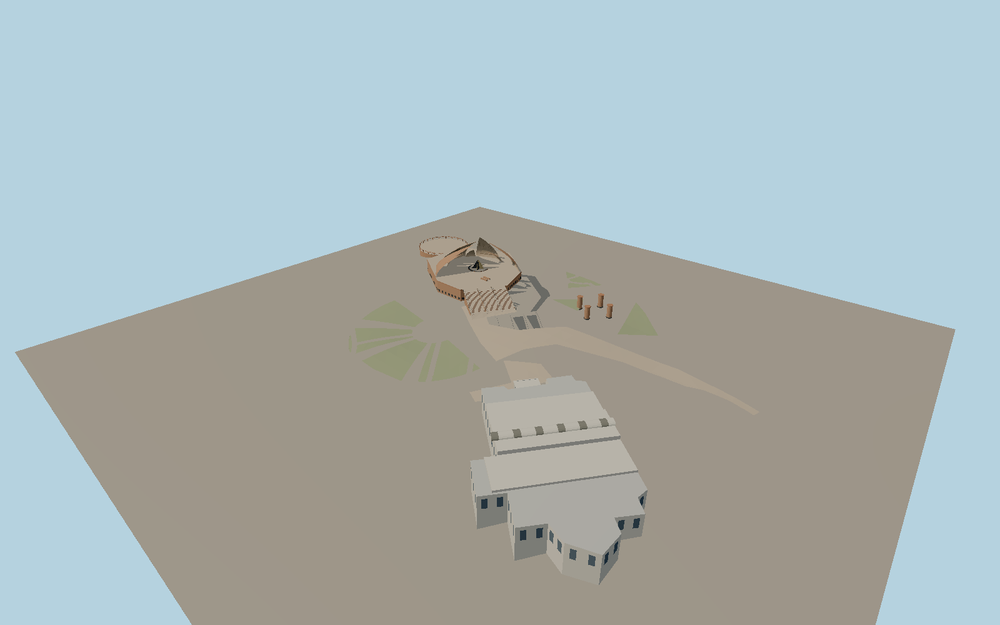

# Pakistan Monument

Seven independent curved petal shells above a faceted sandstone podium. The open interior has a tapered star and crescent, carved relief panels and broad divided stairs. Approach pillars, planted terraces, a barrel-roofed museum and a circular overlook complete the hilltop complex.

Run `node packages/worldgen/scripts/generate-pakistan-monument.mjs` to rebuild the source master. Append `--check` to compare the exact bytes. Use `--ids=pakistan_monument` for targeted import, LOD generation and placement.

The four large petal footprints and the museum outline come from PMTiles. Three smaller petals and the star use photo-based dimensions. The visible relief compositions are simplified geometric interpretations.

The raised podium, stairs, museum thresholds and paths follow the standard terrain height field. Museum interiors and exact inscriptions remain simplified.

Original geometry follows the repository license. Map data is © OpenStreetMap contributors under ODbL-1.0 via Protomaps. Terrain samples are described in terrain-grid.json. Ordinary pictures stay local and are not redistributed or used as textures. Current acceptance is recorded in qa.json.
