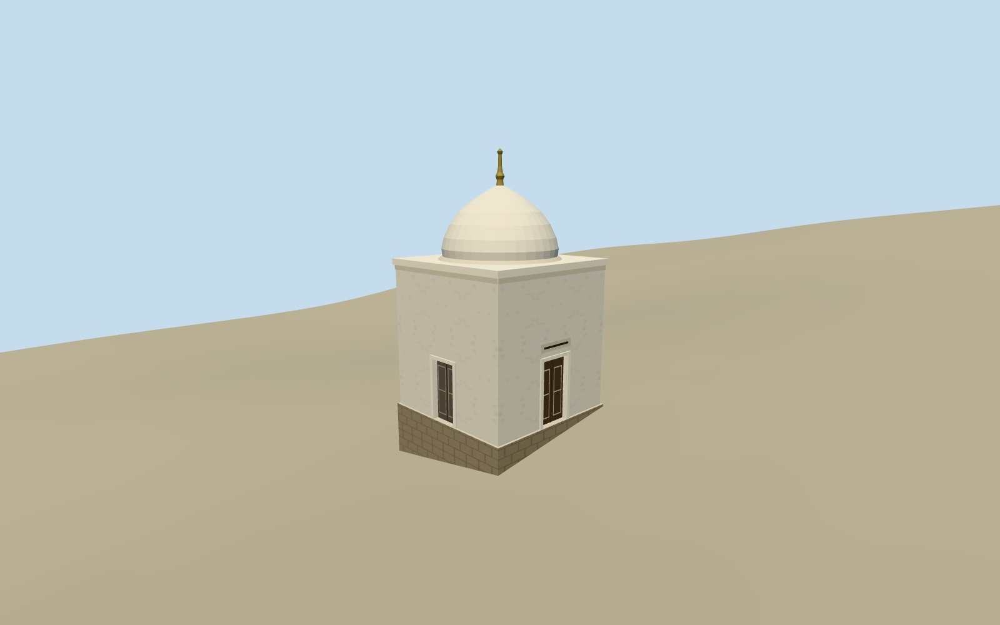

# Shrine of Baba Farid

A small square white marble tomb chamber, with the east Nuri Darwaza, the closed south Bahishti Darwaza and a pointed dome under a slim pinnacle.

Authoring state: **review-in-qa.json**. Current completion evidence is in [qa.json](qa.json) and the [completion ledger](../../../../qualla-structures/batches/qualla-003.PROGRESS.md).

- [Shrine of Baba Farid](https://qualla.com/shrine-of-baba-farid/)

The national monument locator has no stated accuracy. The 5.20 m square is reconstructed from the written survey at that pin. There is no separate digitized tomb perimeter in this mapping.

Dome height and profile, plinth height, thresholds, door widths, trim and metal finishes are estimates. The floor sits just above the highest corner of the unchanged terrain field. The model uses a plain inscription panel to represent the reported location without inventing lettering.

This model covers the tomb chamber and its gates. The neighbouring Ala-ud-Din mausoleum and modern mosque are separate buildings.

The unmodified composite DEM is a terrain reference. Fine historic paving, building decks and abrupt grades are below its resolving power.

Build: `node content/worldgen/source/places/tt/ttk/shrine_of_baba_farid/models/generate-shrine-of-baba-farid.mjs`. Add `--check` to verify exact regeneration. 1166 triangles; 5 materials; no embedded photographs.
