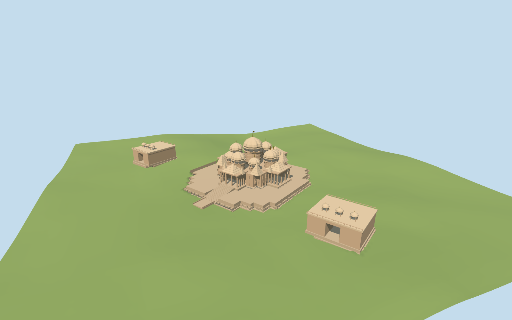

# Akshardham

Akshardham Delhi principal mandir exterior, its mapped waterside stepped platform and approach bridge, plus two mapped flanking forecourt pavilions. Nine domes, twenty quadrangled roof spires, southwest-facing open entrance porches, carved wall rhythms and an elephant plinth identify the specific temple. Distant exhibition halls, gardens, theatre and the full religious campus remain separate native structures.

## Evidence and reconstruction

Published dimensions and reconstructed details are separated in spec.json. Primary references:

- [Reference](https://commons.wikimedia.org/wiki/File:New_Delhi_Temple.jpg)
- [Reference](https://commons.wikimedia.org/wiki/File:Akshardham_Delhi_Ricky_W.jpg)
- [Reference](https://commons.wikimedia.org/wiki/File:Akshardham_construction.jpg)

Two shared256-square material graphs, metric UVs and linear tints. Nine domes, twenty quadrangled spires, open porches, stepped plinth, approximate elephant frieze and forecourt pavilions are geometry. No unique atlas or copied photograph is shipped. Two registered recipes rebuild the master and browser levels.

## Model and axes

48,097 triangles; 144,291 vertices; 4 material groups; 5,774,656 bytes. Native bounds: -98.962, -1.076, -80.701 to 49.922, 43.644, 121.131. Source hash: `sha256:2d16600483e96654d178dcd741bad1fb11d5b036e7931a5f8081b262808e94cf`.

{"x":"east","y":"up","z":"south"}

The geographic proposal uses exact-QID OpenStreetMap evidence. Map-derived orientation and estimated architectural details require real-site visual review; preview eligibility is distinct from geographic/fidelity approval. Map attribution: © OpenStreetMap contributors, ODbL-1.0.

## Reproduce

Run `node packages/worldgen/scripts/generate-additional-landmarks.mjs --ids=akshardham` (or add `--check`). The generator preserves manually edited masters by checking their baseline hashes. Import through the standard authored-model workflow with optimization disabled; then capture all QA cameras, including shared-surface views.

## Pending work

- Akshardham Delhi principal mandir exterior, its mapped waterside stepped platform and approach bridge, plus two mapped flanking forecourt pavilions. Nine domes, twenty quadrangled roof spires, southwest-facing open entrance porches, carved wall rhythms and an elephant plinth identify the specific temple. Distant exhibition halls, gardens, theatre and the full religious campus remain separate native structures.
- Q1849858/way400921719 and PMTiles building35184773010551 identify the main temple. Its thirty original vertices remain controls. Dominant mapped walls establish a59.689-degree east/south grid; +Z faces the formal southwest approach between the two mapped forecourt pavilions35184724288565/35184723487770. The old minimum-area rectangle axis does not establish facade facing. Platform edges follow the inner bank of mapped Narayan Sarovar water2242541262; only the rear connection and narrow approach bridge are explicit picture-guided joins.
- The official ordinary mandir page gives141.3ft maximum height,316ft width and356ft length, nine domes and twenty quadrangled spires. The current mapped bank and approach give approximately108x95m of principal occupied platform. The main tip is modeled43m above its approach-based foundation. Dome/drum/finial allocation, porches, elephant poses, reliefs and the two forecourt pavilion roof details are photo/map-guided medium-fi estimates. Names and surveyed heights of the flanking pavilions are not established.
- Original161-square/6m standard Mapzen-USGS DEM retained unchanged with198.205m raw datum. Principal foundation grade follows the formal southwest approach sample plus0.85m; each forecourt pavilion uses its own local ground sample. Only these three bounded occupied floors open ground. Opaque floor tops, deep continuous retaining faces and inward joins to the coarse boundary grade close the footprint. The source preview alone seats terrain below the occupied floors. Native water remains intact beneath and around the modeled approach bridge. Exact thresholds and canopy/building-influenced terrain levels are not surveyed.
- Dome and finial allocation, porch bays, sculptural poses, facade niches and forecourt roofs are photo/map-guided medium-fi estimates. Elephant and niche figures are simplified original geometry, not literal copies of individual carvings. Interior murtis, the complete carved inventory, exact surveyed thresholds, exhibition halls and distant gardens are outside scope. Current review status is recorded in qa.json.

This bundle follows the medium-fi standard. Medium-fi appearance and geographic fit are reviewed separately. Hash-bound visual acceptance is recorded separately after capture inspection.

## Additional geographic data

©OpenStreetMap contributors; Protomaps; Mapzen/USGS terrain.
