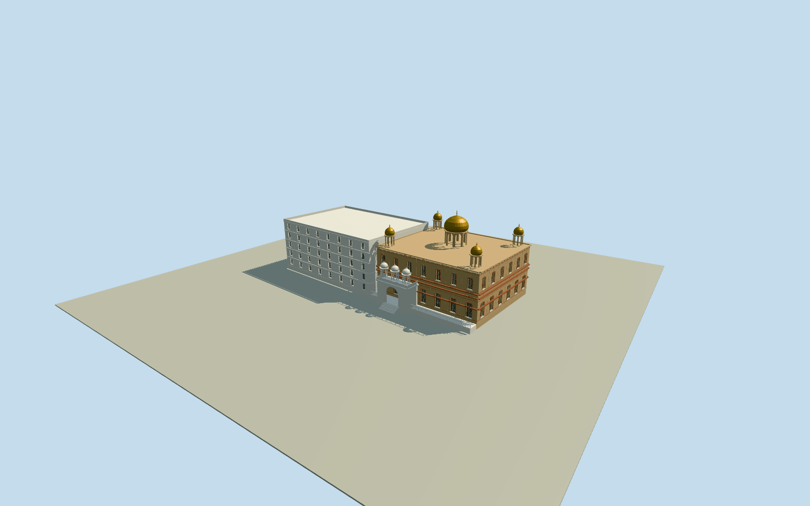

# Gurdwara Sis Ganj Sahib

Whole Gurdwara Sis Ganj Sahib: photo-reconstructed warm sandstone mainhall, tiered cornices, recessed jali windows, central gold onion dome and four open gold-domed corner chhatris; white marble street gateway with genuine open arches and three visible roof chhatris, intrinsic terrace/six steps; actual native four-control five-level flat-roof eastern wing. Worship-area rectangle is identity context only, never extruded as the hall. Qualla-published Jais006 2011 own CC0 exterior; hidden plans, heights, rear facades and current changes bounded. Separate neighboring mosque excluded.

Authoring state: **review-in-qa.json**. Current completion evidence is in [qa.json](qa.json) and the [completion ledger](../../../../qualla-structures/batches/qualla-002.PROGRESS.md).

- [Gurdwara Sis Ganj Sahib](https://qualla.com/gurdwara-sis-ganj-sahib/)

Native actual worship-area identity and separately tagged five-level eastern physical building. Worship-area context is not a measured mainhall footprint; all reconstructed hall/gateway parts will be explicitly distinguished.

Whole Sikh temple assembly: warm sandstone mainhall with gold domed open rooftop pavilions, white marble arched street gateway and native five-level flat-roof eastern wing. Mainhall/gateway plan and hidden facades will be explicitly photo-derived estimates, never measured from the worship-area rectangle. Excludes neighboring mosque, property parcel/pad, detached street objects, traffic/wires/people, interiors and photo-pixel textures.

Once-only source-field street-side sample followed by fixed photographic building proportions; no native measured heights. Five native levels constrain the eastern wing. Original field, anchor, axes, floor and main sections are immutable after this choice; ground contact unverified, preview only.

Exact published 2011 Jais006 own CC0 photograph supplies the visible exterior. Photo-hidden mainhall/rear layouts, dome/pavilion census, dimensions, jali motifs, roof partitions, finishes and current repairs are bounded estimates, not measured survey or current photogrammetry. Native eastern four-control physical building and five levels retained at every LOD.

Five gold-domed pavilions and three visible white gateway chhatris are explicit photographic reconstructions. All pavilions and gateway arches contain actual voids; skyline simplifies columns and dome profiles, district omits eastern window apertures, detailed levels add genuine facade recesses and lattice. No neighboring mosque, property pad, street fixtures, people, traffic, wires, inscriptions, interiors or photographic texture pixels.

Original native frame/256m129field/floor/main sections frozen before geometry. No fitting, flattening, field replacement, reframing, reacquisition or raising. Exact ground contact unverified; geographic preview/replacement false. Flat review ground and synthetic context neighbors are fixtures.

Build: `node content/worldgen/source/places/tt/ttn/gurdwara_sis_ganj_sahib/models/generate-gurdwara-sis-ganj-sahib.mjs`. Add `--check` to verify exact regeneration. 35828 triangles; 5 materials; no embedded photographs.
