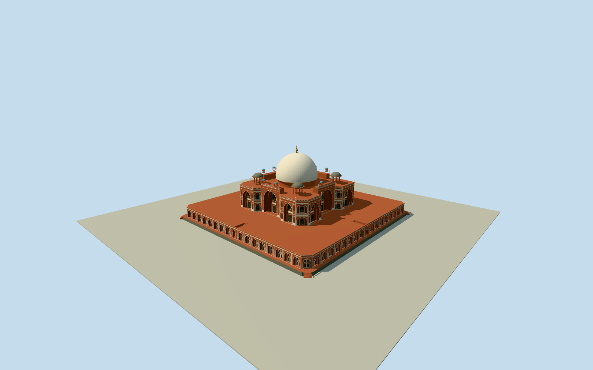

# Humayun’s Tomb

Main native clipped mausoleum on raised terrace, four real central stair niches and open upper-deck exits, clipped lower stone plinth and corner steps, deeply recessed pointed iwans and smaller arched bays, red sandstone with white marble inlay, four open corner chhatris and eight smaller tiled kiosks, marble double dome and metal finial. Separate gates, other tombs, gardens, water, trees and navigable interiors excluded.

Authoring state: **owner-accepted-medium-fi-preview**. Current completion evidence is in [qa.json](qa.json) and the [local 100 ledger](../../../../qualla-structures/batches/PROGRESS.md).

- [Humayun's Tomb](https://qualla.com/humayun-s-tomb/)

Owner accepted the medium-fi model and geographic preview on 2026-10-19 with known host-terrain limitations. Original source ground remains unmodified; contact can intrude or float with coarse urban surface DEMs.

Native quantized terrace/body/roof parts, UNESCO42.5m double-dome height reference, estimated42.5m overall finial height and photo proportions. Exact crown datum, levels, inlay motifs, fine stonework, unseen elevations and chhatri capitals are estimates.

Raised platform lower step1.3m, main deck7m, wing parapet20.75m and central parapet23.75m follow map/photo interpretation; conflicting native3/7/20/28height tags retained as facts, not surveyed dimensions.

Four central upper-terrace stairways follow the primary survey text;2.25m width,8.4m run,26close-view risers,shaft proportions and unseen corners are estimates. Coarse levels use2/3/16risers. The lower plinth preserves mapped long edges with estimated3.2m corner cuts and six-step corner access. No geometry or source elevation is fitted to the incompatible DEM.

Separate garden tombs, gates, garden design, water, trees, furnishings and interior tomb chambers excluded. Four sides use symmetric photo-directed rhythms with small native asymmetries.

Original photo pixels are inspection controls only, not redistributed textures; standard sandstone, marble, glazed tile and bronze graphs with opaque dark jaali backing.

Build: `node packages/worldgen/scripts/generate-authored-places.mjs --ids=humayuns_tomb`. Add `--check` to verify exact regeneration. 42634 triangles; 5 materials; no embedded photographs.
