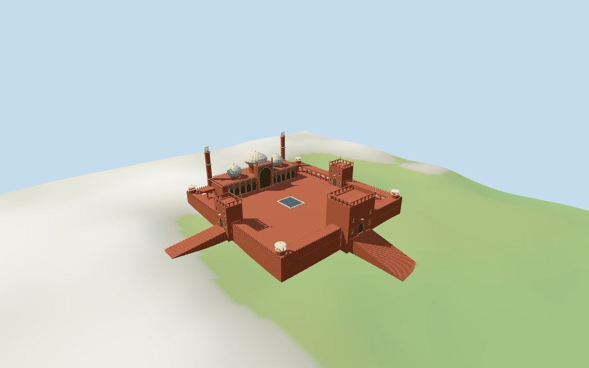

# Jama Masjid, Delhi

Individual medium-fi Jama Masjid Delhi:three mapped pale onion domes with dark radial stripes,two vertically pale-striped cylindrical minarets/open cupolas,red hall/central pale-bordered iwan/five side bays per wing/two small chhatris,open red court/low arcades,three mapped-projection gateways/open upper galleries/pinnacles,corner domed pavilions,mapped rectangular basin and three PMTiles-aligned exterior stairs. Four existing shared256² graphs,six merged groups,four browser levels. Raw compound/dome/water/steps controls retained;nominal maximum and picture-estimated partitions/fine details/current finish/exact site joins explicit.

## Evidence and reconstruction

Published dimensions and reconstructed details are separated in spec.json. Primary references:

- [Reference](https://commons.wikimedia.org/wiki/File:Jama_Masjid,_Delhi,_main_facade.jpg)
- [Reference](https://commons.wikimedia.org/wiki/File:Jama_Masjid,_Courtyard,_Delhi,_India.jpg)
- [Reference](https://commons.wikimedia.org/wiki/File:20191203_Jama_Masjid,_Delhi_0722_6487_DxO.jpg)
- [Reference](https://commons.wikimedia.org/wiki/File:Main_entrance,_and_the_approach_road,_from_the_minaret,_Jama_Masjid,_Delhi.jpg)

Four existing shared256² sandstone,marble,plain wood and bronze graphs;six merged groups including local glazing/water. Pale trim and roofs reuse marble;dark dome stripes and pale minaret inlay are original geometry/linear tints over shared surfaces. Metric UVs;no embedded images,baked lighting,unique facade maps or copied lettering.

## Model and axes

39,201 triangles; 117,603 vertices; 6 material groups; 4,707,896 bytes. Native bounds: -61.866, -9.957, -85.373 to 97.782, 40.921, 97.289. Source hash: `sha256:f4fdb6127ffaa5502164fef10695e88ee01325d1252d2897e0cb431292f28972`.

{"x":"east main gate/opposite west prayer hall","y":"up","z":"south side gate"}

Standard viewer DEM datum227.662404m;whole perimeter-8.56 to-0.40m relative to datum. Floor0.921m is maximum retained perimeter/interior-grid sample plus0.30m. Adaptive sandstone footings crossY=0 and extend below retained ground. Approximate platform plane;coarse terrain may expose tall foundations. No cutout,flattening or road replacement. Stair lower endpoints sample the standard DEM,not surveyed street levels. Exact door/step/court/pool/street/base contact,altitude and walking remain unverified.

## Reproduce

Run `node packages/worldgen/scripts/generate-additional-landmarks.mjs --ids=jama_masjid_delhi` (or add `--check`). The generator preserves manually edited masters by checking their baseline hashes. Import through the standard authored-model workflow with optimization disabled; then capture all QA cameras, including shared-surface views.

## Pending work

- Retained exact relation/3926057 /Q233678 identifies Jama Masjid in Delhi. Current whole52776562059305 (3×2^44+3926057) and three circular dome controls retain101 raw building outline/courtyard-hole/dome points/properties,including two clipped fragments of the compound. Water3602640052 retains the mapped basin ring/properties;three independently retained steps lines preserve original MultiLineString boundaries and properties. Anchor[77.23347554,28.650691208] and heading0.064310858946rad unchanged,no horizontal rescale. Native−X west prayer hall/qibla,+X east main gate,+Z south side gate,−Z north side gate. Pictures resolve facing with about3° uncertainty. Dome centers/radii and basin follow map controls;gate footprints follow compound/courtyard projections. Minaret centers,portal/arcade/chhatri subdivisions and exterior stair widths/counts/grades are picture/map-led estimates with about2.5m horizontal working uncertainty. Adjacent streets,markets,Red Fort,outer plazas,trees and city buildings remain host content.
- Retained Wikidata40m height has no linked reference URL;current compound/domes have no height tags. Use40m as nominal maximum for both main minarets,not a surveyed roof inventory. Picture-estimated partitions:hall11.5m,central iwan21.5m/portal chhatris26m,central bulb18–28.5m/finial30m,side bulbs12.5–22m/finials23.5m,tower collars12/24/34m/open cupolas35–39m/tips40m. Low court gallery6.1m,main east gate22m/open upper gallery22–25m/pinnacles28m,side gates17m/upper galleries17–20m/pinnacles23m,corner pavilions12m and basin rim.55m. Stair axes/runs use PMTiles steps;width20m east/12m north-south and riser distribution/DEM endpoint grades are approximations. Fine profiles,unseen faces,current finish and exact site contacts unverified.
- Standard viewer DEM datum227.662404m;whole perimeter-8.56 to-0.40m relative to datum. Floor0.921m is maximum retained perimeter/interior-grid sample plus0.30m. Adaptive sandstone footings crossY=0 and extend below retained ground. Approximate platform plane;coarse terrain may expose tall foundations. No cutout,flattening or road replacement. Stair lower endpoints sample the standard DEM,not surveyed street levels. Exact door/step/court/pool/street/base contact,altitude and walking remain unverified.
- Individual medium-fi exterior from four actually inspected2006/2007/2019 facade/court/gate pictures and standard viewer PMTiles/DEM. Three pale dark-striped domes,two pale-striped cylindrical minarets/open cupolas,central iwan/ten side bays,three gateways/open upper galleries,pinnacles,corner pavilions,mapped water basin and three vector-aligned stair approaches. Fine cusped/scalloped carving,inlay inscriptions,lattice,muqarnas,fixtures,actual interiors,engineering,current finish and exact site joins excluded or abstracted. Main hall/gateway fields terminate closed;court/cupola/gallery voids are exterior openings,no enclosed interior/free traversal claim. Stair widths,treads/rises and street landings are approximate;standard DEM is retained,not a surveyed plinth datum. Adjacent markets,streets,Red Fort,outer plazas/trees/city content excluded. Synthetic context and physical-device timing unverified.

This bundle follows the medium-fi standard. Medium-fi appearance and geographic fit are reviewed separately. Hash-bound visual acceptance is recorded separately after capture inspection.

## Additional geographic data

©OpenStreetMap contributors;Protomaps;Mapzen/USGS terrain tiles.
