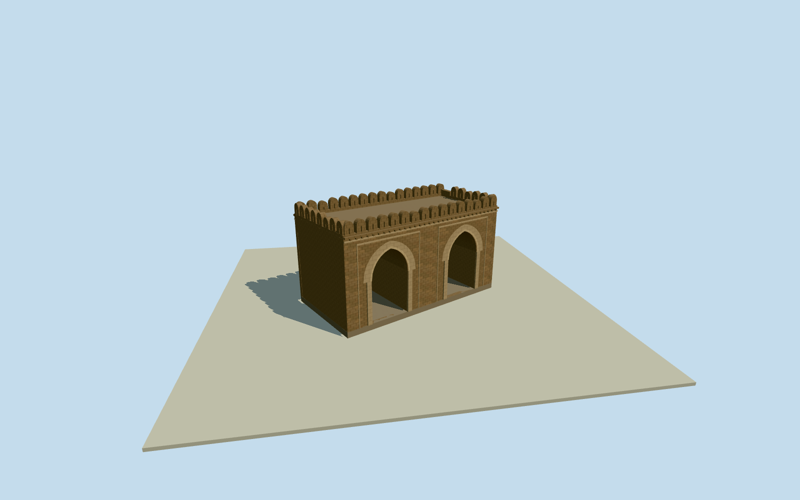

# Kashmiri Gate, Delhi

Whole surviving Kashmiri Gate physical five-control block: two pointed through-vaulted passages, framed recessed surrounds, masonry shell/cornice/coping and slotted scalloped parapets. Cleared published Bourne1860s/Beato1858 expired originals first, current native gate outline. Original bounded enduring shell/current hidden profiles, excluding archaeological gardens/cityfortifications/moat/old timberbridge/metro.

Authoring state: **review-in-qa.json**. Current completion evidence is in [qa.json](qa.json) and the [completion ledger](../../../../qualla-structures/batches/qualla-002.PROGRESS.md).

- [Kashmiri Gate, Delhi](https://qualla.com/kashmiri-gate-delhi/)

Actual named surviving city_gate way464312292/Q1196073 whole five-control physical gateway, fixed bboxanchor/heading0 before independentfield/floor/sections/geometry. Separate archaeological garden265818322 and metro/roads excluded.

Actual5-control surviving city_gate464312292/Q1196073 physical block, native longedge1-to2 fixes longitudinal axis. Whole native polygon retained in foundation everyLOD; two passage subdivisions/pointed vault/surround/parapet profiles original photo-bounded estimates. Archaeologicalsite265818322 is a property/garden polygon and cannot substitute for the building. Separate citywallfortifications, moat, old timberbridge, metro/ISBT/neighbourhood excluded.

Original independent256m129x12916641samples/one rawTerrariumtile/SW220.8353m providerrelative datum/current native5-control bboxanchor/heading0 frozen before once-only exterior floor-11.7029m and all sections/geometry. Original bounded pointed passage halfwidth2.15m/centers±4.8/spring4.5/apex7.25m, outer surround3.05halfwidth/apex8.0, blocktop9.0/cornice9.18/parapet crown10.5m. These follow ratios of exact published named-photographer expired originals, not a measured survey. Current fine repairs/colors/hiddenvault/roof/merlon census/damage/contact notverified. No late floor/sections/field/anchor retuning/fitting/flattening/reframe/reacquire/raising.

Two exact cleared published named-photographer expired originals, Bourne1860s and Beato1858, personally inspected. No source pixels embedded; modern CC photos unselected. Enduring gateway shape, not exact1858 wartime damage, infilled portal or old timberbridge reconstruction.

Original bounded height/passages/hidden roof-vault profiles/parapet and slit census/current repairs and neutral masonry colors. No exact restoration survey or present-condition claim. Simplified original architectural recesses omit copied inscriptions and sculptural relief.

Original field/floor/sections frozen before geometry, exact contact unverified, preview/replacementfalse; synthetic neighboring houses/flatground are review fixtures.

Build: `node content/worldgen/source/places/tt/ttn/kashmiri_gate_delhi/models/generate-kashmiri-gate-delhi.mjs`. Add `--check` to verify exact regeneration. 7497 triangles; 4 materials; no embedded photographs.
