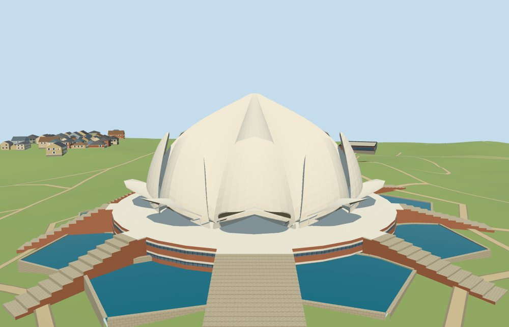

# N0492 — Lotus Temple

Reviewed2026-10-18. Specific medium-fi exterior and approximate normal PMTiles/DEM fit accepted.

## Exterior

Inspected all11 current portable views. The specific27-shell arrangement has a pointed fluted crown, intermediate petals and low outward canopies around nine open porches. The raised red/white base retains continuous glazing bands; the broad southwest stair and eight related approaches connect the terrace to the mapped radial corridors. Nine mapped pools retain their independent outlines. Profiles, heights, shell thickness, stair counts and individual entry designation are picture-guided approximations. Fine panel joints, shell engineering, planting and hidden interiors are omitted.

## Shared materials

Inspected all11 current shared-material views. Four common256² graphs supply marble, sandstone, limestone and storefront glazing; metric UVs and linear tints. Water uses an explicit teal/reflection constant. Five material draws nearby, no embedded images or unique atlas. Every shared graph loads once, and eviction disposes all model geometry. The flat shared fixture usesY-10 ground and reveals below-grade basin/foundation geometry; its visible cutout voids do not establish terrain contact. Actual fit uses the separate unchanged standard DEM.

## Browser levels

| Level | Triangles | Bytes | Draws |
| --- | ---: | ---: | ---: |
| skyline | 980 | 102236 | 1 |
| district | 3629 | 355784 | 5 |
| street | 8321 | 851956 | 5 |
| closeup | 17153 | 1826396 | 5 |

Inspected all27 current medium-fi views: three distances, noon/late, Economy/High, untextured silhouette, all detail cameras and four level/transition comparisons. The980-triangle skyline keeps the fluted blossom, ninefold low canopy/pool layout and raised base/approaches. Its large facets, ramped stairs and omitted subpixel fascia/glazing are visible when forced close; district/street/closeup restore curvature, bands, undersides and steps. All four levels meet1000/4000/16000/64000triangle and eight-draw limits. Initial skyline+district458020bytes plus shared textures. Separate GPU attribute streams avoid duplicate uploads. Physical laptop/phone/tablet and dense-city measurements remain pending.

## Placement and streaming

Mapped principal building,18 roof parts and nine pools establish plan/rhythm and approximate fit to the retained unchanged161-square/6m DEM. Arches face the mapped radial approach gaps; individual shell phase is uncertain by up to20degrees within the repeated40-degree pattern. Full-site loading removes all19 authored records and preserves all192 independent tile buildings. It replaces3773.2267m² of pool water while retaining1845.1839m² of unrelated native water.64m partial residency retains5283.8121m² of water, including unloaded pool portions. Failure keeps all211 map records and original5618.4106m² of water; eviction restores both surfaces and frees geometry.181 control vertices retain raw-map positions.8052 floor samples cover all36 pool/LOD combinations. The partial fixture has empty semantic buildings and proves clipping/lifecycle only; visibly exposed temporary domain edges are not accepted contact outside residency.

## Limits

Accepted for the specific medium-fi exterior and approximate normal-map/terrain scope. Upper/middle/low shell elevations34.5/24.3/11.2m, platform4.4m, Bézier shell curvature,24cm shell thickness, stair counts, radial phase and entry designation are estimates. Pool levels use independent local medians from the coarse DEM and can differ from surveyed levels. Basin banks/foundations are visualization fits. Fine marble joints, exact engineering, detailed glazing, landscaping, navigable interiors and surveyed thresholds are omitted. Native neighboring facades and green landcover are generic fixture context. No bespoke survey or terrain research was added.

## Source and validation

Two registered recipes and retained map/reference/terrain inputs reconstruct the master and browser levels. Six Khronos validations have zero errors/warnings.324 geometry probes,181 control round-trips and8052 floor samples pass.49 official views and20 actual-site/failure/partial views were inspected. Source/import/placement --check, strict medium-fi and scene validate/sim30 pass. Bulk captures remain ignored; one additional small site preview is retained.

Rebuild: node packages/worldgen/scripts/generate-additional-landmarks.mjs --ids=N0492; import-next-1000-models.mjs --ids=N0492; generate-landmark-lods.mjs --ids=N0492. Capture source with --antialias --fit-shadows --reflections; shared with --adaptive-clipping --reflections --bounded-placement; medium-fi with --ids=n0492_lotus_temple --reflections.

Source: sha256:4f1bdf5f1dafbecc8b441163f455fb140215cc674c45b7c9c631526161ceb31b

Runtime: sha256:1ee518a0b56455294125490de5177065f05a39f1cac28cd1bf4c892d54a402c2

Input: sha256:1b8f948ccc1eeb0d1e3b5586d933169676760bd9f75601e98921199944216f59

## References

- https://commons.wikimedia.org/wiki/File:Lotus_temple_daytime.jpg
