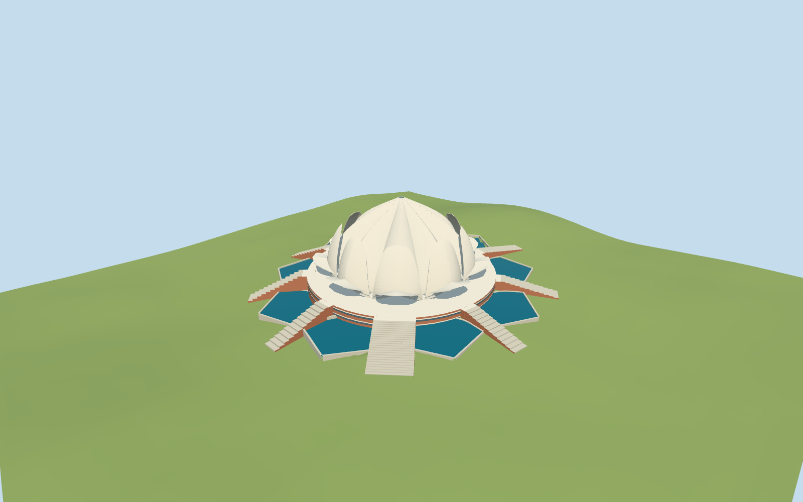

# Lotus Temple

Specific Lotus Temple exterior:27 curved petal shells in three ninefold groups, open porch arches, raised red/white base with continuous glazing bands, nine stepped/ramped approaches and nine independently mapped pools. Fine panel joints, exact shell engineering, hidden interiors and landscaping are omitted.

## Evidence and reconstruction

Published dimensions and reconstructed details are separated in spec.json. Primary references:

- [Reference](https://commons.wikimedia.org/wiki/File:Lotus_temple_daytime.jpg)

Four common256² marble,sandstone,limestone and storefront graphs; metric UVs and linear tints. Water is an explicit matte/reflection constant. No embedded images,unique atlas or copied photo pixels. Two registered recipes reconstruct the master and four authored browser levels.

## Model and axes

36,395 triangles; 109,185 vertices; 5 material groups; 4,370,720 bytes. Native bounds: -62.063, -6.433, -60.935 to 60.364, 34.500, 61.958. Source hash: `sha256:4f1bdf5f1dafbecc8b441163f455fb140215cc674c45b7c9c631526161ceb31b`.

{"x":"east","y":"up","z":"south"}

Retained unmodified161-square/6m standard Protomaps/Mapzen-USGS extract. NativeY0 uses the terrain sample at the retained building center. The platform remains level; foundations and pool retaining edges meet the coarse neighboring terrain. Source preview seating is separate from actual-site contact verification. Each pool is fixed to its mapped outline and a neighborhood median from the unchanged standard DEM, plus12cm. These levels and visible coping/retaining edges are approximate; the coarse source cannot establish surveyed basin levels.

## Reproduce

Run `node packages/worldgen/scripts/generate-additional-landmarks.mjs --ids=N0492` (or add `--check`). The generator preserves manually edited masters by checking their baseline hashes. Import through the standard authored-model workflow with optimization disabled; then capture all QA cameras, including shared-surface views.

## Pending work

- Specific Lotus Temple exterior:27 curved petal shells in three ninefold groups, open porch arches, raised red/white base with continuous glazing bands, nine stepped/ramped approaches and nine independently mapped pools. Fine panel joints, exact shell engineering, hidden interiors and landscaping are omitted.
- Q940843/way44827278 identifies the principal building. Standard PMTiles building35184416916110 and18 independent roof-part outlines establish the70m plan and ninefold rhythm. Nine mapped water polygons establish the pool layout. The main approach is chosen along the southwest garden corridor; the radial building has nine related entrances. Pointed shell arches face the mapped radial approach gaps; individual shell phase is picture-guided with up to20degrees uncertainty.
- No architectural heights in the retained mapped controls. The34.5m upper shell elevation,24.3m intermediate tips,11.2m outer tips,4.4m platform, shell thickness and stair counts are picture-guided estimates. The mapped outline and component rhythm are retained; shell engineering is not surveyed.
- Retained unmodified161-square/6m standard Protomaps/Mapzen-USGS extract. NativeY0 uses the terrain sample at the retained building center. The platform remains level; foundations and pool retaining edges meet the coarse neighboring terrain. Source preview seating is separate from actual-site contact verification.
- Each pool is fixed to its mapped outline and a neighborhood median from the unchanged standard DEM, plus12cm. These levels and visible coping/retaining edges are approximate; the coarse source cannot establish surveyed basin levels.
- The broad southwest stair and eight secondary entries follow related mapped radial corridors; exact entry designation is approximate. Fine shell joints,glazing mullions,hidden interiors,landscaping and surveyed thresholds are omitted.

This bundle follows the medium-fi standard. Medium-fi appearance and geographic fit are reviewed separately. Hash-bound visual acceptance is recorded separately after capture inspection.

## Additional geographic data

©OpenStreetMap contributors;Protomaps;Mapzen/USGS terrain.
