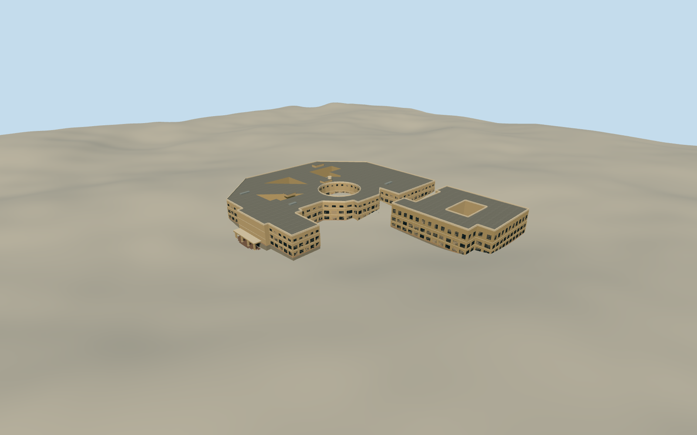

# National Museum of India

The Janpath National Museum of India with its sandstone bays, open circular sculpture court and adjoining old Archaeological Survey of India block.

Authoring state: **review-in-qa.json**. Current completion evidence is in [qa.json](qa.json) and the [completion ledger](../../../../qualla-structures/batches/qualla-003.PROGRESS.md).

- [National Museum of India](https://qualla.com/national-museum-of-india/)

The outer facade details, modeled roof services and exact entrance arrangement are estimates based on open map controls and written building information. The public-domain image directly documents the circular courtyard.

The sculpture plinths are schematic and the collection, staff areas and gallery interiors are outside the exterior model. Finished grades use the original composite elevation field.

The original elevation surface crosses the mapped circular court and low side facades. The viewer clears terrain only within the native court boundary, and neither the field nor grades outside the court were altered.

Build: `node content/worldgen/source/places/tt/ttn/national_museum_of_india/models/generate-national-museum-of-india.mjs`. Add `--check` to verify exact regeneration. 13694 triangles; 8 materials; no embedded photographs.
