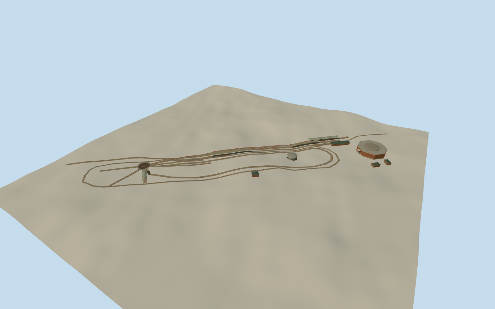

# National Rail Museum, New Delhi

National Rail Museum, New Delhi, with its octagonal Indoor Gallery, fixed rail yard, round turntable, curved steel display canopies and Rail Cafeteria.

Authoring state: **review-in-qa.json**. Current completion evidence is in [qa.json](qa.json) and the [completion ledger](../../../../qualla-structures/batches/qualla-003.PROGRESS.md).

- [National Rail Museum, New Delhi](https://qualla.com/national-rail-museum-new-delhi/)

The Indoor Gallery, Rail Cafeteria and fixed yard buildings follow the mapped footprints. Their external finishes, roof sections and door positions are approximate.

Open-sided steel canopies follow the October 2023 Qualla originals. Individual canopy dimensions, their exact extents along the chosen four sidings, and the turntable bridge are estimates.

The original elevation field controls the terrain and track grade. India’s common 1.676 m broad gauge and a two-foot visitor-track gauge are approximations for the museum alignments. The track bend radii and turnout hardware are generalized.

The structures represent the preserved railway yard in 2023. Rolling stock, station exhibits, gardens and interiors are outside this model.

Build: `node content/worldgen/source/places/tt/ttn/national_rail_museum_new_delhi/models/generate-national-rail-museum-new-delhi.mjs`. Add `--check` to verify exact regeneration. 31720 triangles; 6 materials; no embedded photographs.
