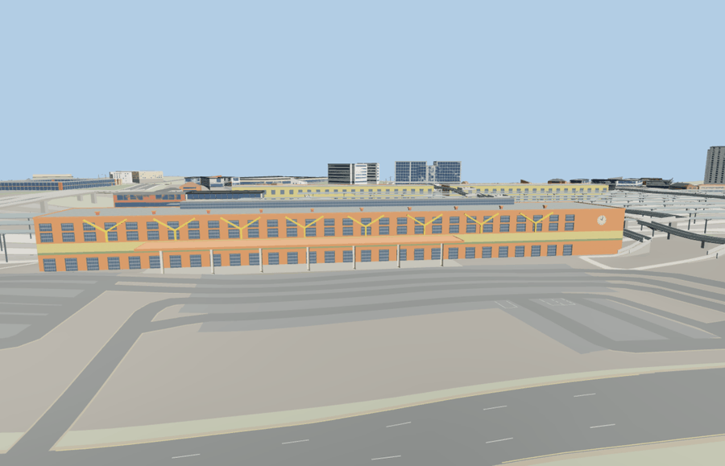

# New Delhi Railway Station

All 9 current portable views actually inspected. Complete principal New Delhi passenger ensemble: the long orange Paharganj building with actual yellow Y braces, clock, recessed glazing, closed entrance doors, projecting supported canopy and roof-service bar; separate Ajmeri north and south colonnaded ranges with paired upper columns, recessed closed doors, end pavilions and closed roofs; and nine open-sided platform canopy groups following the mapped islands. No invented floors or walls fill the railway corridors. Hidden returns, opening inventory, roof services and support details are original medium-fi approximations. No copied murals, brands, emblems, lettering, display locomotive, street gantry or navigable interiors.

The viewer uses the same Paharganj terrain reference for the west headhouse, the two Ajmeri ranges and nine platform canopy groups. Local grades expose both Ajmeri entrances and preserve the open gap between the ranges. The focused fixture replaces ten mapped station records and retains the other 234 buildings and all 586 road and rail records.

Failed loading preserves the native layers. Eviction restores the ground and releases model geometry.

| Detail level | Triangles | Download bytes | Draws |
| --- | ---: | ---: | ---: |
| skyline | 896 | 77,352 | 1 |
| district | 3,972 | 354,860 | 8 |
| street | 14,270 | 1,316,992 | 8 |
| closeup | 57,924 | 5,510,048 | 8 |

Skyline and district total 432,212 bytes. Six GLBs pass Khronos validation and contain zero embedded images. Seven shared material graphs bind in the viewer. The review covers 76 renders and 80 geographic samples.

The standard terrain yields approximate entrance and platform elevations. The mapped platforms retain the existing yard grade and their open sides.

This model represents the principal passenger buildings and mapped canopies. Hidden facade openings and roof installations remain photo-based approximations.

[Mapped site frame](map-frame.json) · [Terrain fit](site-fit.json) · [QA evidence](qa.json)
