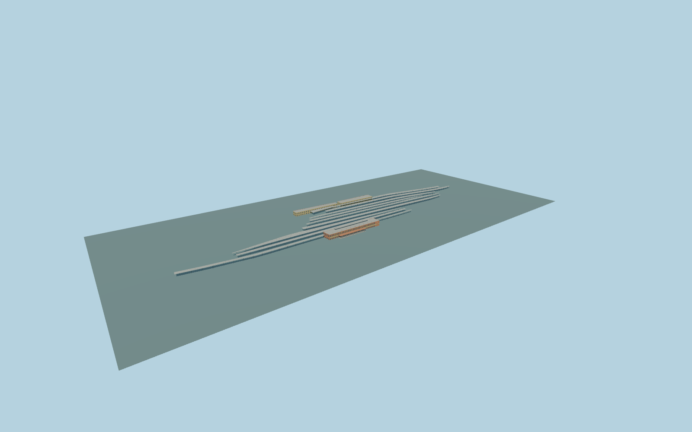

# New Delhi railway station

Complete principal New Delhi station exterior:the long Paharganj entrance building withyellow Y braces/clock andprojecting canopy,Ajmeri Gate north andsouth passenger ranges withcolonnades/end returns,closed doors/windows androofs,andnine open-sided platform canopy groups followingtheactual mapped islands. Keep rail corridors andplatform surfaces native andopen. Existing pedestrian overbridges are retained asmap context until explicit connection/replacement is established. No navigable interiors,copied signage/murals/emblems,display locomotive,street gantry,flyover,metro orindependent station-area buildings.

Rebuild: `node packages/worldgen/scripts/generate-new-delhi-railway-station.mjs`;append `--check` for exact source bytes. Select import/LOD/placement with `--ids=new_delhi_railway_station`. Detailed source and four browser tiers are separate ignored GLB outputs.

Complete principal New Delhi station exterior:the long Paharganj entrance building withyellow Y braces/clock andprojecting canopy,Ajmeri Gate north andsouth passenger ranges withcolonnades/end returns,closed doors/windows androofs,andnine open-sided platform canopy groups followingtheactual mapped islands. Keep rail corridors andplatform surfaces native andopen. Existing pedestrian overbridges are retained asmap context until explicit connection/replacement is established. No navigable interiors,copied signage/murals/emblems,display locomotive,street gantry,flyover,metro orindependent station-area buildings.

Passenger-building heights are absent from the map. Source west parapet16m/roof service18.5m,east cornice13.5m/parapet14.25m andplatform roofs9m are explicit photo-proportioned or coherent original approximations. Native underground parent33 layer-1/height5m is retained andis not an above-ground architectural height. One common unchanged standard field sample outside Paharganj at local[-65,132], 215.7131708m suppliesY=0. Occupied floors+.35m/support-3m;platform posts have individual structural feet but no track-area floor. Exact current thresholds andplatform grades remain unverified.

Two adequate ordinary entrance photographs retained;the obstructed2025 street-gantry photo was replaced. Reference appearance is2022,aligned approximately tocurrent standardPMTiles. No bespoke research,downloaded meshes or private facade images. Full principal station exterior only;hidden rear/side opening inventory,roof services,entrance proportions,platform roof coverage andsteel supports remain original medium-fi approximations. Murals are replaced by quiet original panel colors. No copied railway emblems,lettering,brands,display locomotive,street gantry,metro,flyover orinteriors. Existing pedestrian overbridges remain native until explicit connection/replacement isestablished. Current native contact requiresactual field inspection;no bespoke terrain oroutside plaza flattening. Physical-device timings andnumerical LOD errors remain unmeasured.

Seven existing shared256px limestone,plaster,painted-metal,granite,window-grid,membrane andcorrugated-metal graphs;eight semantic groups maximum. MetricUVs,linearcolors andzero private/embeddedimages. Skyline retains allthree passenger ranges,clock,entrance canopy andnine curved platform groups. District addsY braces,facadebands andcoarse columns. Street retainsrecessedfront glazing,paired columns andopen supports withreduced rear-window detail. Close-up addsallwindowrecesses/frames,finercolumns andarchcurves. Master preservesfine shafts,roofseams andclock curves separately.

Original geometry:repository license. Map:© OpenStreetMap contributors,ODbL-1.0;Protomaps. Standard terrain:terrain-grid.json. Ordinary pictures stay local and are not redistributed or used as textures. Current acceptance:qa.json.
