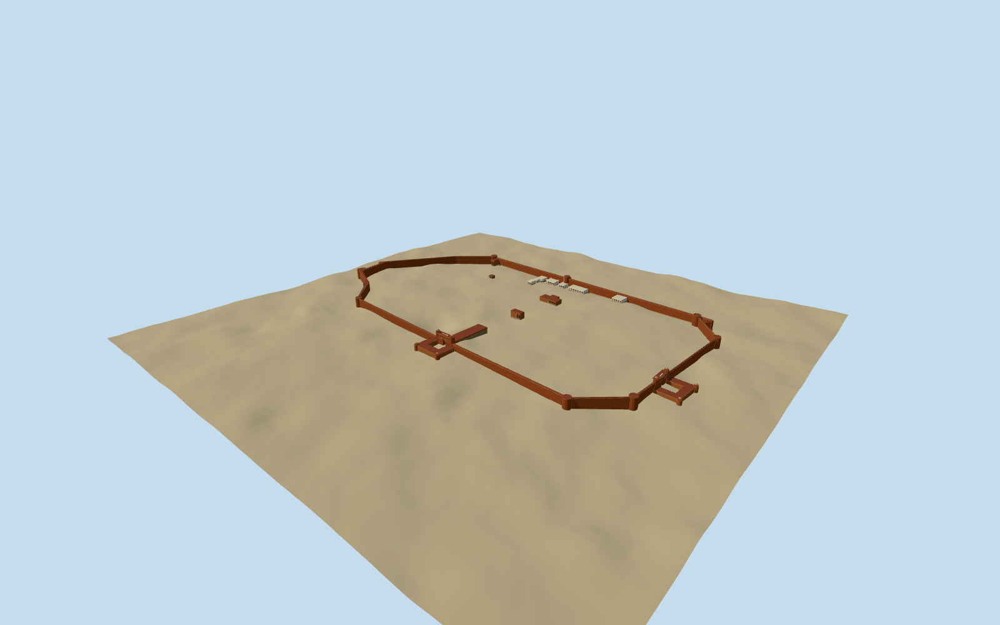

# Red Fort

Standing Red Fort in Delhi with its red sandstone battlements, paired main gates, large audience hall and marble waterfront pavilions inside an irregular octagon.

Authoring state: **review-in-qa.json**. Current completion evidence is in [qa.json](qa.json) and the [completion ledger](../../../../qualla-structures/batches/qualla-003.PROGRESS.md).

- [Red Fort](https://qualla.com/red-fort/)

Standing exterior interpretation. Wall top levels, intervals between smaller bastions, later repairs, roof and arcade sections, and some local ground contacts are approximate.

The map and period photograph control historic architectural form. A selection of surviving Mughal buildings is represented. Later barracks, interiors, archaeology, moat excavation, and the adjacent Salimgarh Fort are outside the model.

Pale marble and red sandstone follow the official descriptions. The archived plan predates present changes and is used only for corroborating the surviving plan.

Build: `node content/worldgen/source/places/tt/ttn/red_fort/models/generate-red-fort.mjs`. Add `--check` to verify exact regeneration. 24206 triangles; 6 materials; no embedded photographs.
