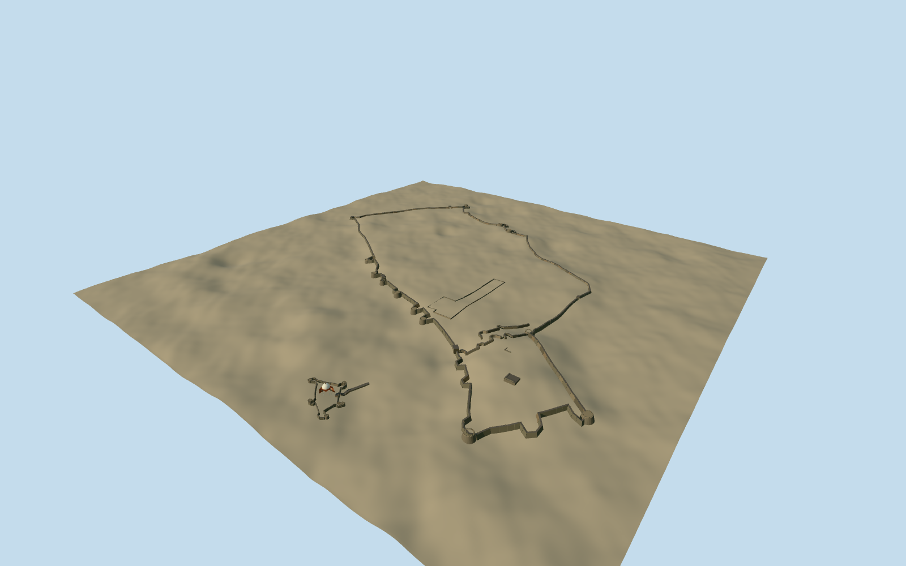

# Tughlaqabad Fort

Tughlaqabad’s long rubble curtain walls, gate passages, broken citadel crowns and low palace ruins, set against Delhi’s original rocky terrain. South of the modern road, the fortified tomb retains its red and pale stone chamber and white dome.

Authoring state: **review-in-qa.json**. Current completion evidence is in [qa.json](qa.json) and the [completion ledger](../../../../qualla-structures/batches/qualla-003.PROGRESS.md).

- [Tughlaqabad Fort](https://qualla.com/tughlaqabad-fort/)

The model follows the mapped surviving wall circuit and principal visitor-facing structures. Wall heights, losses between mapped controls, masonry joints and culvert details are approximate.

Reconstruction focuses on the present above-ground stone fabric. The wider ancient city grid, Adilabad, underground rooms, former lake and the stepwell below the mapped ground surface are outside its scope.

The in-situ palace and mosque are shown as low ruin fabric, and the known tomb causeway retains the break at the modern road. The fortified tomb enclosure and its main exterior are modeled as the associated southern monument.

Build: `node content/worldgen/source/places/tt/ttn/tughlaqabad_fort/models/generate-tughlaqabad-fort.mjs`. Add `--check` to verify exact regeneration. 16520 triangles; 6 materials; no embedded photographs.
