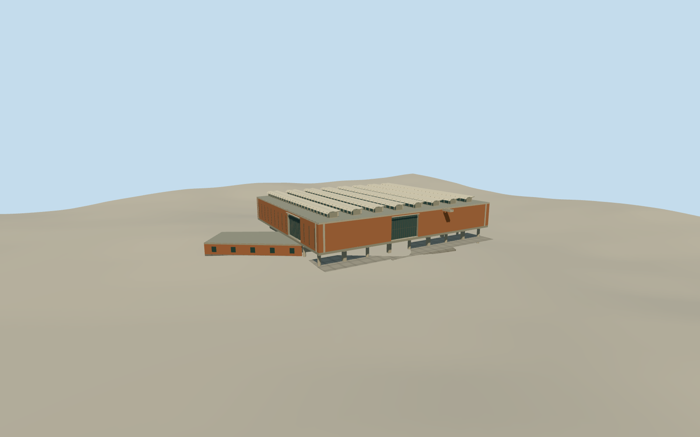

# Government Museum and Art Gallery, Chandigarh

Le Corbusier’s concrete and fired-clay museum in Chandigarh, with its shaded southwest portico and eight parallel concrete roof lanterns.

Authoring state: **review-in-qa.json**. Current completion evidence is in [qa.json](qa.json) and the [completion ledger](../../../../qualla-structures/batches/qualla-003.PROGRESS.md).

- [Government Museum and Art Gallery, Chandigarh](https://qualla.com/government-museum-and-art-gallery-chandigarh/)

The contemporary, named outline sets the main gallery and the two connected lower projections. The Architecture Museum is a separate nearby building. The modeled exterior covers the main museum, its raised massing, open portico and roof daylighting.

The eight roof lanterns, terracotta-facing surfaces, recessed undulatory windows and alternating round pilotis and piers follow the written museum and conservation accounts. Their vertical dimensions, component placement, fins, scuppers, glazing divisions and contemporary finish are estimates.

The preserved open terrain grid establishes the plaza-side approach. Raised ground floor, ramps, changes in grade and lower rear masses are approximate.

Build: `node content/worldgen/source/places/tt/ttq/government_museum_and_art_gallery_chandigarh/models/generate-chandigarh-art-museum.mjs`. Add `--check` to verify exact regeneration. 3831 triangles; 6 materials; no embedded photographs.
