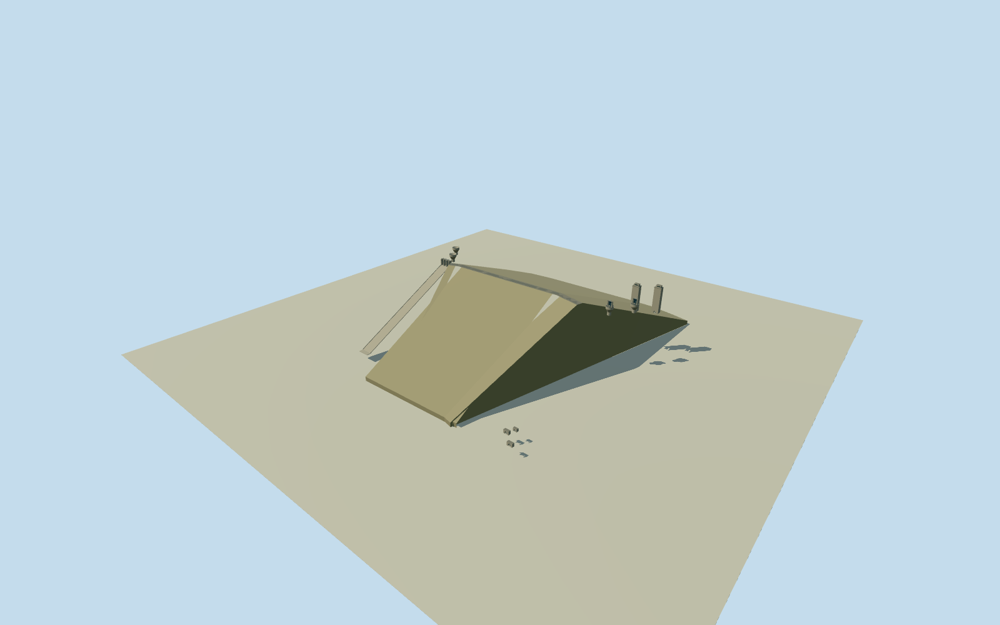

# Tehri Dam — Bhagirathi Stage-I

WholephysicalTehriStage-Iearth-and-rockfilldam/maincrest andallintrinsicexteriorworks: three-bayrightbankchutespillway, bothrightbankungatedshaftspillways/bothleftbankgatedshaftspillways, fullleftbankmainHPPintakeandtailrace/accessportalexteriors. Primaryowner260.5m/575m/five-spillway/undergroundfour-unit1000MWfacts, original48controlnamedQ69091damoutline. Nativearearoles/exposedtoeandcrestedgeinterpretationapproximate; allshaft/chute/intake/portalplans/sections/gradeexplicitestimates. Undergroundpowerhouse/tunnelsnotinventedabovegroundroofedsheds, interiorsnotrepresented. No bareembankment/onegate/unit/nearbyKoteshwar/newPSP/neighborproxy. Historical2014Stage-Ionly, allimageryunused.

Authoring state: **review-in-qa.json**. Current completion evidence is in [qa.json](qa.json) and the [completion ledger](../../../../qualla-structures/batches/qualla-002.PROGRESS.md).

- [Tehri Dam](https://qualla.com/tehri-dam/)

WholephysicalTehriStage-Iearth-and-rockfilldam/maincrest andallintrinsicexteriorworks: three-bayrightbankchutespillway, bothrightbankungatedshaftspillways/bothleftbankgatedshaftspillways, fullleftbankmainHPPintakeandtailrace/accessportalexteriors. Primaryowner260.5m/575m/five-spillway/undergroundfour-unit1000MWfacts, original48controlnamedQ69091damoutline. Nativearearoles/exposedtoeandcrestedgeinterpretationapproximate; allshaft/chute/intake/portalplans/sections/gradeexplicitestimates. Undergroundpowerhouse/tunnelsnotinventedabovegroundroofedsheds, interiorsnotrepresented. No bareembankment/onegate/unit/nearbyKoteshwar/newPSP/neighborproxy. Historical2014Stage-Ionly, allimageryunused.

OriginalcurrentoperatorHTMLintroduction/technicaltable andoriginalFeb2025two-pageoperatorPDFpage1wereactuallyread; allsourcephotos/figuresunused. Stage-I260.5mearthrockfill/575mcrest, fullthree-bayrightbankchute/tworightshaft/twoleftshaftspillways, undergroundleftbankfour250MWmachines/1000MWsince2006-2007. Legacyownercachedsectiontable supplies839.5mcrest/25.5to30.5mwidth/1125mbase/2.5upstreamand2downstreamslopes/3x10.5mchute/12mshafts/shaftcrestELs; originallegacyrequestsrepeatTimeout explicitlydisclosed. No originallegacyplanbyteclaim.

Original48nativeareacontrols retained as wholemappedphysicaldam/exposeddownstreamfacecontext, not a surveyeddeepburied/upstreamtoe. Fouroriginalupperedgeindices4,2,1,0interpretedascrest, actualnativepolyline588.565mretainedwithoutstretchto575m. Entiremainbarrierincludesbothupstream/downstreamrockfillfaces andburiedfoundation. Allcomponentplanpositions/edge-functionalroles approximate; noengineeringdrawing/photos traced.

Original2048m/16641height/nine-tileproviderfieldfixedfirst. LegacyreportedcrestEL839.5m minusoriginalprovideranchor702.207m givesestimatedlocalcrest137.2930m, not a surveyedverticaldatumconversion. Primary260.5mheightplacesdeepestbase-123.2070m local; nominal1125mbase/25.5mcrown/2.5up-and2downstreamslopesyield244.333mupperrockfillheightand16.167madditionalburiedbase. This estimatedsectionreconcilesreportedmaximumdimensionswithoutstretchingnativearea; foundation/profile/toerolesnotcertified. Originalfieldmin607.9172m wellabovedeepbase579m, noexcavation/bathymetryclaim. Allheights/fields/mainsectionsremainfixedthroughreview.

Completechutespillway estimatedcenter[-335,-25]m, three10.5mclearbays/17.5mestimatedgateheight, bridgearoundcrestlevel/hoists5mabovecrest, estimated415mdownstreamchutetoEL610m/apronandtwochute-wingwalls. Published220msystemdropnotmisstatedasexactindividualchutesill-to-outletdrop:815to610mestimated205mchutedrop. Exactportal/controlblock/pier/gatepose/chutepath/curvature/profile/finishandgrade estimated, nohydraulicoperationclaim.

Allfour12mshaftthroatsincluded. Two rightbankfree-overflowcircularbellmouthscenter[-380,-110]/[-430,-180], lipEL830.2m; twoleftbankgatedshaftscenter[350,-95]/[405,-165], lipEL815m. Lipdiameters28mright/25mleft,14mfunneldepth/18mvisibleliner andgantries/gatepanels exactprofiles estimated;12mnominalshaftdiameterpreserved. Buriedlongshafttunnels/internalflowmechanicsnotmodeledaboveground. Allshaft/bridge/bankregistrationsuncertain75m, no surveyedgatemouthlocations.

TwoleftbankmainHPPintakeexteriorsatestimated[365,-255]/[430,-290]m, nominal25x18mshaft/platform, sourceheadrace2x8.5mdiameter, estimatedlowerintakeEL745m/uppercontrolhouses8.5mhigharoundcrest. Four5.75mpenstocksand197x22x47.2mpowerhouseareunderground, notinventedopenairpipesorabovegroundhall. Two9mtailraceportalsestimated[345,440]/[385,475]m, EL615mfloor, fullhorse-shoemouthedconcreteheadwalls9mclearopening and12mwallheight. Adjoiningvehicularaccessheadwallestimatedsameleftbankportalzone, noclaimexactas-builtportalpositionorarchitecturalcensus. DetachedindoorSF6switchyard/office/campus/neighborhoodandKoteshwarseparatestructuresareexcluded.

Historical2014Stage-Ionly, valid2014-06-01to2015-06-01, afterall2007commissioningandbeforelaterpumpedstorageoperation. NoKoteshwar400MW/2025-2026newPSP1000MWsubstitution. Entirevisiblecivilworksanddefiningfive-spillwaycensusincluded, notbareearthbody/singleintakeproxy. Surfacepalette/profiles/finish and all75mcomponent/15mheightuncertaintiesexplicit. Sourcefield/frame/floors/mainsectionsnotcut/masked/flattened/refetched/refitforviews. Currentcoarseproviderfieldnot2014grading; clipping/burial/float andunverifiedground/verticalcontact disclosed. All38Quallafamiliesandallotherimageryunused.

Build: `node content/worldgen/source/places/tt/ttr/tehri_dam/models/generate-house.mjs`. Add `--check` to verify exact regeneration. 6858 triangles; 6 materials; no embedded photographs.
