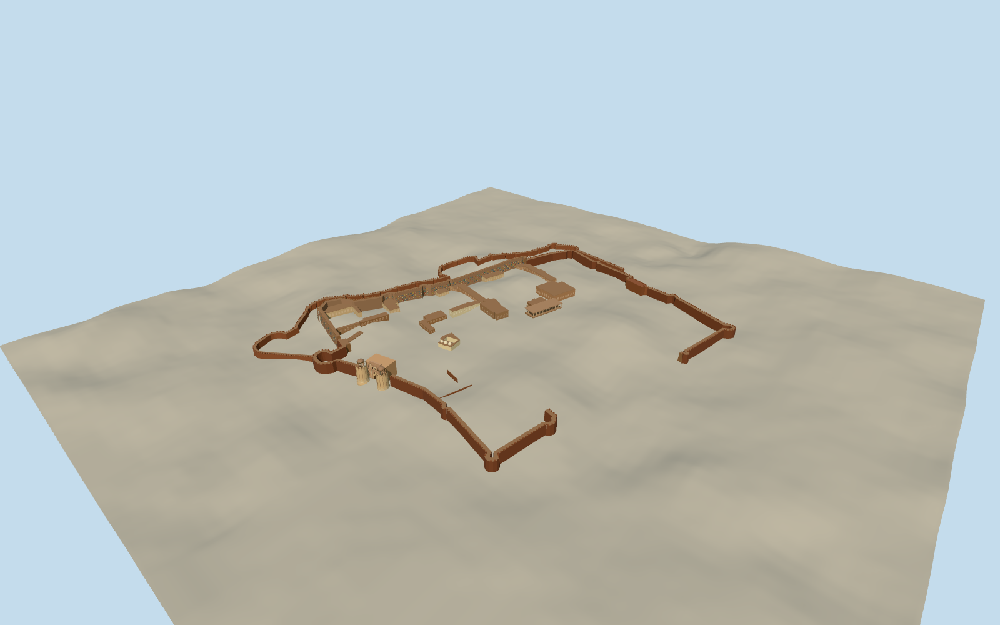

# Lahore Fort

The Lahore Fort enclosure with Alamgiri and Akbari gates, the north and west Picture Wall, and the principal courtyard buildings.

Authoring state: **review-in-qa.json**. Current completion evidence is in [qa.json](qa.json) and the [completion ledger](../../../../qualla-structures/batches/qualla-003.PROGRESS.md).

- [Lahore Fort](https://qualla.com/lahore-fort/)

The medium-fidelity model covers the defensive walls, gatehouses and principal named exterior courts. Outer boundary paths and ordinary modern service sheds remain host context.

The Picture Wall repeats an original geometric interpretation of the documented panels. Historic tile scenes, stone reliefs and calligraphy are schematic.

Some roofs, interior-facing facades, rear passages, unbounded court ends and masonry heights are estimates. The British Library photograph documents a historical state and is used for persistent features.

Build: `node content/worldgen/source/places/tt/tts/lahore_fort/models/generate-lahore-fort.mjs`. Add `--check` to verify exact regeneration. 37053 triangles; 8 materials; no embedded photographs.
