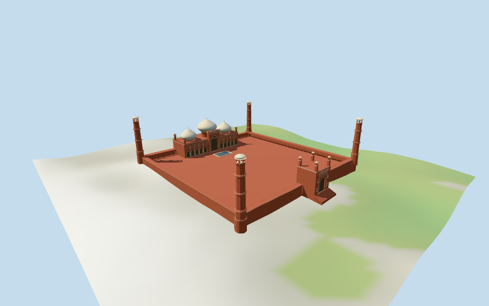

# N0419 — Badshahi Mosque

Reviewed2026-10-16 against current bytes. Accepted for stated medium-fi exterior and approximate horizontal fit;nominal/picture heights,subplans,fine architecture/current finish and exact terrain/site joins retain explicit limits.

## Exterior and shared surfaces

Inspected all11 current portable views,including the1024×640 summary. Three pale bulbous marble domes above long red-sandstone prayer hall,raised central iwan and ten smaller pointed bays with broad pale inlay/panel borders. Four corner minarets with collar bands and open pale cupolas;small hall chhatris,low arcaded enclosure around red open court,rectangular pale ablution basin,east gatehouse with corner pavilions/upper arcade and broad approach steps. Smoothed near-view bulb profiles and corrected compound wall/roof/trim overlaps that crossed hall and gateway recesses. Fine carving/cusps,current finish and exact terrain/stair joins retain limits.

Inspected all11 current shared/geographic views. Four existing256² sandstone,marble,plain wood and bronze graphs;six merged groups including local glazing/water. Dome roofs and pale trim reuse one canonical marble graph with different finishes. Shared textures,metric UVs and linear vertex tints;no embedded images,bespoke facade maps,baked lighting or copied inscriptions. Canonical graphs read once;unload leaves zero live model geometries. Shared geographic fixture uses flat terrain;source/medium-fi retain standard DEM. Flat geographic views do not establish exact ground contact.

## Browser levels

| Level | Triangles | Bytes | Draws |
| --- | ---: | ---: | ---: |
| skyline | 988 | 90,988 | 1 |
| district | 3,561 | 284,420 | 6 |
| street | 14,716 | 1,311,152 | 6 |
| closeup | 34,675 | 3,382,408 | 6 |

Initial skyline plus district: **375,408 bytes**. Master **5,281,012 bytes /43,977 triangles**;runtime **5,280,444 bytes**. Four shared256² graphs,six groups,zero embedded images;graph definitions/runtime textures are additional.

Inspected all27 current medium-fi views:Economy/High,noon/late,three distances,silhouette,six details,four matched whole levels and four transitions. Skyline988 retains three white bulbs/red hall,four tall pale-capped minarets,east gateway and open court bounded by simplified low solid walls. District3561 adds shared materials/coarse open court arches,sparse applied hall/gate fields and reduced small turret caps;upper gate gallery is applied dark fields here. Street14716 adds recessed hall/iwan/gate fields,open court/upper gate gallery and all small pavilion voids,marble borders,steps and more curved domes. Close-up34675/master43977 refine bulbs,reveals,panels,parapets and selected basin/tower details. Synthetic context and physical laptop/phone timings unverified.

## Placement and scope

Retained exact relation/12271286 /Q330872 identifies Lahore Badshahi Mosque. Current whole52776570404534 (3×2^44+12271286) retains65 raw outline/courtyard-hole points and tile-fragment properties;no separate hall,dome or minaret parts exist in this standard extract. Anchor[74.310180145,31.588122692] and heading0.192952533481rad unchanged,no horizontal rescale. Native−X west-southwest prayer hall/mihrab,+X east-northeast gate,+Z south-southeast,−Z north-northwest. Pictures resolve signed facing with about3° uncertainty. Hall and east-gate plans follow the mapped courtyard indentation/projection;domes,minaret centers,small turrets,pool and details are picture-led estimates with about4m horizontal working uncertainty. Hazuri Bagh,Alamgiri Gate,Lahore Fort,adjacent buildings,outer gardens and roads remain host content. Retained Wikidata53.75m height and161.14m length facts have no linked reference URLs;the current map has no height tags.53.75m is used as nominal main-minaret maximum,not a survey of all roofs. Picture-estimated partitions:hall17.5m,central iwan27m,central marble bulb24–40m/finial42m,side bulbs18–32m/finials34m,low galleries6.3m,four main towers with collars13/26/39m/open cupolas48–53m/tips53.75m. Hall corner chhatris26m,east-gate body22m/corner pavilion tops31m and pool/stairs are approximate. The whole190×182m plan is retained without rescaling it to the161.14m reference length;that fact may describe a subcomponent. Fine profiles,unseen sides and exact levels/current finish unverified. Standard viewer DEM datum214.568086m;whole perimeter-0.43 to7.59m relative to datum. Floor9.064m is maximum retained perimeter/interior-grid sample plus0.30m. Adaptive stone footings crossY=0 and extend below retained ground. This is an approximate attachment plane;coarse terrain may expose tall footings. No cutout,flattening or road replacement. Exact court/pool/door/stair/street/base contact,altitude and walking remain unverified. All252 actual viewer-footprint checks cover the retained compound and preserve41 separate mapped buildings across source,runtime and four browser levels. Approximate horizontal fit accepted;retained exact identity does not survey subcomponent heights or ground contact. No cutout,flattening or road replacement.

Individual medium-fi familiar exterior from three actually inspected Goharshahzad2011,Taha1202014 prayer-hall/court and Guilhem Vellut2005 east-gateway pictures plus standard viewer PMTiles/DEM. Exact relation/12271286 /Q330872 candidate retained verbatim;current whole52776570404534 and65 raw outline/court-hole points/properties retained. No separate mapped hall,dome or tower parts. Anchor/heading unchanged;about3° facing and4m subplan working uncertainty. Hall/gate follow courtyard indentation/projection;domes,tower centers,chhatris,basin,stairs and all fine profiles are estimates. Reference53.75m height and161.14m length have no linked source URLs;the height is a nominal minaret maximum and the190×182m whole is not rescaled to that length. Main marble cap40m/finial42m,side caps32m/finials34m,hall17.5m,iwan27m,gallery6.3m and gate22m/pavilions31m are picture estimates. Broad borders abstract pale inlay without floral art/calligraphy;fine cusped/scalloped carving,lattice,fixtures,engineering,interior and current finish excluded or unverified. Hall/gate fields terminate closed;court/chhatri/upper-gateway openings are exterior voids,no prayer-hall interior/free traversal claim. Rear/unseen faces use simplified repeats. Separate Hazuri Bagh,Lahore Fort/Alamgiri Gate,outer gardens,roads and neighboring content remain host assets. Exact basin/stair/door/court/street/base contact,altitude/walking and physical-device timing unverified. No bespoke surveys or redistributed photographs.

## Verification

**49 current frames inspected;813 geometry probes;252 footprint checks.** Six Khronos validations:zero errors/warnings/images. Targeted source byte reproduction,scene validation,30-tick simulation and current source/import/LOD/input/recipe/capture-image/report/material bindings pass. Graphs read once;unload leaves zero live model geometries. Full source checkpoint remainsN0410–N0427.

Source: sha256:ead261b850eaab872836a596230ccf919c83161089f090083f2211d5b059429f

Runtime: sha256:ea523b5ee63628de227d17f257645c9f2920047d05d750a243be5f1a36b7d1a4

Input: sha256:98bfc18ce6d52cdb953eefb3b8255dc7dcc013b594941412941cddaf0dd1b66f

Simulation: sha256:d59e758d81704265e58686cc73ee5014fe19842d0129c2ea3414c81e87b20723

Commands:targeted generate/import/LOD/register --ids=N0419;generate --check;portable reflections/antialias/fitted shadows;shared reflections/adaptive clipping/bounded placement;medium-fi reflections;scene validation and30-tick simulation. Bulk captures remain ignored.

## Inspected pictures

[Goharshahzad — 2011-02-12](https://commons.wikimedia.org/wiki/File:Badshahi_Mosque_-_front_view_from_courtyard.jpg). CC-BY-SA-3.0. Inspected960×720 frontal courtyard picture:long red-sandstone prayer hall,three pale bulbous marble domes with taller central cap and finials,a raised central iwan/pointed recess,ten smaller pointed side bays,small open chhatri corner turrets and tall red octagonal minarets with projecting collars/pale open cupolas. Red paved open court and low perimeter arcades. Fine inlay/scallops,calligraphy,carving and current finish remain abstracted.

[Taha 120 — 2014-09-20](https://commons.wikimedia.org/wiki/File:Badshahi_Mosque_courtyard_and_main_entrance.jpg). CC-BY-SA-3.0. Inspected960×720 closer prayer-hall/court picture:central deep pointed iwan framed by pale floral/geometric inlay and slender red pinnacles,flanking lower pointed arch bays and broad rectangular panel divisions;three bulbous marble domes with narrow lotus shoulders/finials,red crenellated parapet and open small cupola turrets. A low rectangular pale ablution enclosure sits before the hall. Model uses broad shared-material borders/closed recesses instead of copied art or an interior.

[Guilhem Vellut — 2005-02-04](https://commons.wikimedia.org/wiki/File:Main_Entrance_of_Badshahi_Mosque.jpg). CC-BY-SA-2.0. Inspected960×720 east gateway view from Hazuri Bagh:raised red rectangular gatehouse with tall pointed timber entry,pale framed panels,inset side lights and upper open gallery. Four slender square corner towers carry wide-eaved open pavilions and pale caps;small ornamental finials/red crenellations,wide descending stair and adjacent low arcaded enclosure. Fine door art/inscriptions and exact stair/contact dimensions are estimates or excluded.
