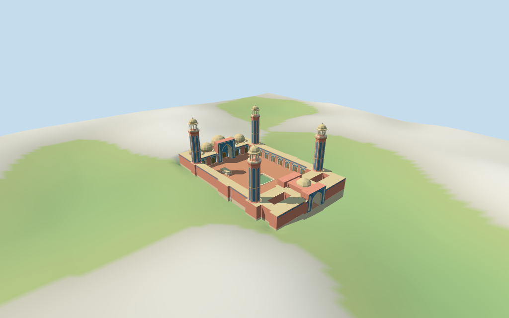

# N0468 — Wazir Khan Mosque

Reviewed2026-10-18 for medium-fi exterior / approximate geographic fit. Twelve current map controls fix the site and major part plans; tagged height totals are preserved.

## Exterior and shared materials

Inspected all11 current portable frames including a compact1024×640 summary. Four octagonal minarets surround the open court, five pale ochre prayer-hall domes stand behind the blue/cream pointed west iwan, and a smaller east dome tops the through gateway. Rose masonry, red paving, green rectangular pool, two separate eastern lightwells and the small mapped court pavilion remain distinct. Corrected an upper iwan collision with the central dome support by shortening the estimated blind recess to4.2 m; the continuous back screen now sits ahead of the support. Shaft tile fields follow their actual octagonal faces, friezes are clipped at openings and the gateway stays clear. Fine floral tilework, calligraphy, muqarnas, people and furnished interiors are omitted.

Inspected all11 current shared/geographic-flat views and north-up placement overlay. Six existing shared256² stucco, lime plaster, raw limestone, mosaic tile, brick and plain wood graphs serve seven emitted roles; opaque static green basin water uses a palette material. All graph reads occur once; eviction disposes geometry and restores host ground. No embedded images, copied photographs, unique tile atlas or invented lettering. Metric UVs and linear tints preserve material scale and brightness. The raw main footprint and selected mapped parts are covered; nine nearby buildings stay host content. Shared flat placement verifies pose and cutout, not a surveyed grade.

## Browser levels

| Level | Triangles | Bytes | Draws |
| --- | ---: | ---: | ---: |
| skyline | 986 | 99620 | 1 |
| district | 3935 | 372488 | 7 |
| street | 6095 | 597792 | 7 |
| closeup | 7568 | 742712 | 7 |

**472,108 bytes for initial skyline plus district**, plus six existing shared256² textures. Seven merged roles; no embedded images.

Inspected all27 medium-fi frames: Economy/High, noon/late light, three distances, silhouette, six details, four matched LODs and four transitions. Skyline retains four minarets, five west domes, east gateway, central iwan and open court/lightwells. Skyline simplifies chhatris and small court bays; district restores open minaret pavilions and bay rhythm; street and closeup refine arches and shared-material fields. Coarse dome facets and loss of small panels are deliberate distance changes. Synthetic neighbors and ordinary DEM are review fixtures. Physical laptop/phone/tablet timing and full-city performance remain pending.

## Placement and limitations

Retained Q2352054 / relation8420214 anchor [74.323613747,31.5832002] and heading -0.022862258642 rad remain unchanged. Current named Wazir Khan Mosque POI confirms identity. Twelve current building/part controls retain 178 vertices: main34-vertex outer with21/4/4-vertex courtyard/lightwell holes, small court pavilion, four octagonal minarets, five west prayer-hall domes and the east gate dome. Positive X faces east toward the entry and Chowk Wazir Khan; the prayer hall is west at negative X. Positive Z faces south. Separate shrines, city houses and the plaza remain host content. Standard viewer DEM datum 218.51175650914803 m; working floor 2.326621991257457 m is the median of 114 outside-perimeter samples at1 m offset plus.3 m. 485 raw footprint samples span -3.249240272149592..8.125159203624662 m. Adaptive footing follows the main raw outline at edge stations no farther apart than2.5 m. Model paving covers the court and two eastern lightwells; their roofs remain open. Runtime ground cutout uses the main outer ring; preview terrain seats that outline with1.5 m margin. Exact grade, historic thresholds and pool fit remain approximate; ordinary DEM is not a survey. Independently reproduced all12 raw map controls/178 vertices, named mosque POI, retained facts, anchor and heading. All126 renderer footprint checks pass across six GLBs, including preservation of nine nearby buildings. All892 FrontSide probes pass for the clear east passage, pointed soffits, west recess/back screen, visible tiled fields, all three open courts/lightwells, pool/pavilion levels, six dome totals, four33 m minaret tips, open chhatris and terrain-seated foundation edges. Reproduced485 raw terrain samples,114 perimeter samples and458 seated preview points/required16-bit heightmap. Pool, thresholds and exact current grade joins remain approximate.

Individual medium-fi Wazir Khan Mosque: rose masonry ranges around an open paved court and green ablution pool, five pale ochre west prayer-hall domes, blue/cream/ochre tiled pointed central iwan, east gateway and four33 m octagonal minarets with balconies and open chhatris. Main outer and all three open roof holes follow current map controls. Small court pavilion retains its own mapped plan and3 m total. Six existing shared256² graphs serve seven merged roles. Original geometry and color fields, no copied photographs, tile artwork, inscriptions or furnished interiors. Current unqualified map height totals are used directly: low main ranges7 m, small court pavilion3 m, four minaret finials33 m, central west dome15 m, four flanking west domes12 m and eastern gateway dome12 m. Retained height/width/length fact arrays are empty; no independent measured dimensions are claimed. The main tag roof:height .3 is included within7 m. Iwan crest13.5 m, east gateway crest10 m, shaft/balcony/chhatri stages, dome profiles, openings, courtyard paving and pool dimensions remain estimates from the two pictures and footprint scale. No invented epigraphy or exact tile motifs. Two inspected2015/2016 picture pages guide appearance, not independently verified current restoration finish or measured dimensions. Stage divisions, iwan/passage profiles and pool are visualization estimates. No archaeological, engineering, collision-certified/navigable or furnished-interior claim. City, neighboring shrines and complete plaza remain host content.

## Verification

49 current standard views inspected;892 FrontSide probes;126 footprint checks;six Khronos validations with zero errors/warnings. Source/runtime/input/LOD/material/render/placement hashes agree. Raw map/POI and required16-bit height fixture reproduced. Source/placement --check,scene validate/sim30,selected LOD layout and recipe/registration Biome pass. Bulk captures remain local.

Source: sha256:0835fb76faf9315248c79e7d78e280b96f68b117679a99c2a7bb2351ffc61cd5

Runtime: sha256:a96d8ffe4525fa82710516037a916b72b441dc6b67ffb7e4c35836c4678f29be

Input: sha256:59556c39d8228045cc9224ba5a71e99f16e79dca6ace5a763728b84553c44685

Commands: targeted generate-additional-landmarks/import-next-1000-models/generate-landmark-lods/register-landmark-previews --ids=N0468;generator/placement --check;capture-next-1000-models --reflections --antialias --fit-shadows;capture-landmark-library --reflections --adaptive-clipping --bounded-placement;capture-medium-fi --ids=n0468_wazir_khan_mosque --reflections;selected LOD check;scene validate/sim30;recipe/registration Biome. Prior full source checkpoint N0432–N0449;next routine checkpoint N0450–N0469.

## Inspected picture references

[Saima Asad — 2015-04-25](https://commons.wikimedia.org/wiki/File:Courtyard_of_wazir_khan_mosque.jpg). CC-BY-SA-4.0. Close courtyard-side facade: rose brick/plaster, pale lower trim, central two-tier pointed niche framing a dark door, repeated pointed bays, blue/yellow/turquoise mosaic panels and roof frieze, patterned dark shutters. Tall neighboring urban building is host content. No floral or calligraphic motif copied.

[Fassifarooq — 2016-11-26](https://commons.wikimedia.org/wiki/File:Masjid_Wazeer_Khan,_Lahore.jpg). CC-BY-SA-4.0. Courtyard looking west: octagonal minarets with tall inset panels, upper balcony, open chhatri posts, flared eave and shallow dome/finial; five pale ochre prayer-hall domes, tall central pointed iwan and four lower bays, blue/cream/yellow/rose tile fields and continuous frieze. Red paving, green rectangular pool, small court pavilion at left. City, people, pigeons and temporary fixtures omitted. Photos guide approximate appearance, not current measured finish.
