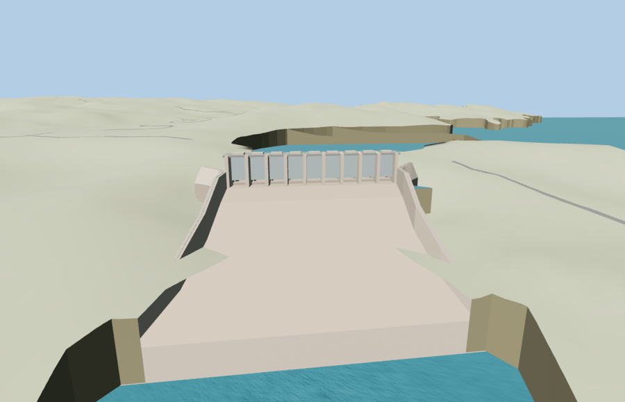

# Mangla Dam

The original exterior includes the curved rock-fill embankment and service-road crown, a separate western nine-bay spillway with broad curved chute, retaining banks and inspection walk, and the long roof and enclosed plinth of the lower powerhouse. The plant wall faces and physical footing support were corrected after inspecting the first site captures.

The new western gate axis follows the mapped forebay and tailwater corridor. The native scene shows a dry upper chute, continuous water in the stilling basin and a separate east powerhouse canal. The narrowed ground opening lets the native shoulders meet the spillway walls. The viewer replaces only the mapped powerhouse footprint and keeps the other twenty buildings and all 759 local road records, including the independent downstream bridge.

Failed loading preserves the native layers. Eviction restores the ground and releases model geometry.

| Detail level | Triangles | Download bytes | Draws |
| --- | ---: | ---: | ---: |
| skyline | 618 | 56,496 | 1 |
| district | 1,784 | 178,280 | 7 |
| street | 2,468 | 235,372 | 7 |
| closeup | 5,156 | 462,532 | 7 |

Skyline and district total 234,776 bytes. Six GLBs pass Khronos validation and contain zero embedded images. Six shared material graphs bind in the viewer. The review covers 71 renders and 95 geographic samples.

The 335 m reservoir, 265.2 m western basin and 263.5 m east tailrace represent static conditions. Some of the coarse terrain contacts, gate hardware and local bank heights remain approximate.

The model depicts the principal dam, main western spillway, and east powerhouse. Auxiliary works, interiors and operating discharge are outside this exterior model.

[Mapped site frame](map-frame.json) · [Terrain and water fit](site-fit.json) · [QA evidence](qa.json)
