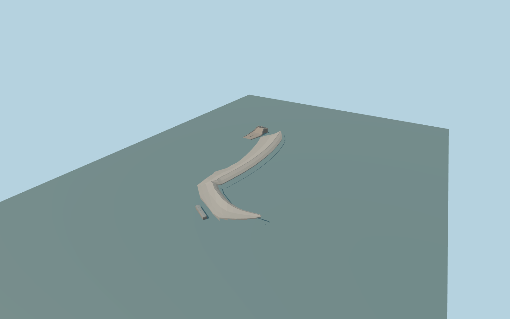

# Mangla Dam

Mangla’s curved rock-fill embankment and crest road, the separate western main spillway with chute and stepped stilling basin, and the mapped lower powerhouse and outlet works.

Rebuild: `node packages/worldgen/scripts/generate-mangla-dam.mjs`;append `--check` for exact source bytes. Select import/LOD/placement with `--ids=mangla_dam`. Detailed source and four browser tiers are separate ignored GLB outputs.

The reservoir outline, native crest road and standard terrain establish the embankment and its shared datum. The western gate axis follows the mapped forebay and the downstream PMTiles channel. Its span and chute sections use ordinary exterior pictures. The two downstream water levels are representative static stages.

The original exterior covers the principal rock-fill dam, western spillway, stilling basin and east-side powerhouse. Local grades and gate hardware are approximate. The 48 m source grid retains its original anomalous values. Auxiliary structures and operating discharge are outside this view.

Original geometry:repository license. Map:© OpenStreetMap contributors,ODbL-1.0;Protomaps. Standard terrain:terrain-grid.json. Ordinary pictures stay local and are not redistributed or used as textures. Current acceptance:qa.json.
