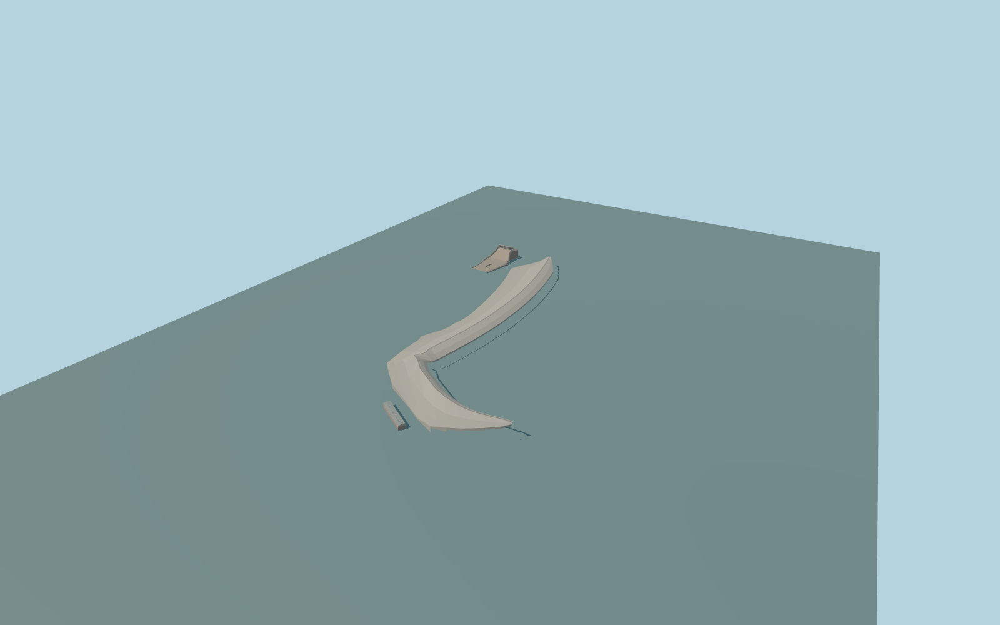

# Mangla Dam

Mangla’s curved rock-fill embankment and crest road, the separate western main spillway with chute and stepped stilling basin, and the mapped lower powerhouse and outlet works.

Rebuild: `node packages/worldgen/scripts/generate-mangla-dam.mjs`;append `--check` for exact source bytes. Select import/LOD/placement with `--ids=mangla_dam`. Detailed source and four browser tiers are separate ignored GLB outputs.

The reservoir shoreline and native crest-side service road establish the embankment plan. The west ridge and grades are interpolated from standard viewer terrain and the aerial reference. The tail basin and separate east-side powerhouse are tied to the current PMTiles. The western gate span, approach and chute profile are estimates from public photos and the downstream channel. The basin water elevations are static visual estimates.

The 48 m terrain review reproduces the original viewer elevations, including ten anomalous low cells in the regional extract. Elevation outliers are excluded only from authoring the local toe heights. Exact western gate coordinates, operating levels, observed road grades, precise embankment ties and auxiliary structures require follow-up. This static exterior shows the main complex in a dry spillway state.

Original geometry:repository license. Map:© OpenStreetMap contributors,ODbL-1.0;Protomaps. Standard terrain:terrain-grid.json. Ordinary pictures stay local and are not redistributed or used as textures. Current acceptance:qa.json.
