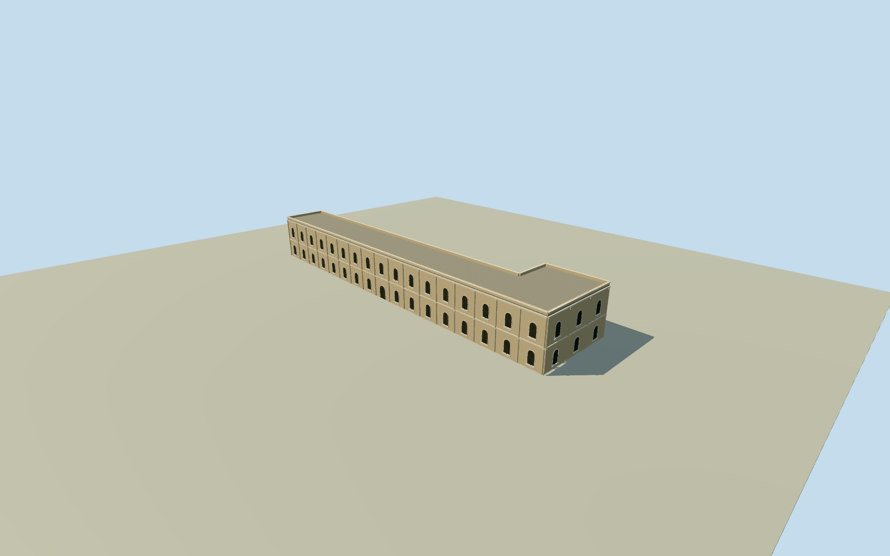

# Eastern courtyard hall, Mubarak Mandi

Whole original six-corner L-shaped eastern courtyard hall, including southern widening/return, closed rear/ends and complete estimated roof/parapets. Two estimated storeys, round-headed wood window panels, plain pilasters/cornices. Whole original outline retained; learned relative height median11m is a numerical estimate. Exact historic name, floor count, facade, roof sections, damage and2023condition unverified. This member does not complete Mubarak Mandi. Original numerical centroid and longest edge facing fixed before source terrain or floor/mainsections. Native Google record and2023relative-height points are independent learned observations, not an as-built or historic survey. Nominal10m horizontal/4m height/components/10degree facing allowances are authoring estimates, not measured bounds. All images unused, Qualla first. No footprint/vertical fitting, courtyard proxy, generic rectangle or claimed restoration. All six original L-shaped plan controls retained, including southern widened return. Learned Google footprint/source confidence0.9121 is not a calibrated probability or surveyed wall plan. Roof/footprint convention and physical2023condition remain unverified. Original69height-data samples at4mstep;22pass the unchanged0.7presence ranking threshold and positive-height filter:8to12m, median11m. Remaining47samples do not establish absence or damage. Learned relative heights have effective4mresolution, potential roof displacement and unvalidated local accuracy. This is a source-based height estimate, not a measured whole roof or proof of survival. Primary2024written study supplies complex-wide masonry/surkhi/deodar/iron and round/pointed/flat arch vocabulary only. Exact historic identity/function is not assigned. Two storeys, floor0.25m/foundation-3m, upperfloor5.5m, roof11.25m, parapet11.85m, uniform roof plane, all round window panels/door/census/pilasters/cornices/finish and precise2023condition are original estimates. No dome, balcony, restored condition or specific damage inferred. Nominal10m horizontal/4m height/component/10degree facing allowances are authoring estimates, not measured error bounds. Independent original256m129x129source field acquired before floor/mainsections. Raw tiles/field/frame/initialfloor/mainsections frozen, without masks, flattening, cutouts, fitting or relocation. Coarse source ground and2023vertical tie unsurveyed. Every appearance image/plan/figure unused. Qualla24candidate families/zero conflicts considered first. Original numerical data and written family facts only; this is a schematic geographically bound exterior, not a surveyed or photo-matched replica. All four levels retain complete six-corner shell/roof/parapets and estimated opening census. Far windows simplify curvature; district simplifies surrounds; near levels refine round-headed frames, wood divisions/sills and shallow pilasters. Other palace bodies remain separate; whole target unfinished.

Authoring state: **review-in-qa.json**. Current completion evidence is in [qa.json](qa.json) and the [completion ledger](../../../../qualla-structures/batches/qualla-002.PROGRESS.md).

- [Mubarak Mandi Palace](https://qualla.com/mubarak-mandi-palace/)

Whole original six-corner L-shaped eastern courtyard hall, including southern widening/return, closed rear/ends and complete estimated roof/parapets. Two estimated storeys, round-headed wood window panels, plain pilasters/cornices. Whole original outline retained; learned relative height median11m is a numerical estimate. Exact historic name, floor count, facade, roof sections, damage and2023condition unverified. This member does not complete Mubarak Mandi. Original numerical centroid and longest edge facing fixed before source terrain or floor/mainsections. Native Google record and2023relative-height points are independent learned observations, not an as-built or historic survey. Nominal10m horizontal/4m height/components/10degree facing allowances are authoring estimates, not measured bounds. All images unused, Qualla first. No footprint/vertical fitting, courtyard proxy, generic rectangle or claimed restoration.

All six original L-shaped plan controls retained, including southern widened return. Learned Google footprint/source confidence0.9121 is not a calibrated probability or surveyed wall plan. Roof/footprint convention and physical2023condition remain unverified.

Original69height-data samples at4mstep;22pass the unchanged0.7presence ranking threshold and positive-height filter:8to12m, median11m. Remaining47samples do not establish absence or damage. Learned relative heights have effective4mresolution, potential roof displacement and unvalidated local accuracy. This is a source-based height estimate, not a measured whole roof or proof of survival.

Primary2024written study supplies complex-wide masonry/surkhi/deodar/iron and round/pointed/flat arch vocabulary only. Exact historic identity/function is not assigned.

Two storeys, floor0.25m/foundation-3m, upperfloor5.5m, roof11.25m, parapet11.85m, uniform roof plane, all round window panels/door/census/pilasters/cornices/finish and precise2023condition are original estimates. No dome, balcony, restored condition or specific damage inferred.

Nominal10m horizontal/4m height/component/10degree facing allowances are authoring estimates, not measured error bounds.

Independent original256m129x129source field acquired before floor/mainsections. Raw tiles/field/frame/initialfloor/mainsections frozen, without masks, flattening, cutouts, fitting or relocation. Coarse source ground and2023vertical tie unsurveyed.

Every appearance image/plan/figure unused. Qualla24candidate families/zero conflicts considered first. Original numerical data and written family facts only; this is a schematic geographically bound exterior, not a surveyed or photo-matched replica.

All four levels retain complete six-corner shell/roof/parapets and estimated opening census. Far windows simplify curvature; district simplifies surrounds; near levels refine round-headed frames, wood divisions/sills and shallow pilasters. Other palace bodies remain separate; whole target unfinished.

Build: `node content/worldgen/source/places/tt/ttv/mubarak_mandi_eastern_courtyard_hall/models/generate-house.mjs`. Add `--check` to verify exact regeneration. 17802 triangles; 4 materials; no embedded photographs.
