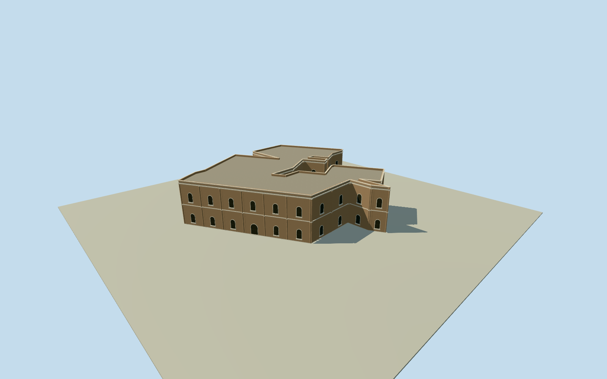

# Eastern riverfront range, Mubarak Mandi (reconstruction)

Bounded eastern palace-range reconstruction on the original31-corner numerical roof outline. Membership in the eastern residential/ruined palace ranges is estimated from site context; exact royal residence/GoleGhar name, survival, storeys, height, facade and precise2026condition are unverified original estimates. All original corners retained; no courtyard/site envelope extrusion. Original independent numerical roof retains every concavity and corner; whole-body extrusion is not a site/courtyard boundary. Eastern palace/residential membership, exact historical royal/GoleGhar assignment, survival and represented2026condition are original estimates. No named historic residence or restored ruin inventory is certified. Existing nine independently completed palace members remain unchanged. Complex-wide primary written architectural facts support brick/stone masonry, deodar joinery, round/pointed/lancet arches, cornices and decorative columns. This bounded original interpretation uses two estimated storeys, plain flat roof/parapets, round-headed closed wood window panels, pilasters and cornice bands. Height13m, all storeys, opening census, material colour, exact damage/roof sections and facade facing are original estimates. No qualified height data adopted and no empty2022/23height query repeated. Original numerical centroid/frame precedes independent256m129x129 source ground and initial floor0.25/foundation-3m/main sections. Coarse current terrain is not a surveyed historic bench; hillside intersections/exposed plinths remain approximations. No flattening, terrain mask, footprint shift or fitting. All appearance imagery unused. Cleared1906panorama supplies no unique numeric or appearance control here; disputed1905photographs and protected plans remain unused. Original numerics plus written architecture and explicit original reconstruction estimates only. Four levels retain the whole native polygon/closed roof and facade rhythm; thin parapets/cornices and finer window profiles/pilasters reduce at distance.

Authoring state: **review-in-qa.json**. Current completion evidence is in [qa.json](qa.json) and the [completion ledger](../../../../qualla-structures/batches/qualla-002.PROGRESS.md).

- [Mubarak Mandi Palace](https://qualla.com/mubarak-mandi-palace/)

Bounded eastern palace-range reconstruction on the original31-corner numerical roof outline. Membership in the eastern residential/ruined palace ranges is estimated from site context; exact royal residence/GoleGhar name, survival, storeys, height, facade and precise2026condition are unverified original estimates. All original corners retained; no courtyard/site envelope extrusion.

Original independent numerical roof retains every concavity and corner; whole-body extrusion is not a site/courtyard boundary. Eastern palace/residential membership, exact historical royal/GoleGhar assignment, survival and represented2026condition are original estimates. No named historic residence or restored ruin inventory is certified. Existing nine independently completed palace members remain unchanged.

Complex-wide primary written architectural facts support brick/stone masonry, deodar joinery, round/pointed/lancet arches, cornices and decorative columns. This bounded original interpretation uses two estimated storeys, plain flat roof/parapets, round-headed closed wood window panels, pilasters and cornice bands. Height13m, all storeys, opening census, material colour, exact damage/roof sections and facade facing are original estimates. No qualified height data adopted and no empty2022/23height query repeated.

Original numerical centroid/frame precedes independent256m129x129 source ground and initial floor0.25/foundation-3m/main sections. Coarse current terrain is not a surveyed historic bench; hillside intersections/exposed plinths remain approximations. No flattening, terrain mask, footprint shift or fitting.

All appearance imagery unused. Cleared1906panorama supplies no unique numeric or appearance control here; disputed1905photographs and protected plans remain unused. Original numerics plus written architecture and explicit original reconstruction estimates only. Four levels retain the whole native polygon/closed roof and facade rhythm; thin parapets/cornices and finer window profiles/pilasters reduce at distance.

Build: `node content/worldgen/source/places/tt/ttv/mubarak_mandi_eastern_riverfront_range/models/generate-house.mjs`. Add `--check` to verify exact regeneration. 21384 triangles; 4 materials; no embedded photographs.
