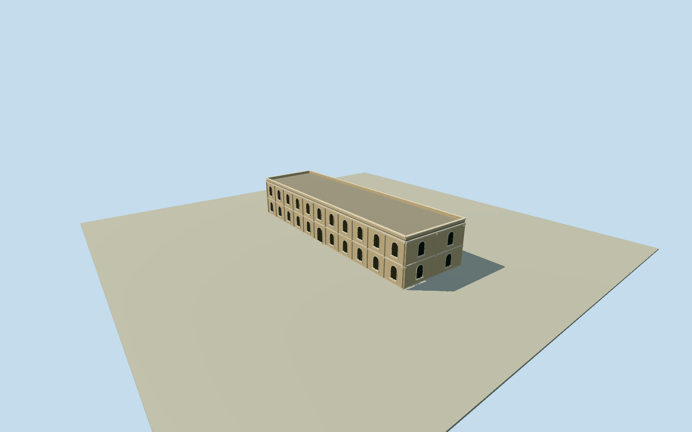

# Northern courtyard hall, Mubarak Mandi

Whole independent northern courtyard building: all original four corners, two estimated storeys, complete closed rear/ends, flat roof and parapets, estimated round-headed wood openings, masonry pilasters and cornice bands. Exact historic name, height, storey count, opening census, roof profile and2024condition unverified; whole palace remains separate. Numerical centroid and north long-edge frame fixed before own source ground, floor or sections. Nominal10m horizontal/4m height-component/10degree facing allowances are estimates, not surveyed error bounds. All appearance images and plans unused. Family facts support materials and broad vocabulary only; no specific historic court/ArmyHQ/MarbleHall attribution. Every original four-corner numerical plan point is preserved at all levels; generalized current map is not a measured architectural or2024survey. The2024primary study documents masonry/surkhi, deodar joinery, iron-supported upper floors, multiple arch families and cornices across the complex. Exact binding of any historic named body or facade to this original way is unverified. Original schematic estimates for this body: floor0.3m, foundation-3m, upperfloor4.6m, roof9m, parapet9.65m, two storeys, eleven south-court bays per storey, nine north bays and two end bays per floor, round arch openings and modest cornice/pilaster treatment. No independently measured height/storeys/roof/profile/census/finish/2024condition. No dome, front balcony or identifiable historical damage claimed. Ten-metre horizontal/four-metre height and component/ten-degree facing allowances are nominal modeling estimates, not measured error bounds. Own original256m129x129 field acquired before initial floor/mainsections; raw tile, original frame, field, floor and mainsections frozen without mask, flattening, cutout, fitting or relocation. Coarse ground contact and historic vertical registration unsurveyed. Every appearance photograph/Google-based plan/figure/art unused; Qualla24families/0conflicts screened first. Original numerical body and written family facts only. This is a schematic medium-fi historical exterior interpretation, not a surveyed or photo-matched replica. Four levels retain whole shell/rear/ends/flat roof/parapets, all estimated openings and major cornice lines. Close levels refine arch curvature, surrounds, joinery divisions/sills and estimated pilasters. Other palace buildings remain separate; whole palace unfinished.

Authoring state: **review-in-qa.json**. Current completion evidence is in [qa.json](qa.json) and the [completion ledger](../../../../qualla-structures/batches/qualla-002.PROGRESS.md).

- [Mubarak Mandi Palace](https://qualla.com/mubarak-mandi-palace/)

Whole independent northern courtyard building: all original four corners, two estimated storeys, complete closed rear/ends, flat roof and parapets, estimated round-headed wood openings, masonry pilasters and cornice bands. Exact historic name, height, storey count, opening census, roof profile and2024condition unverified; whole palace remains separate. Numerical centroid and north long-edge frame fixed before own source ground, floor or sections. Nominal10m horizontal/4m height-component/10degree facing allowances are estimates, not surveyed error bounds. All appearance images and plans unused. Family facts support materials and broad vocabulary only; no specific historic court/ArmyHQ/MarbleHall attribution.

Every original four-corner numerical plan point is preserved at all levels; generalized current map is not a measured architectural or2024survey.

The2024primary study documents masonry/surkhi, deodar joinery, iron-supported upper floors, multiple arch families and cornices across the complex. Exact binding of any historic named body or facade to this original way is unverified.

Original schematic estimates for this body: floor0.3m, foundation-3m, upperfloor4.6m, roof9m, parapet9.65m, two storeys, eleven south-court bays per storey, nine north bays and two end bays per floor, round arch openings and modest cornice/pilaster treatment. No independently measured height/storeys/roof/profile/census/finish/2024condition. No dome, front balcony or identifiable historical damage claimed.

Ten-metre horizontal/four-metre height and component/ten-degree facing allowances are nominal modeling estimates, not measured error bounds.

Own original256m129x129 field acquired before initial floor/mainsections; raw tile, original frame, field, floor and mainsections frozen without mask, flattening, cutout, fitting or relocation. Coarse ground contact and historic vertical registration unsurveyed.

Every appearance photograph/Google-based plan/figure/art unused; Qualla24families/0conflicts screened first. Original numerical body and written family facts only. This is a schematic medium-fi historical exterior interpretation, not a surveyed or photo-matched replica.

Four levels retain whole shell/rear/ends/flat roof/parapets, all estimated openings and major cornice lines. Close levels refine arch curvature, surrounds, joinery divisions/sills and estimated pilasters. Other palace buildings remain separate; whole palace unfinished.

Build: `node content/worldgen/source/places/tt/ttv/mubarak_mandi_northern_courtyard_hall/models/generate-house.mjs`. Add `--check` to verify exact regeneration. 12228 triangles; 4 materials; no embedded photographs.
