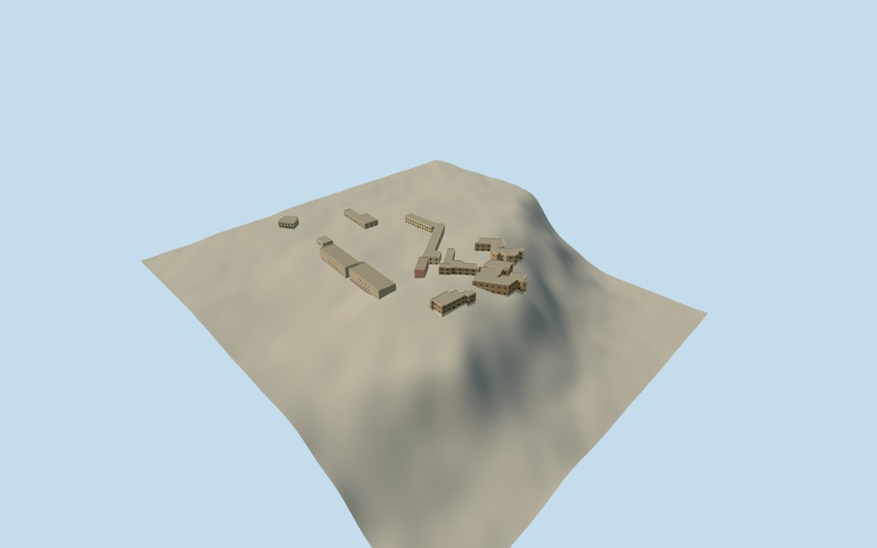

# Mubarak Mandi Palace

A bounded palace-range reconstruction assembled from thirteen individually registered structures: nine previously completed courtyard/outer halls and the post office, plus four new eastern ranges using every original31/25/14/16roof corner.

The eastern ranges use original Microsoft numerical roof records and primary written complex-wide masonry, deodar joinery, arch and cornice facts. Their exact royal residence/GoleGhar assignments, survival/date, height/storeys, opening patterns, roof sections and finish remain original reconstruction estimates. They are characteristic range models rather than a certified restored historic plan or a survey of every royal room. All source photographs, plans and artwork remain unused for the four new models. Existing accepted structure reviews are preserved.

Each structure retains its independent geographic placement, source field, floor and sections. The assembly has an original512m terrain field from two original Terrarium tiles. Coarse ground can intersect lower walls and does not establish historical engineered benches. Member dates2012/2023/2026are mixed observations or estimates, not a certified simultaneous condition.

[Qualla story](https://qualla.com/mubarak-mandi-palace/)
