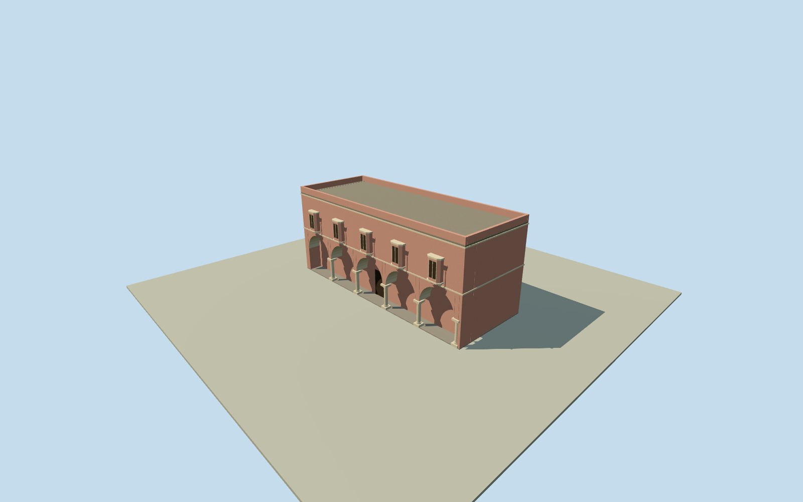

# Pink Hall, Mubarak Mandi

Whole independently named Pink Hall, now housing the Dogra Art Museum, as a dated2012exterior: reported rectangular hall, five courtyard-facing arches and five reported columns, matching gateway and projecting jharokha windows. Separate MarbleHall, deorhis and other palace buildings remain separate; this member does not complete MubarakMandi. Written reported95x36ft rectangle and40ft height are converted exactly, with inside/outside dimensions and section datum unverified. Ten-corner current native museum outline is not relabeled as that rectangle. Original context centroid and edge-derived facing retained as approximate reported-hall registration; nominal25m horizontal/2m height/components/15degree facing allowances are estimates, not measured bounds. Portico depth, roof/parapet, vertical sections, five-window census, jharokha profiles, hidden faces and precise2012condition are original exterior interpretations. Every appearance image unused. Primary author field study reports rectangular95x36ft hall,40ft height, five columns and five courtyard arches including the entrance, plus Dogra/Rajasthani projecting windows. Unit conversions retained. Exact interior/exterior measurement convention and height datum are unverified; reported dimensions are used as overall visible visualization extent. Not an independent modern measurement. Original exterior interpretation: complete pink plastered hall, front recessed five-bay arcade, five outer column supports and one end pier, solid rear/ends, simple flat roof/parapet and five upper jharokha window bays. Portico1.8m deep; spring3.5m/arcade top6.4m, roof11.64m, parapet/whole reported top12.442m above datum with floor0.25m; foundation-2.5m. Arches/column sections, upper opening count, projecting-window/canopy/bracket profiles, roof, rear openings/material and precise2012condition are estimates. No unsupported main dome, whole-palace composite, artefact art or facade-only panel. Original ten-corner museum record and containing museum point provide geographic context only. It differs from the reported rectangular hall and is not used as the whole reported perimeter. Original context-centroid anchor and edge-derived facing frozen before own field; nominal25m horizontal/2m height/components/15degree facing allowances are not measured bounds. No stretched native outline or post-field alignment. Own independent256m129x129 original source field acquired before floor/main sections. Coarse hillside contact and exposed/buried foundation portions remain approximate; no surveyed2012vertical tie. Field/frame/floor/mainsections frozen with no masks, flattening, cutout, vertical fitting or relocation. All appearance photographs, architectural figures, INTACH plan images and art images unused. Qualla24families/zero conflicts screened first; questionable historic originals remain excluded. Written source is a transparent factual extraction from the original author-upload text; its PDF link returned404. Official district textual identity/finish and original numerical native context bound separately. No raw PDF retrieval is claimed. All four authored levels retain the complete hall, five actual open arcade bays, five outer supports, projecting windows, gateway and closed roof/ends/rear. Near levels refine column profiles, arch segmentation, cornices, canopy brackets and window frames. Approximate April2012dated preview/currentWorldEligiblefalse. Other palace buildings remain unresolved.

Authoring state: **review-in-qa.json**. Current completion evidence is in [qa.json](qa.json) and the [completion ledger](../../../../qualla-structures/batches/qualla-002.PROGRESS.md).

- [Mubarak Mandi Palace](https://qualla.com/mubarak-mandi-palace/)

Whole independently named Pink Hall, now housing the Dogra Art Museum, as a dated2012exterior: reported rectangular hall, five courtyard-facing arches and five reported columns, matching gateway and projecting jharokha windows. Separate MarbleHall, deorhis and other palace buildings remain separate; this member does not complete MubarakMandi. Written reported95x36ft rectangle and40ft height are converted exactly, with inside/outside dimensions and section datum unverified. Ten-corner current native museum outline is not relabeled as that rectangle. Original context centroid and edge-derived facing retained as approximate reported-hall registration; nominal25m horizontal/2m height/components/15degree facing allowances are estimates, not measured bounds. Portico depth, roof/parapet, vertical sections, five-window census, jharokha profiles, hidden faces and precise2012condition are original exterior interpretations. Every appearance image unused.

Primary author field study reports rectangular95x36ft hall,40ft height, five columns and five courtyard arches including the entrance, plus Dogra/Rajasthani projecting windows. Unit conversions retained. Exact interior/exterior measurement convention and height datum are unverified; reported dimensions are used as overall visible visualization extent. Not an independent modern measurement.

Original exterior interpretation: complete pink plastered hall, front recessed five-bay arcade, five outer column supports and one end pier, solid rear/ends, simple flat roof/parapet and five upper jharokha window bays. Portico1.8m deep; spring3.5m/arcade top6.4m, roof11.64m, parapet/whole reported top12.442m above datum with floor0.25m; foundation-2.5m. Arches/column sections, upper opening count, projecting-window/canopy/bracket profiles, roof, rear openings/material and precise2012condition are estimates. No unsupported main dome, whole-palace composite, artefact art or facade-only panel.

Original ten-corner museum record and containing museum point provide geographic context only. It differs from the reported rectangular hall and is not used as the whole reported perimeter. Original context-centroid anchor and edge-derived facing frozen before own field; nominal25m horizontal/2m height/components/15degree facing allowances are not measured bounds. No stretched native outline or post-field alignment.

Own independent256m129x129 original source field acquired before floor/main sections. Coarse hillside contact and exposed/buried foundation portions remain approximate; no surveyed2012vertical tie. Field/frame/floor/mainsections frozen with no masks, flattening, cutout, vertical fitting or relocation.

All appearance photographs, architectural figures, INTACH plan images and art images unused. Qualla24families/zero conflicts screened first; questionable historic originals remain excluded. Written source is a transparent factual extraction from the original author-upload text; its PDF link returned404. Official district textual identity/finish and original numerical native context bound separately. No raw PDF retrieval is claimed.

All four authored levels retain the complete hall, five actual open arcade bays, five outer supports, projecting windows, gateway and closed roof/ends/rear. Near levels refine column profiles, arch segmentation, cornices, canopy brackets and window frames. Approximate April2012dated preview/currentWorldEligiblefalse. Other palace buildings remain unresolved.

Build: `node content/worldgen/source/places/tt/ttv/mubarak_mandi_pink_hall/models/generate-house.mjs`. Add `--check` to verify exact regeneration. 2240 triangles; 5 materials; no embedded photographs.
