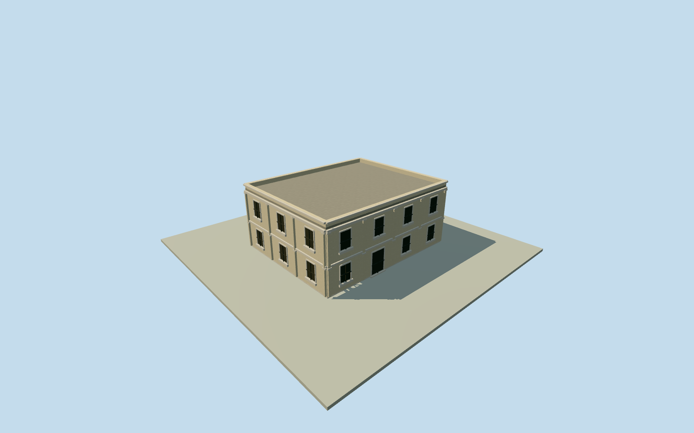

# Mubarak Mandi Post Office

Whole independent mapped postal building: all four original corners, complete exterior, rear, ends, roof and parapets. Two storeys, window census, plain rectangular joinery and all heights/finishes are explicit schematic estimates. The current mapped post office is not identified as historic Tootan Wali Deodi. This member does not complete Mubarak Mandi. Original native centroid/edge facing fixed before independent field, floors or sections. Ten-metre horizontal/four-metre height-component/ten-degree facing allowances are nominal authoring estimates, not measured bounds. Qualla24candidate families considered first; all appearance imagery unused. The official postal directory supplies identity/locality only; no protected plan, branding or image adopted. All four original2023OSM numerical perimeter points retained. Generalized map is not a measured architectural survey. Original containing postal point gives current mapped service identity; postal directory gives service/locality, not independently surveyed building geometry. Two storeys, floor0.25m, foundation-2.5m, upperfloor3.65m, roof7.15m, parapet7.65m and all rectangular windows/doors, opening census, finishes, modest bands and exact2023condition are original schematic estimates. No measured facade, photo comparison or restoration state is claimed. Historic Tootan Wali Deodi/gateway identity and palace construction phase are unverified. No historic gateway, dome, balcony or decorative motif inferred from that name. No official postal logo, art or signage copied. Ten-metre horizontal/four-metre height-component/ten-degree facing allowances are nominal authoring estimates, not measured error bounds. Independent256m129x129original terrain acquired before initial floor/mainsections. Source tiles, field, original frame and sections frozen; no mask, flattening, cutout, fitting or relocation. Coarse grade and historical vertical registration remain unsurveyed. All appearance imagery unused; Qualla24families/zero conflicts considered first. This is a geographically bound schematic exterior, not a surveyed or photo-matched replica. All four authored levels retain complete original body/roof/parapets and estimated two-storey opening arrangement. Close levels refine joinery, lintels/sills and shallow plain pilasters. Other palace buildings remain separate; whole complex unfinished.

Authoring state: **review-in-qa.json**. Current completion evidence is in [qa.json](qa.json) and the [completion ledger](../../../../qualla-structures/batches/qualla-002.PROGRESS.md).

- [Mubarak Mandi Palace](https://qualla.com/mubarak-mandi-palace/)

Whole independent mapped postal building: all four original corners, complete exterior, rear, ends, roof and parapets. Two storeys, window census, plain rectangular joinery and all heights/finishes are explicit schematic estimates. The current mapped post office is not identified as historic Tootan Wali Deodi. This member does not complete Mubarak Mandi. Original native centroid/edge facing fixed before independent field, floors or sections. Ten-metre horizontal/four-metre height-component/ten-degree facing allowances are nominal authoring estimates, not measured bounds. Qualla24candidate families considered first; all appearance imagery unused. The official postal directory supplies identity/locality only; no protected plan, branding or image adopted.

All four original2023OSM numerical perimeter points retained. Generalized map is not a measured architectural survey. Original containing postal point gives current mapped service identity; postal directory gives service/locality, not independently surveyed building geometry.

Two storeys, floor0.25m, foundation-2.5m, upperfloor3.65m, roof7.15m, parapet7.65m and all rectangular windows/doors, opening census, finishes, modest bands and exact2023condition are original schematic estimates. No measured facade, photo comparison or restoration state is claimed.

Historic Tootan Wali Deodi/gateway identity and palace construction phase are unverified. No historic gateway, dome, balcony or decorative motif inferred from that name. No official postal logo, art or signage copied.

Ten-metre horizontal/four-metre height-component/ten-degree facing allowances are nominal authoring estimates, not measured error bounds.

Independent256m129x129original terrain acquired before initial floor/mainsections. Source tiles, field, original frame and sections frozen; no mask, flattening, cutout, fitting or relocation. Coarse grade and historical vertical registration remain unsurveyed.

All appearance imagery unused; Qualla24families/zero conflicts considered first. This is a geographically bound schematic exterior, not a surveyed or photo-matched replica.

All four authored levels retain complete original body/roof/parapets and estimated two-storey opening arrangement. Close levels refine joinery, lintels/sills and shallow plain pilasters. Other palace buildings remain separate; whole complex unfinished.

Build: `node content/worldgen/source/places/tt/ttv/mubarak_mandi_post_office/models/generate-house.mjs`. Add `--check` to verify exact regeneration. 3284 triangles; 4 materials; no embedded photographs.
