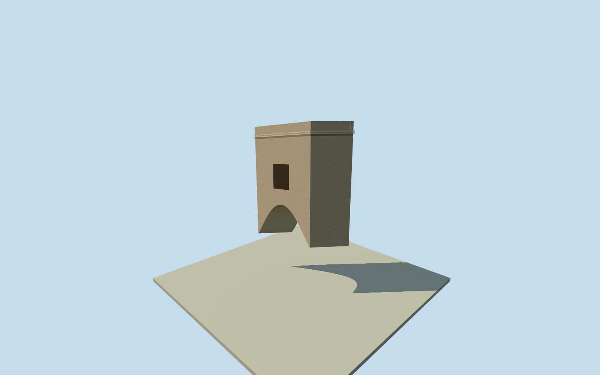

# Southern courtyard upper link, Mubarak Mandi

Whole inferred enclosed upper connection between the two southern native halls, with complete sloping deck/enclosure/roof/parapet and an explicitly estimated gateway arch underneath. It is a separate intrinsic connection, not a standalone pier-supported building, MainDeorhi/BadiDeorhi identity or whole-palace proxy. Primary written study describes upper connection above a deorhi; exact pairing of the two native halls remains inferred. Proposed depth3.048m along their end faces interprets the reported10ft group verandah and is not a measured bridge width. Original numerical gap endpoints plus initial0.06m end bearings define the estimated frame before own field/floor/sections. Arch, window/finish/census, route, exact2012condition and vertical tie are original interpretations. Nominal10m horizontal/3m height/components/10degree facing allowances are not measured bounds. All imagery unused. Whole elevated enclosed upper link, complete intrinsic estimated gateway arch/spandrel, sloping upper enclosure/deck/roof/parapets, one estimated projecting front window and closed rear/end interfaces. No invented ground piers or whole-palace proxy. Pairing with these two halls remains an inference from primary written southwestern upper-connection fact and original numerical gap. Original gap6.2987m and0.06m initial end bearings were selected before own field/floor/sections. Proposed3.048m offset along hall end faces interprets the group10ft verandah; it is not a measured connector clear width or footprint. The sheared proposed plan is retained rather than stretched to a regular rectangle. Initial interface floor levels are the original accepted halls arcade-top sections plus their unchanged source-DEM datums minus this original link datum. Roof/parapet/spring levels derive from the same saved input sections. These are proposed interfaces, not surveyed historic floor heights. Sloped passage and rounded gateway arch are original interpretations; exact structure pairing, arch/enclosure/window/material profiles, hidden access route and precise2012condition remain unverified. Nominal10m horizontal/3m height/components/10degree facing allowances are not measured bounds. Own independent256m129x129 field and one raw tile acquired before all link floor/mainsections. Field/frame/initial sections frozen with no masking, flattening, cutout, vertical fitting or relocation. Accepted hall source geometry, frames, fields, original floor/mainsections and QA are hash-bound and unchanged. This elevated part is supported by neighboring halls; isolated views intentionally show no standalone supports. Every source photograph, architectural image, INTACH plan, figure, painting and image-derived appearance unused. Qualla24families/zero conflicts screened first; questionable archive imagery remains excluded. Primary author-upload written connection fact, original numerical gap and explicit original section estimates only. All four levels retain full enclosed passage, closed deck/roof/end interfaces, complete gateway arch and window volumes. Near levels refine arch curvature, window frames and brackets. Interiors/passable routing through the accepted hall end walls are not reconstructed. Three current assembly views with the accepted halls verify relative placement without re-reviewing their geometry. Approximate2012historical preview/currentWorldEligiblefalse; full palace unfinished.

Authoring state: **review-in-qa.json**. Current completion evidence is in [qa.json](qa.json) and the [completion ledger](../../../../qualla-structures/batches/qualla-002.PROGRESS.md).

- [Mubarak Mandi Palace](https://qualla.com/mubarak-mandi-palace/)

Whole inferred enclosed upper connection between the two southern native halls, with complete sloping deck/enclosure/roof/parapet and an explicitly estimated gateway arch underneath. It is a separate intrinsic connection, not a standalone pier-supported building, MainDeorhi/BadiDeorhi identity or whole-palace proxy. Primary written study describes upper connection above a deorhi; exact pairing of the two native halls remains inferred. Proposed depth3.048m along their end faces interprets the reported10ft group verandah and is not a measured bridge width. Original numerical gap endpoints plus initial0.06m end bearings define the estimated frame before own field/floor/sections. Arch, window/finish/census, route, exact2012condition and vertical tie are original interpretations. Nominal10m horizontal/3m height/components/10degree facing allowances are not measured bounds. All imagery unused.

Whole elevated enclosed upper link, complete intrinsic estimated gateway arch/spandrel, sloping upper enclosure/deck/roof/parapets, one estimated projecting front window and closed rear/end interfaces. No invented ground piers or whole-palace proxy. Pairing with these two halls remains an inference from primary written southwestern upper-connection fact and original numerical gap.

Original gap6.2987m and0.06m initial end bearings were selected before own field/floor/sections. Proposed3.048m offset along hall end faces interprets the group10ft verandah; it is not a measured connector clear width or footprint. The sheared proposed plan is retained rather than stretched to a regular rectangle.

Initial interface floor levels are the original accepted halls arcade-top sections plus their unchanged source-DEM datums minus this original link datum. Roof/parapet/spring levels derive from the same saved input sections. These are proposed interfaces, not surveyed historic floor heights. Sloped passage and rounded gateway arch are original interpretations; exact structure pairing, arch/enclosure/window/material profiles, hidden access route and precise2012condition remain unverified. Nominal10m horizontal/3m height/components/10degree facing allowances are not measured bounds.

Own independent256m129x129 field and one raw tile acquired before all link floor/mainsections. Field/frame/initial sections frozen with no masking, flattening, cutout, vertical fitting or relocation. Accepted hall source geometry, frames, fields, original floor/mainsections and QA are hash-bound and unchanged. This elevated part is supported by neighboring halls; isolated views intentionally show no standalone supports.

Every source photograph, architectural image, INTACH plan, figure, painting and image-derived appearance unused. Qualla24families/zero conflicts screened first; questionable archive imagery remains excluded. Primary author-upload written connection fact, original numerical gap and explicit original section estimates only.

All four levels retain full enclosed passage, closed deck/roof/end interfaces, complete gateway arch and window volumes. Near levels refine arch curvature, window frames and brackets. Interiors/passable routing through the accepted hall end walls are not reconstructed. Three current assembly views with the accepted halls verify relative placement without re-reviewing their geometry. Approximate2012historical preview/currentWorldEligiblefalse; full palace unfinished.

Build: `node content/worldgen/source/places/tt/ttv/mubarak_mandi_southern_courtyard_upper_link/models/generate-house.mjs`. Add `--check` to verify exact regeneration. 380 triangles; 4 materials; no embedded photographs.
