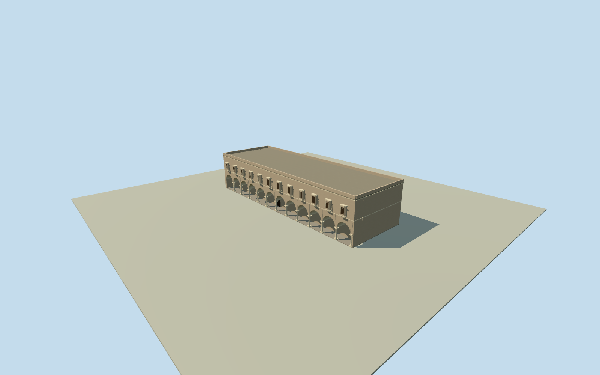

# Southern west hall, Mubarak Mandi

Whole independently mapped southern west hall at MubarakMandi, original way/168959079, including full four-corner body, closed rear/ends/roof and estimated courtyard arcade/projecting windows. Exact historic block name unverified; it is not relabeled as a proven HighCourt or UPSC office. Neighboring hall and cross-gap upper deorhi link remain separate; this member does not complete the palace. Original native footprint, centroid and derived facing retained. Primary written study describes the southwestern administrative pair with10ft verandahs, arcades, projecting windows and upper link. The42ft height reported for one named right block is group-scale context only: exact correspondence unverified, so this model height, bay/window counts, columns, roof and finish are explicit estimates. Ambiguous184double-prime text is not converted to a claimed exact foot length. All appearance images unused; nominal10m horizontal/3m height/components/10degree facing allowances are not measured bounds. Original four-corner native shell is preserved exactly in local plan construction. A bilinear coordinate map from the detail-authoring rectangle to those four original corners constructs the shell and details; it does not resize or move the original footprint. Source map remains generalized numerical data, not an archaeological survey. Author2015primary written study describes southern administrative pair with10ft front verandahs interrupted by stairs, arcades, projecting/recessed windows, carved stone columns and upper connection. Exact historic HighCourt/UPSC assignment of this anonymous native body is unverified. The42ft height is reported for one named right block and is NOT assigned as a measurement of this body;184double-prime length text remains ambiguous and unused for plan geometry. Original medium-fi exterior interpretation: whole native body, twelve estimated courtyard arcade bays/supports and upper projecting windows, closed rear/ends, simple roof/parapet and closed estimated entry. Estimated civil height12.8m above0.25m floor, whole top13.05m, roof12.25m, arcade top6.9m/spring3.5m, foundation-2.5m; portico3.048m is the reported group10ft depth interpreted for this candidate body. All sections, bay/window/column census, exact facade assignment, materials/finish, roofs and precise2012condition remain estimates; height/component allowance3m, nominal horizontal10m, facing10degrees, not measured bounds. Own independent256m129x129 source field and one raw tile acquired before floor/main sections. Frame, field, original floor and main sections frozen; no mask, flattening, cutout, height fitting or relocation. Coarse terrain contact/exposed/buried foundation parts remain approximate, without surveyed2012vertical tie. Every appearance image, photograph, INTACH plan, survey figure, painting and motif image unused. Qualla24families/zero conflicts screened first; questionable archive sources remain excluded. Written author-upload facts saved transparently, original native numerical data bound. No image-fidelity or image-license approval claimed. All four levels retain the entire original four-corner body, twelve actual estimated open arcade bays, all estimated main supports/projecting windows and closed roof/ends/rear. Skyline uses simple box columns/window volumes and two-segment arches; near levels add curves, ledges, frames and brackets. The neighboring hall and upper cross-gap deorhi link remain separate; full palace unfinished. Approximate2012historical preview/currentWorldEligiblefalse.

Authoring state: **review-in-qa.json**. Current completion evidence is in [qa.json](qa.json) and the [completion ledger](../../../../qualla-structures/batches/qualla-002.PROGRESS.md).

- [Mubarak Mandi Palace](https://qualla.com/mubarak-mandi-palace/)

Whole independently mapped southern west hall at MubarakMandi, original way/168959079, including full four-corner body, closed rear/ends/roof and estimated courtyard arcade/projecting windows. Exact historic block name unverified; it is not relabeled as a proven HighCourt or UPSC office. Neighboring hall and cross-gap upper deorhi link remain separate; this member does not complete the palace. Original native footprint, centroid and derived facing retained. Primary written study describes the southwestern administrative pair with10ft verandahs, arcades, projecting windows and upper link. The42ft height reported for one named right block is group-scale context only: exact correspondence unverified, so this model height, bay/window counts, columns, roof and finish are explicit estimates. Ambiguous184double-prime text is not converted to a claimed exact foot length. All appearance images unused; nominal10m horizontal/3m height/components/10degree facing allowances are not measured bounds.

Original four-corner native shell is preserved exactly in local plan construction. A bilinear coordinate map from the detail-authoring rectangle to those four original corners constructs the shell and details; it does not resize or move the original footprint. Source map remains generalized numerical data, not an archaeological survey.

Author2015primary written study describes southern administrative pair with10ft front verandahs interrupted by stairs, arcades, projecting/recessed windows, carved stone columns and upper connection. Exact historic HighCourt/UPSC assignment of this anonymous native body is unverified. The42ft height is reported for one named right block and is NOT assigned as a measurement of this body;184double-prime length text remains ambiguous and unused for plan geometry.

Original medium-fi exterior interpretation: whole native body, twelve estimated courtyard arcade bays/supports and upper projecting windows, closed rear/ends, simple roof/parapet and closed estimated entry. Estimated civil height12.8m above0.25m floor, whole top13.05m, roof12.25m, arcade top6.9m/spring3.5m, foundation-2.5m; portico3.048m is the reported group10ft depth interpreted for this candidate body. All sections, bay/window/column census, exact facade assignment, materials/finish, roofs and precise2012condition remain estimates; height/component allowance3m, nominal horizontal10m, facing10degrees, not measured bounds.

Own independent256m129x129 source field and one raw tile acquired before floor/main sections. Frame, field, original floor and main sections frozen; no mask, flattening, cutout, height fitting or relocation. Coarse terrain contact/exposed/buried foundation parts remain approximate, without surveyed2012vertical tie.

Every appearance image, photograph, INTACH plan, survey figure, painting and motif image unused. Qualla24families/zero conflicts screened first; questionable archive sources remain excluded. Written author-upload facts saved transparently, original native numerical data bound. No image-fidelity or image-license approval claimed.

All four levels retain the entire original four-corner body, twelve actual estimated open arcade bays, all estimated main supports/projecting windows and closed roof/ends/rear. Skyline uses simple box columns/window volumes and two-segment arches; near levels add curves, ledges, frames and brackets. The neighboring hall and upper cross-gap deorhi link remain separate; full palace unfinished. Approximate2012historical preview/currentWorldEligiblefalse.

Build: `node content/worldgen/source/places/tt/ttv/mubarak_mandi_southern_west_hall/models/generate-house.mjs`. Add `--check` to verify exact regeneration. 5110 triangles; 5 materials; no embedded photographs.
