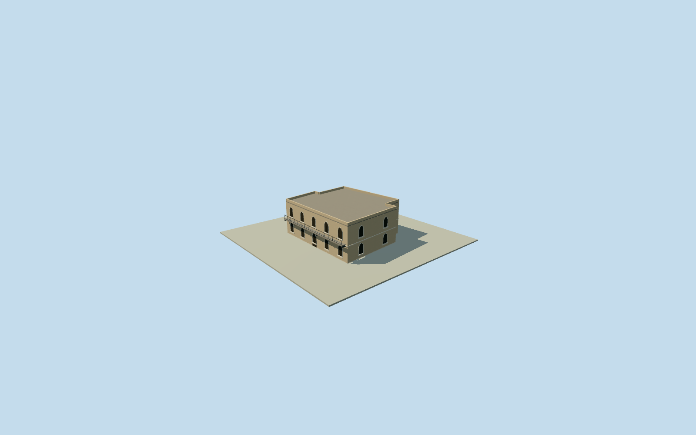

# Southwestern outer hall, Mubarak Mandi

Whole original eight-corner southwestern outer building, preserving rear step/notch, complete two-storey shell/roof/ends and estimated pointed-window/concrete-balcony architectural family. Historic identity, function and precise2012condition unverified; the named SessionCourts vocabulary is only a cross-complex family analogy; it is not named as a proven historic court or a whole-palace proxy. Native numerical centroid/long-edge facing fixed before own terrain or sections. All height, census, balcony/girder/arch/door/roof/finish and facade assignment are explicit estimates, not measured architectural observations. The primary report of entrance collapse has no bound location or outline here; this is a schematic historical exterior interpretation, not exact damage reconstruction. Nominal10m horizontal/3m height-component/10degree facing allowances are not measured bounds. All images unused, Qualla first. Original eight-corner numerical shell, including rear step/notch, preserved at every level. Native map is generalized current numerical data, not an archaeological or 2012 building survey. Primary written description of the northwest SessionCourts supplies a two-storey colonial pointed-arch/concrete-balcony-on-steel-girders analogy only. It does not identify or document the exterior of this southwestern building. Every applied family detail is explicitly inferred, not an observed facade. No named court/library identity asserted. Source entrance-collapse report has no bound damage location here; closed schematic entry does not claim exact collapsed or restored2012condition. Original estimated exterior: floor0.25m, foundation-2.5m, upper floor4.3m, roof8.45m, parapet9.05m; all section heights, five front window bays per storey, other-window census, pointed arch profiles, balcony1.1m projection and support spacing, closed entry, finish and roof are estimates. Nominal10m horizontal/3m height-component/10degree facing allowances are not measured bounds. Own independent256m129x129 original source field and two raw tiles acquired before floor/mainsections. Original frame/field/floor/sections frozen with no mask, flattening, cutout, fitted vertical shifts or relocation. Coarse contact and precise historic vertical tie are unsurveyed. Every appearance photograph, architectural/INTACH plan, figure and decorative art unused. Qualla24families/zero conflicts screened first; questionable archives excluded. Original numerical full body plus transparent factual text and explicit estimates only. All four levels retain complete eight-corner shell/closed rear/ends, roof/parapets, two levels of estimated pointed windows, concrete balcony and support girders. Close levels refine pointed openings, arch surrounds, window divisions, girder profile and rail uprights. Adjacent buildings and full palace remain unfinished; approximate2012historical exterior/currentWorldEligiblefalse.

Authoring state: **review-in-qa.json**. Current completion evidence is in [qa.json](qa.json) and the [completion ledger](../../../../qualla-structures/batches/qualla-002.PROGRESS.md).

- [Mubarak Mandi Palace](https://qualla.com/mubarak-mandi-palace/)

Whole original eight-corner southwestern outer building, preserving rear step/notch, complete two-storey shell/roof/ends and estimated pointed-window/concrete-balcony architectural family. Historic identity, function and precise2012condition unverified; the named SessionCourts vocabulary is only a cross-complex family analogy; it is not named as a proven historic court or a whole-palace proxy. Native numerical centroid/long-edge facing fixed before own terrain or sections. All height, census, balcony/girder/arch/door/roof/finish and facade assignment are explicit estimates, not measured architectural observations. The primary report of entrance collapse has no bound location or outline here; this is a schematic historical exterior interpretation, not exact damage reconstruction. Nominal10m horizontal/3m height-component/10degree facing allowances are not measured bounds. All images unused, Qualla first.

Original eight-corner numerical shell, including rear step/notch, preserved at every level. Native map is generalized current numerical data, not an archaeological or 2012 building survey.

Primary written description of the northwest SessionCourts supplies a two-storey colonial pointed-arch/concrete-balcony-on-steel-girders analogy only. It does not identify or document the exterior of this southwestern building. Every applied family detail is explicitly inferred, not an observed facade. No named court/library identity asserted. Source entrance-collapse report has no bound damage location here; closed schematic entry does not claim exact collapsed or restored2012condition.

Original estimated exterior: floor0.25m, foundation-2.5m, upper floor4.3m, roof8.45m, parapet9.05m; all section heights, five front window bays per storey, other-window census, pointed arch profiles, balcony1.1m projection and support spacing, closed entry, finish and roof are estimates. Nominal10m horizontal/3m height-component/10degree facing allowances are not measured bounds.

Own independent256m129x129 original source field and two raw tiles acquired before floor/mainsections. Original frame/field/floor/sections frozen with no mask, flattening, cutout, fitted vertical shifts or relocation. Coarse contact and precise historic vertical tie are unsurveyed.

Every appearance photograph, architectural/INTACH plan, figure and decorative art unused. Qualla24families/zero conflicts screened first; questionable archives excluded. Original numerical full body plus transparent factual text and explicit estimates only.

All four levels retain complete eight-corner shell/closed rear/ends, roof/parapets, two levels of estimated pointed windows, concrete balcony and support girders. Close levels refine pointed openings, arch surrounds, window divisions, girder profile and rail uprights. Adjacent buildings and full palace remain unfinished; approximate2012historical exterior/currentWorldEligiblefalse.

Build: `node content/worldgen/source/places/tt/ttv/mubarak_mandi_southwestern_outer_hall/models/generate-house.mjs`. Add `--check` to verify exact regeneration. 5858 triangles; 5 materials; no embedded photographs.
