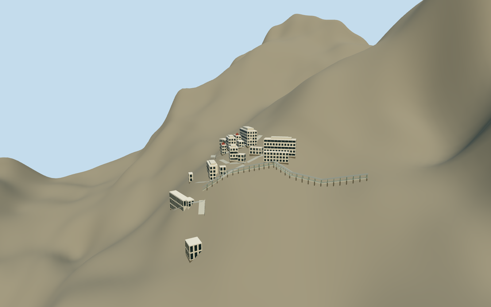

# Vaishno Devi Temple

The Vaishno Devi Holy Bhawan’s stacked white hillside buildings and the immediately adjoining covered approach on Trikuta.

Authoring state: **review-in-qa.json**. Current completion evidence is in [qa.json](qa.json) and the [completion ledger](../../../../qualla-structures/batches/qualla-003.PROGRESS.md).

- [Vaishno Devi Temple](https://qualla.com/vaishno-devi-temple/)

The reconstruction covers publicly visible buildings of the Holy Bhawan. The cave interior, distant pilgrimage gates and the separate Bhairon Temple are outside its scope.

Footprints come from aerial-derived Overture vector geometry. Individual block names, roofs behind the main frontage, façade heights and floor levels are approximate.

The covered approach is a partial exterior based on the mapped hillside track and photos. Its framing and deck elevations are estimated.

The original source terrain is kept independent. The source-scale elevation field cannot resolve the real retaining benches at each floor level.

Build: `node content/worldgen/source/places/tt/ttv/vaishno_devi_temple/models/generate-vaishno-devi-temple.mjs`. Add `--check` to verify exact regeneration. 7738 triangles; 6 materials; no embedded photographs.
