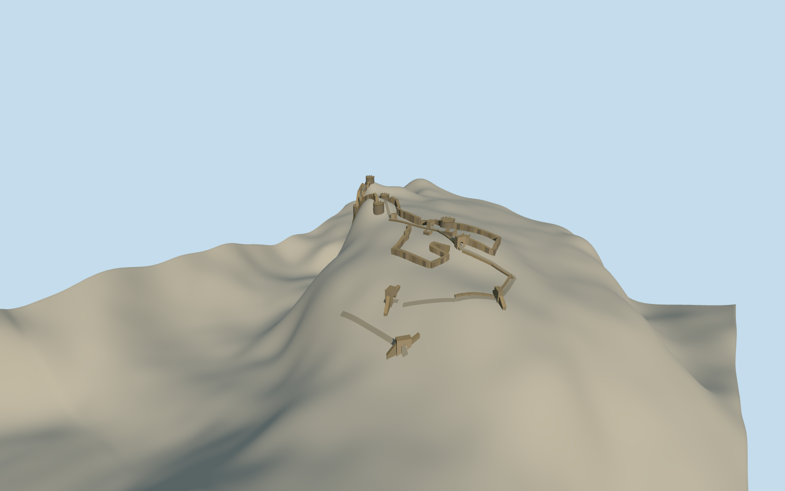

# Kangra Fort

Kangra Fort is a ruined hill fortress with gray stone ramparts, round bastions, successive gates and temple remains above the river confluence.

Authoring state: **review-in-qa.json**. Current completion evidence is in [qa.json](qa.json) and the [completion ledger](../../../../qualla-structures/batches/qualla-003.PROGRESS.md).

- [Kangra Fort](https://qualla.com/kangra-fort/)

The surviving western mapped masonry and northeast approach are represented. The outer mapped precinct line includes open slopes and access space.

Exact rampart height, parapet gaps, gate locations and temple foundations are estimates. Relative terrain is from an independent composite elevation field with coarse native cells.

Small reliefs and carvings are modeled in simplified original geometry. Former buildings destroyed in 1905, current vegetation and the separate ticket office and museum are outside scope.

Build: `node content/worldgen/source/places/tt/ttw/kangra_fort/models/generate-kangra-fort.mjs`. Add `--check` to verify exact regeneration. 6806 triangles; 4 materials; no embedded photographs.
