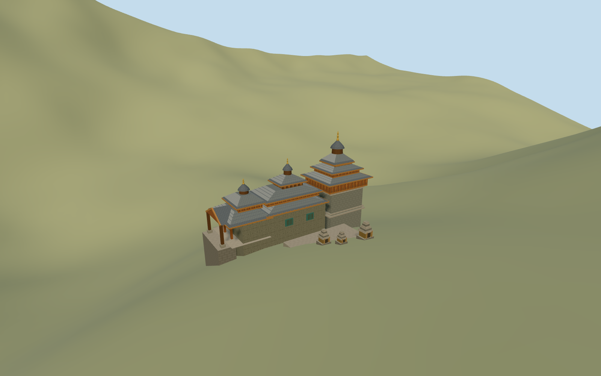

# Mahasu Devta Temple

Hanol’s stone sanctuary and carved amber timber galleries stand under tiered slate roofs with gold finials, beside smaller stone shrines in the court.

Authoring state: **review-in-qa.json**. Current completion evidence is in [qa.json](qa.json) and the [completion ledger](../../../../qualla-structures/batches/qualla-003.PROGRESS.md).

- [Mahasu Devta Temple](https://qualla.com/mahasu-devta-temple/)

The two native roof rectangles and precinct locate the standing temple. The short west vestibule, minor shrines and immediate courtyard paths are placed from site photographs and are approximate.

Exact section heights, structural timber joints, iconography and ornament spacing are estimated. The model represents the standing public exterior and small shrines in the immediate court.

The photographs establish the current roof profiles, masonry and timber character. The original Qualla file appeared to depict a reproduction of a lion door fitting, with insufficient source clarity to use as architectural reference.

Build: `node content/worldgen/source/places/tt/ttx/mahasu_devta_temple/models/generate-mahasu-devta-temple.mjs`. Add `--check` to verify exact regeneration. 6749 triangles; 6 materials; no embedded photographs.
