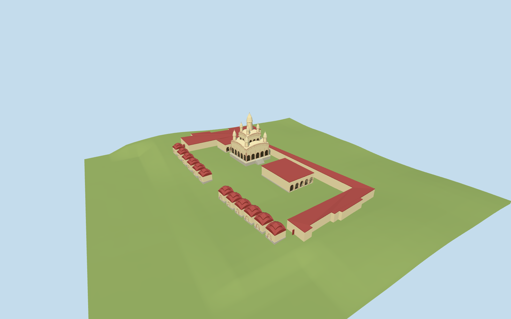

# Dakshineswar Kali Temple

Dakshineswar Kali Temple medium-fi compound: the specific cream/red nine-spired Navaratna main shrine with four lower/four upper/one central ridged spires, strongly bowed cornices, five-bay recessed arches, raised platform and south approach; a separate southern Natmandir hall and northern shrine, twelve small red double-curved-roof Shiva shrines along the riverfront split around the central passage, and mapped low courtyard boundary wings. Keep the court open and the Hooghly outside the asset; no large solid compound extrusion.

## Evidence and reconstruction

Published dimensions and reconstructed details are separated in spec.json. Primary references:

- [Reference](https://commons.wikimedia.org/wiki/File:Dakshineswar_Kali_Temple_(7169302531).jpg)
- [Reference](https://commons.wikimedia.org/wiki/File:Dakhineswar_temple_Kali.jpg)
- [Reference](https://commons.wikimedia.org/wiki/File:Dakshineswar_Kali_Temple,_Dakshineswar,_West_Bengal,_India_(2007).jpg)

Two registered recipes build the specific nine-spired Navaratna shrine, twelve riverfront shrines and open compound with shared 256² material graphs, metric UVs and linear tints. No embedded images or unique atlas.

## Model and axes

30,742 triangles; 92,226 vertices; 4 material groups; 3,692,008 bytes. Native bounds: -57.761, -3.048, -51.773 to 15.106, 31.280, 82.412. Source hash: `sha256:742761bdce090ef12fe86268c35a915431ee16ba55f13d8631359b593d0c37f7`.

{"x":"east","y":"up","z":"south"}

The geographic proposal uses exact-QID OpenStreetMap evidence. Map-derived orientation and estimated architectural details require real-site visual review; preview eligibility is distinct from geographic/fidelity approval. Map attribution: © OpenStreetMap contributors, ODbL-1.0.

## Reproduce

Run `node packages/worldgen/scripts/generate-additional-landmarks.mjs --ids=dakshineswar_kali_temple` (or add `--check`). The generator preserves manually edited masters by checking their baseline hashes. Import through the standard authored-model workflow with optimization disabled; then capture all QA cameras, including shared-surface views.

## Pending work

- Dakshineswar Kali Temple medium-fi compound: the specific cream/red nine-spired Navaratna main shrine with four lower/four upper/one central ridged spires, strongly bowed cornices, five-bay recessed arches, raised platform and south approach; a separate southern Natmandir hall and northern shrine, twelve small red double-curved-roof Shiva shrines along the riverfront split around the central passage, and mapped low courtyard boundary wings. Keep the court open and the Hooghly outside the asset; no large solid compound extrusion.
- Q1157765 and way291865633 identify the mapped compound. Standard PMTiles record35184663954465 supplies its precise irregular outer outline; it currently has no courtyard holes or individual temple plans. Replace that one broad native shell with an open compound. Align local east/south about6degrees to the mapped walls. Main-shrine, Natmandir, northern shrine and twelve riverfront-shrine centers/dimensions are explicit picture-led subdivisions inside the boundary, not surveyed footprints. The south-facing main approach and western riverfront give signed orientation. Preserve every independent surrounding map record.
- Daylight pictures guide the main three diminishing bowed stages, four-plus-four-plus-one spire silhouette, cream plaster/red pilasters, ribbed conical-curved crowns, five-bay arcades, plinth and shallow stairs. Main total height is estimated about31m above its approach, with subordinate hall about7m and small riverfront shrines about7m. Fine mouldings, rib counts, sculpture, inscriptions, exact balcony/door patterns and hidden interiors remain simplified; later restoration paint is not independently certified.
- Pinned standard Protomaps2026-10-14 and Mapzen13–14 terrain. Retain the original six-meter native grid and water. Each principal building has a locally sampled level datum and buried base; the main floor is raised about2.2m. Low boundary wings follow coarse native grade with buried bottoms. No terrain/water cutout or river surface is authored. The DEM does not resolve historic courtyard paving/ghat levels; exact thresholds and embankment engineering are approximate.
- The compound outline is mapped; internal centers, dimensions, carved profiles and levels are picture-led estimates. Nine main spires and twelve riverfront shrines remain distinct. Preserve independent neighboring buildings, river water and native terrain; no navigable interior is claimed.

This bundle follows the medium-fi standard. Medium-fi appearance and geographic fit are reviewed separately. Hash-bound visual acceptance is recorded separately after capture inspection.

## Additional geographic data

©OpenStreetMap contributors; Protomaps; Mapzen/USGS terrain.
