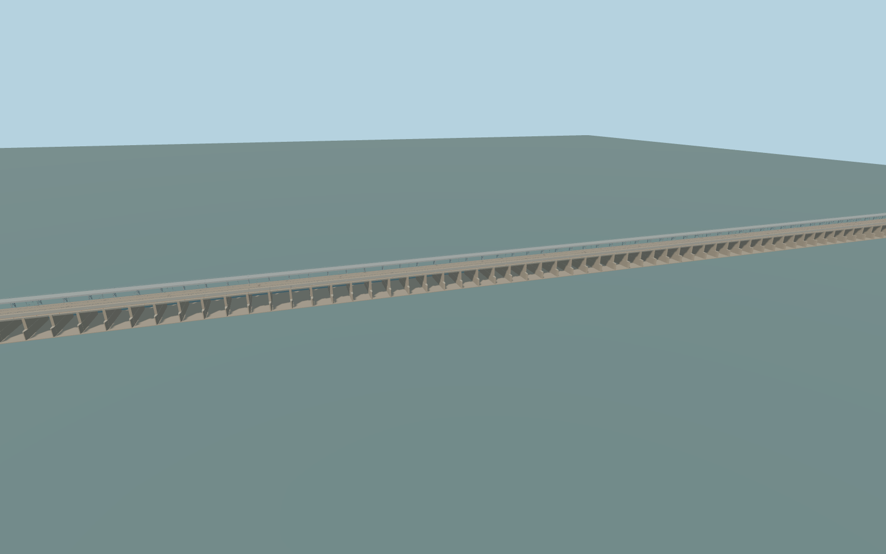

# Farakka Barrage

The 2,245 m Farakka Barrage, its parallel NH12 and rail decks, bay 25 fish lock, the eleven-bay head regulator, canal control house and existing navigation chamber.

Rebuild: `node packages/worldgen/scripts/generate-farakka-barrage.mjs`;append `--check` for exact source bytes. Select import/LOD/placement with `--ids=farakka_barrage`. Detailed source and four browser tiers are separate ignored GLB outputs.

Standard Terrarium places the main pond near 23.00 m and the tailwater near 17.99 m. The production sampler returns 23.48�23.64 m upstream, 18.42 m below the barrage, 25.53 m in the feeder and 25.71 m in the existing lock.

The regulator and existing chamber follow the mapped geometry. The newer parallel chamber and the separate feeder rail bridge are outside the modeled scope.

Gate openings show an illustrative operating state. Approach grades, concrete and gate machinery use observed exterior proportions and standard terrain.

The terrain fixture keeps the sampled heights. The feeder and lock comparison also reproduces the higher local water estimate from the viewer.

Original geometry:repository license. Map:© OpenStreetMap contributors,ODbL-1.0;Protomaps. Standard terrain:terrain-grid.json. Ordinary pictures stay local and are not redistributed or used as textures. Current acceptance:qa.json.
