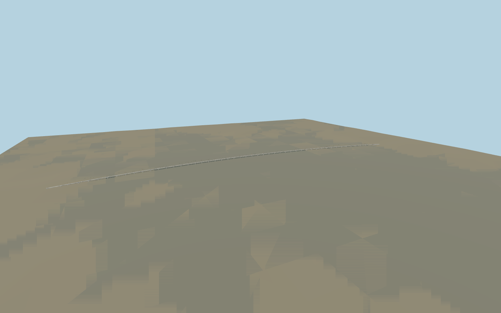

# Jamuna Bridge

Compact Jamuna crossing retains mapped circle,49main spans,50piers, two128m approaches, tapered concrete box, pylons, representative power lines, gas pipe, rail and simple lights. Detailed source remains independently reproducible.

## Evidence

- [Primary reference](https://www.iabse-bd.org/old/proceedings2005RP1.pdf)
- [Primary reference](https://www.iabse-bd.org/session/52.pdf)
- [Primary reference](https://iabse-bd.org/2020/pdf/26.pdf)
- [Primary reference](https://bba.gov.bd/pages/projects/6922d980dbfbab28ce04d529)
- [Primary reference](https://bangla.bppa.gov.bd/upload/noa/2026-05-06-08-56-37-Signed-NOA_28.04.2026--Jamuna-Deck-Renovation.pdf)
- [Primary reference](https://www.eprocure.gov.bd/resources/common/ViewTender.jsp?TenderCancel=false&id=1319559)
- [Primary reference](https://www.openstreetmap.org/way/279534616)

Published dimensions and reconstruction assumptions are separated in spec.json. Source photos were consulted; no photos or third-party geometry are embedded. Map plan attribution: © OpenStreetMap contributors, ODbL-1.0.

## Source

60188 triangles; 7225708 bytes; 5 material groups. SHA256: sha256:a3e86afbb0da5e4bfae5b35f6e554be03c4b6b03f428b62ecfdeeadda91f1879.

Shared surfaces (concrete_plain, metal_painted, metal_stainless) are loaded through the central library; any transparent materials use local PBR parameters. Axis and provisional vertical datum are in spec.json.

Regenerate with node packages/worldgen/scripts/generate-researched-bridges.mjs --ids=N0023; append --check to verify. Import and capture through the standard next-1000 scripts. Geometry validation does not substitute for current-frame visual review.

## Reconstruction limits

- One inspected elevated picture supports the curved concrete deck, red/white utility pylons, sagging power lines and narrow river crossing. Standard viewer PMTiles identifies the southern Jamuna Multi-purpose Bridge/N405, separate from the northern railway crossing. Retain original circle/1.75m offset,4800m main spans and128m approaches at each end; mapped centerline5067.95m is slightly longer than5056m source. Approximate east road20.05875m givesbase7.658751514798725m against endpoint model12.4m; west road20.36192m differs0.30m. River preview7.7589m is a coarse mapped-sample surface. Published+11mPWD source zero is not treated as an absolute PMTiles altitude. Exact flood stage, per-pier ground and current former-rail strip conversion remain unverified; retain the authored bare strip.
- Compact derivatives retain the whole curve and recognizable concrete/service arrangement. Skyline merges pier bases and utility shafts; district omits suspended services; street/closeup restore representative cables, pipe, rails and sparse lights. Individual4m joints, pile-cap bands, insulator discs, fasteners and exact pole arms are simplified.
- Pictures and standard PMTiles determine approximate visualization fit; no bespoke survey or current conversion-document research. Source facts from existing records remain preserved. Physical-device timings remain unmeasured.
- Narrow curved ground opening removes coarse bridge/approach terrain imprint in live placement. The50m-grid preview uses a wider35m contact corridor blended back to raw surroundings by120m; original raw samples remain retained. This is a visualization correction, not river bathymetry or an excavated terrain claim.
