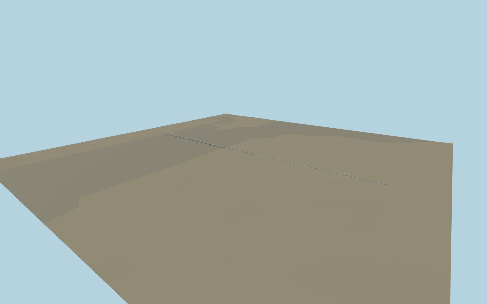

# Mahatma Gandhi Setu

Compact Gandhi Setu: twin through-truss decks,16representative Warren bays in each main closeup span, crossed roof bracing, concrete pier heads, outer walks, sparse lights/markings and shorter pony spans. Original detailed I-sections and hardware remain independently reproducible.

## Evidence

- [Primary reference](https://afcons.com/surface-transport/)
- [Primary reference](https://www.urbanmobilityindia.in/Upload/Conference/e8222e42-1693-4523-aef3-1e4347f64fd4.pdf#page=28)
- [Primary reference](https://www.cecr.in/construction-chemicals-materials-2/case-study-rehabilitation-of-mahatma-gandhi-setu)
- [Primary reference](https://afcons.com/wp-content/uploads/2026/01/Full-Afcons-Annual-Report-2023_0.pdf)
- [Primary reference](https://commons.wikimedia.org/wiki/File:GandhiSetuPatnaRevamped.png)
- [Primary reference](https://www.openstreetmap.org/way/28736579)
- [Primary reference](https://www.openstreetmap.org/way/44695500)

Published dimensions and reconstruction assumptions are separated in spec.json. Source photos were consulted; no photos or third-party geometry are embedded. Map plan attribution: © OpenStreetMap contributors, ODbL-1.0.

## Source

63836 triangles; 7662976 bytes; 4 material groups. SHA256: sha256:4fcf0afa95418b2a752ee25f518b0a4d44b72fc963748e68bfa2fb6d20a95540.

Shared surfaces (concrete_plain, metal_painted) are loaded through the central library; any transparent materials use local PBR parameters. Axis and provisional vertical datum are in spec.json.

Regenerate with node packages/worldgen/scripts/generate-researched-bridges.mjs --ids=N0020; append --check to verify. Import and capture through the standard next-1000 scripts. Geometry validation does not substitute for current-frame visual review.

## Reconstruction limits

- Picture and standard viewer PMTiles approximate fit; no bespoke bridge survey, engineering drawing or datum research.
- Original detailed master remains reproduced by its unchanged recipe and geometric map controls; compact source simplifies I-section profiles, bolts/gussets, bearings, floor/roof bracing and fittings into readable beams and shared metal/concrete materials.
- Skyline merges paired piers/decks and representative outer trusses; district/street omit many truss panels and inner fine members, while closeup retains16main Warren bays. Road/paint markings are local flat materials; shared graphs are reused.
- Reference aerial picture is an intermediate replacement state; existing twin-steel source facts are retained separately. River surface and northern-road contact use coarse PMTiles; exact flood stage, submerged foundations, approach joins and physical-device timing remain unmeasured. Footprint replacement off.
