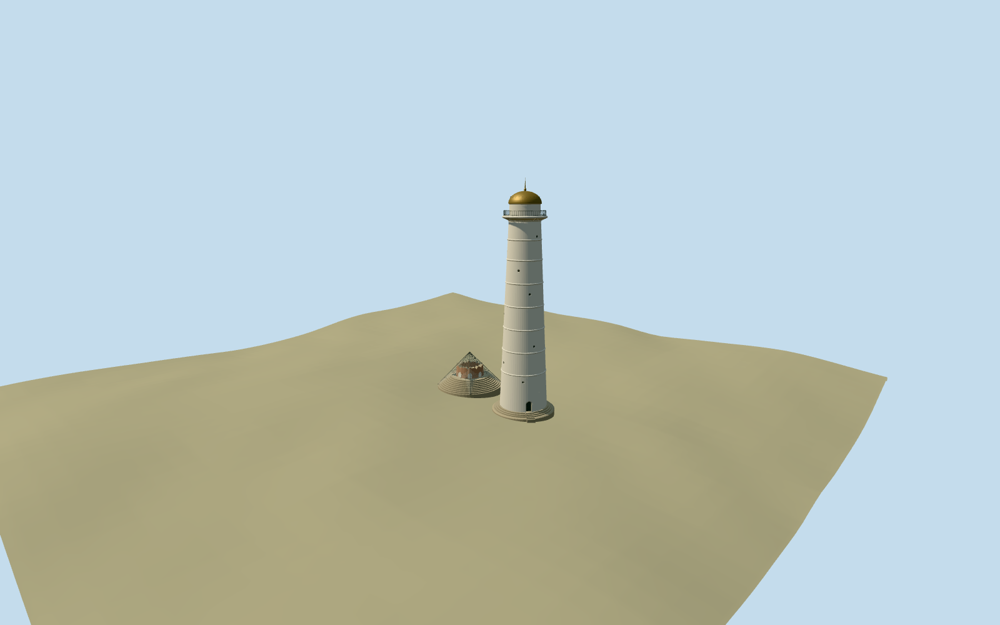

# dharahara — Dharahara

Reviewed 2026-10-19 in one continuous author/build/inspect/fix round.

## Appearance

Inspected all47 current views in this continuous construction round:8 source,7 shared-material,24 medium-fi and8 native-map frames. The standing tapered pale shaft/eight collars/sparse circular oculi, recessed arched closed entrance/real treads, projecting molded observation deck/open rail, rounded crown/needle and separate old stepped base/broken hollow stump/transparent framed pyramid are present. Corrected opaque shelter export, false full disks across the balcony rails, district door recess and old base heights during construction. Whole source and native views carry both structures; detail frames show the entrance, crown and preserved remains. A foreground independent building partly covers the right edge of the native low entrance view without hiding the actual portal.

## Shared materials and browser levels

Five existing256-square shared graphs: plaster_lime, stone_sandstone_raw, brick, metal_painted and metal_bronze_cast. Metric surface UVs and restrained role tints; no photograph or embedded image. Clear shelter uses an explicit texture-free0.14-alpha PBR material rather than borrowing unrelated frit artwork; this adds no texture allocation. Shared material graphs each read once; at most six runtime draws. Skyline uses averaged shared colors and omits translucent panes while preserving their simple frame and old stump. Separate POSITION/NORMAL streams and equal CPU/GPU buffer accounting verified.

| Level | Triangles | Bytes | Draws |
| --- | ---: | ---: | ---: |
| skyline | 980 | 100696 | 1 |
| district | 3976 | 383496 | 6 |
| street | 10505 | 997104 | 6 |
| closeup | 15618 | 1493320 | 6 |

Current four authored levels pass triangle/draw/download budgets and retain both mapped components. Skyline980triangles; district under4000; street under16000; closeup15618. Skyline+district484192bytes, below3MB phone/6MB laptop initial limits. Inspected noon/late, economy/high, specific details, silhouette and four transition views. Octagonal far shaft is intentionally coarse at skyline distance; close-up preserves actual collars, tiny oculi, open rail, crown/finial and translucent shelter. Synthetic context images do not establish geographic fit; separate native-map frames do.

## Approximate map fit

Retained reference anchor85.3117,27.7006, heading0/native east-south axes. Five tall circular standard-map controls locate the rebuilt tower at[46.244263715,5.875545352]m; eight older concentric controls locate the preserved old base near[16.767981931,0.456137628]m, about29.97m west/north. Named Dharahara POI supports association; these vector controls do not carry an explicit QID. ESE entrance/shelter axis remains a3m/45degree approximate picture/topology allocation. Only thirteen corresponding shells replaced with2cm pad, zero residual; all3188 independent resident building inputs remain unchanged from3201 originals. Original6m terrain, native paths and22948.411079m2 water unchanged through all levels/failure/unload; no ground/water cutout or precinct slab. Failure restores3201 original shells; unload disposes all model geometries. Footing bottoms/contact and supported entrance treads verified on actual mesh. Shared isolated review used ordinary asset mode because its bounded-query fixture exceeded its local-query assertion for this offset-anchor small site; the separate native test verifies actual placement and footprint replacement.

## Limits

Two ordinary whole2026 photographs carried through construction; no bespoke source research or separate re-evaluation phase. Model depicts the standing rebuilt tower plus preserved earlier stump, not a reconstructed intact destroyed tower. Nominal72m rebuilt height follows inspected picture captions/proportions and is distinguished from the ambiguous unqualified61.88m retained historical catalog fact. Map body parts report51/61/63m; exact height qualifiers, basement/plaza/foundation levels, doorway bearing, sparse oculus/rail inventory, dome finish under night illumination and old stump/shelter details are explicit visual estimates. Native coarse DEM cannot resolve the underground museum or actual plaza engineering. No copied inscription/photo atlas, furnished interior, whole precinct, temporary lighting or visitors. Medium-fi guidelines and browser budgets govern the simplification. No physical device performance measurements claimed.

## Selected checks

Six Khronos files: zero errors/warnings.259 actual mesh/material/contact checks; 47 current inspected views. Scene validation/sim30 and strict selected medium-fi audit pass. Source/runtime/LOD hashes and material bindings verified.

Rebuild: node packages/worldgen/scripts/generate-additional-landmarks.mjs --ids=dharahara; node packages/worldgen/scripts/import-structure-models.mjs --ids=dharahara; node packages/tooling/scripts/generate-landmark-lods.mjs --ids=dharahara --force.

Source: sha256:1d7c7a6d64a75b56cfb924835a17b02410e5042aba7816bf22fe5f3cfa114f12

Runtime: sha256:5d1dcd7816d6abb736388a719665d11cb4ddc9f600042fab20b6670af54b99c4

Input: sha256:9d33ac1ff19cc56e920b5b44a045e4c4df2f7d6e75f74b9884a0b36f0377cb6c

## Viewed ordinary pictures

https://commons.wikimedia.org/wiki/File:Dharahara_(Bhimsen_Stambha)_is_a_72-metre-tall_(236_ft)_Tower_at_the_Centre_of_Sundhara,Kathmandu,Nepal_(1).jpg — Saddam Hussain Ansari (Saddam19); CC-BY-4.0. Viewed only; no pixels copied.

https://commons.wikimedia.org/wiki/File:Dharahara_(Bhimsen_Stambha)_is_a_72-metre-tall_(236_ft)_Tower_at_the_Centre_of_Sundhara,Kathmandu,Nepal_(6).jpg — Saddam Hussain Ansari (Saddam19); CC-BY-4.0. Viewed only; no pixels copied.
