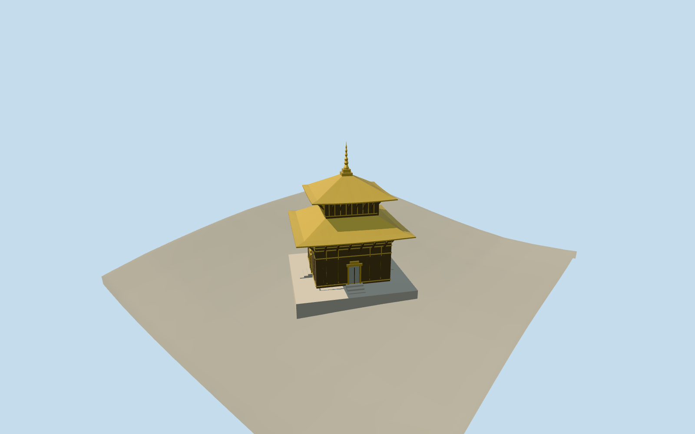

# Pashupatinath Temple

The specific principal Pashupatinath pagoda exterior: square stone platform, four silver-covered doors in a dark timber lower shrine, two independently mapped gold hipped roofs, the upper timber storey and a tall central gold pinnacle. Courtyard buildings, separate pavilions, river ghats and eastern stone shrines remain independent native context; the broader precinct is not one temple footprint.

## Evidence and reconstruction

Published dimensions and reconstructed details are separated in spec.json. Primary references:

- [Reference](https://commons.wikimedia.org/wiki/File:Pashupatinath_Temple-2020.jpg)
- [Reference](https://commons.wikimedia.org/wiki/File:Shivalaya_Pashupatinath_Kathmandu_Nepal_Rajesh_Dhungana_(5).jpg)

Four common256-square timber, metal and stone graphs; metric UVs and linear tints. No embedded images or unique atlas. Two registered recipes reconstruct the master and browser levels.

## Model and axes

2,828 triangles; 8,484 vertices; 4 material groups; 342,356 bytes. Native bounds: -11.410, -2.159, -10.287 to 15.552, 23.991, 16.940. Source hash: `sha256:63039ff0395c506b075a992e4e61617275afd0bd62a96066ef8099315da353b5`.

{"x":"east","y":"up","z":"south"}

Retain the unchanged161-square/6m standard Mapzen-USGS grid and1312.132m reference datum. Set the small platform top just above the maximum standard DEM sample inside the actual mapped footprint. Local foundation feet extend50cm below their terrain samples. Steps remain inside the platform. No ground or water excavation is requested; detailed archaeological floor levels are not surveyed.

## Reproduce

Run `node packages/worldgen/scripts/generate-additional-landmarks.mjs --ids=N0496` (or add `--check`). The generator preserves manually edited masters by checking their baseline hashes. Import through the standard authored-model workflow with optimization disabled; then capture all QA cameras, including shared-surface views.

## Pending work

- The specific principal Pashupatinath pagoda exterior: square stone platform, four silver-covered doors in a dark timber lower shrine, two independently mapped gold hipped roofs, the upper timber storey and a tall central gold pinnacle. Courtyard buildings, separate pavilions, river ghats and eastern stone shrines remain independent native context; the broader precinct is not one temple footprint.
- Standard PMTiles building35185285259147 is also the named Pashupatinath Temple POI. Its four-point platform and four independently mapped roof/body/finial parts identify the principal shrine. Preserve raw east/south coordinates and the square grid axis at37.66 degrees south of east. Four door faces are treated symmetrically; the separate eastern precinct gate is not confused with the main shrine.
- Normal map parts give lower roof9–11.5m, upper storey14.5m and upper roof14.5–19m. The ordinary article architecture paragraph gives nominal23.07m base-to-pinnacle height. The upper roof tag includes the lower pinnacle base: use a picture-guided17.5m roof crest and the23.07m final tip. Preserve the photographed broad roof pitches and relative widths; exact carved timber, door relief and pinnacle ornaments are simplified estimates. The small mapped central part has inconsistent13–16m tags and is used only as a horizontal center control.
- Retain the unchanged161-square/6m standard Mapzen-USGS grid and1312.132m reference datum. Set the small platform top just above the maximum standard DEM sample inside the actual mapped footprint. Local foundation feet extend50cm below their terrain samples. Steps remain inside the platform. No ground or water excavation is requested; detailed archaeological floor levels are not surveyed.
- This model represents the principal pagoda, not every independent temple in the broader precinct. Exact carvings, deity figures, door reliefs, inscriptions and interior rooms are omitted. Pinnacle details and foundation thresholds are visualization estimates.

This bundle follows the medium-fi standard. Medium-fi appearance and geographic fit are reviewed separately. Hash-bound visual acceptance is recorded separately after capture inspection.

## Additional geographic data

©OpenStreetMap contributors; Protomaps; Mapzen/USGS terrain.
