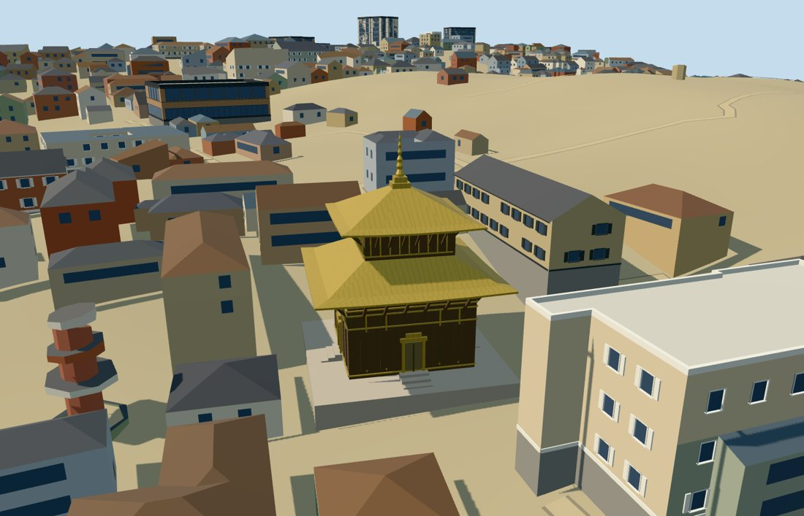

# pashupatinath_temple — Pashupatinath Temple

Reviewed 2026-10-18. Accepted for the principal medium-fi pagoda exterior and approximate normal-map/DEM fit.

## Exterior and materials

Two broad gold hipped roofs with raised eave corners, a dark timber lower shrine, upper timber storey, four silver-covered door faces and a tall gold pinnacle identify the principal pagoda. Both mapped roof outlines and the slight upper-storey skew are retained. The initial upper roof was too steep; its crest was lowered to a picture-guided 17.5 m, retaining the nominal 23.07 m final pinnacle height. Exact carved figures, door relief, inscriptions and interior rooms are omitted.

Four common 256-square graphs provide timber grain, standing-seam metal tinted gold, beadblasted stainless door panels and limestone grain. Metric UVs and linear tints are used. Four near draws, no embedded images or unique atlas. Each graph loads once; eviction disposes model geometry. Master: 2,828 triangles / 342,356 bytes.

## Browser levels

| Level | Triangles | Bytes | Draws |
| --- | ---: | ---: | ---: |
| skyline | 248 | 28,044 | 1 |
| district | 834 | 86,720 | 4 |
| street | 2,236 | 219,788 | 4 |
| closeup | 2,724 | 269,700 | 4 |

Initial geometry: 114,764 bytes plus the four shared graphs. Skyline retains the platform, both roof tiers and pinnacle; district adds door surrounds and sparse struts; street and closeup add selected timber bands, struts and finial tiers. Separate attribute streams avoid duplicate GPU uploads.

Inspected 11 portable, 11 shared-material and 27 medium-fi frames: procedural neighbors at street/block/skyline ranges, noon/late lighting, Economy/High, untextured silhouette, details and LOD transitions. Physical-device and dense-city performance measurements remain pending.

## Geographic fit

The named principal temple footprint and its four independent roof/body/finial records define the model. Raw east/south positions preserve the shrine grid at 37.6656 degrees south of east. All four door faces remain symmetric. The small mapped central part has inconsistent 13–16 m height tags and is used as a horizontal control only.

The original 161-square / 6 m Mapzen-USGS grid is unchanged. The platform top clears the maximum local terrain sample; foundation feet extend 50 cm below corner samples. No terrain or water cutout is needed. Full-site loading replaces five records and preserves all 1,612 independent buildings in the 960 m tile exactly. Three native water features retain 57,903.0123 square metres. Failure retains all 1,617 native tile buildings; eviction preserves both surfaces and frees all model geometry.

Inspected 24 full-site, failure and partial-residency views. A synthetic 16 m tile retains original terrain under and around clipped model pieces. Its empty semantic context verifies clipping and lifecycle only. Temporary cut faces are not permanent shrine geometry. The shared flat stage exposes variable foundation depth and is not geographic-contact evidence.

## Scope and checks

This is the principal pagoda exterior. Independent courtyard buildings, eastern gate, pavilions, river shrines and ghats remain native context. Strut counts, timber bands, silver door treatment, finial beads and foundation thresholds are visualization estimates. No surveyed archaeological or interior claim is made.

Six Khronos validations have zero errors/warnings. All 96 roof/door/eave probes, 23 mapped outline vertices and 568 platform samples pass. Selected source/import/placement checks, strict medium-fi, scene validation and a 30-tick simulation pass. All previous 502 readiness approvals remain ready.

Two registered recipes, retained map controls, terrain and ordinary reference metadata reconstruct the master and browser levels. Source keeps the five controls and 52 nearby map records plus a digest of the full 3,918-record source plan. Full city context was used in the local production fixture; unrelated city footprints are not required model inputs. Source checking verifies 922 logical bundles and 666 indexed recipes. Bulk review images remain ignored. No full rebuild, npm audit, Git mutation or upload was performed.

Rebuild with Node: generate-additional-landmarks.mjs --ids=pashupatinath_temple; import-structure-models.mjs --ids=pashupatinath_temple; generate-landmark-lods.mjs --ids=pashupatinath_temple.

Source: sha256:63039ff0395c506b075a992e4e61617275afd0bd62a96066ef8099315da353b5

Runtime: sha256:a5bd0aab6b990f929b7ff969a93e4994f631e3503fb5329a5c720750f9a1eec8

Input: sha256:40f79180b536fdacb2ad71bb783621a01aefd723ffca02fbb895411ff8610bfa

## Ordinary picture references

https://commons.wikimedia.org/wiki/File:Pashupatinath_Temple-2020.jpg — Bijay Chaurasia, 20 July 2020, CC BY-SA 4.0; viewed only.

https://commons.wikimedia.org/wiki/File:Shivalaya_Pashupatinath_Kathmandu_Nepal_Rajesh_Dhungana_(5).jpg — Rajesh Dhungana, 2 October 2021, CC BY-SA 4.0; surrounding context viewed only. Its media GPS caption is not used for placement. No picture pixels are shipped.
