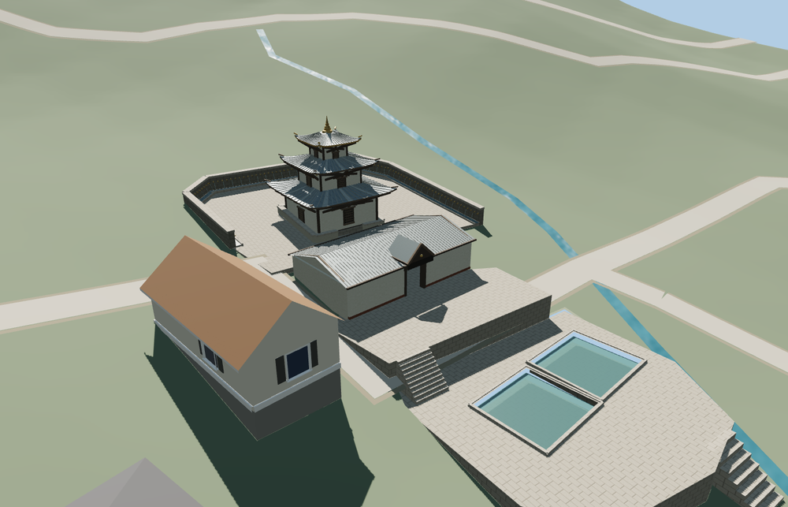

# Muktinath Temple

Three upturned roofs, dark timber bracing and a gilt finial identify the whitewashed shrine. An open cross-gabled entry pavilion links the stepped bathing terraces and the upper spring court. Street and close-up geometry includes all 108 spouts.

The pagoda and pavilion follow two PMTiles footprints, oriented toward the bathing pools. Three model terraces meet the sampled hillside. The second pool outline is reconstructed from its mapped point and photographs. Native ground and water are restored on unload. The placement preserves 11 independent buildings and 20 transportation records in the fixture.

The 27,289-triangle source rebuilds byte for byte. The first two runtime tiers total 360,788 bytes. Six GLBs validated and 36 current views were inspected.

The shrine and pavilion are reconstructed from two PMTiles footprints, with the entrance directed toward the mapped bathing pools. The second pool outline follows the independently mapped point and the photographed companion basin. The standard terrain controls the terrace transitions. Roof heights, pond levels, spout spacing and individual fittings are exterior-photo estimates. The model covers the exterior, entrance passage and bathing courts.

Rebuild with `node packages/worldgen/scripts/generate-muktinath-temple.mjs`. Append `--check` to compare exact bytes. Use `--ids=muktinath_temple` for targeted import, LOD, placement and readiness.
