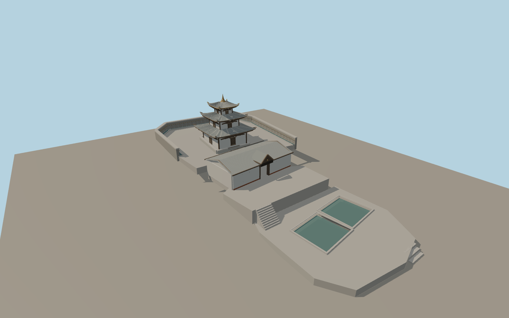

# Muktinath Temple

Three upturned roofs, dark timber bracing and a gilt finial identify the whitewashed shrine. An open cross-gabled entry pavilion links the stepped bathing terraces and the upper spring court. Street and close-up geometry includes all 108 spouts.

Run `node packages/worldgen/scripts/generate-muktinath-temple.mjs` to rebuild the source master. Append `--check` to compare the exact bytes. Use `--ids=muktinath_temple` for targeted import, LOD generation and placement.

The shrine and pavilion are reconstructed from two PMTiles footprints, with the entrance directed toward the mapped bathing pools. The second pool outline follows the independently mapped point and the photographed companion basin.

The standard terrain controls the terrace transitions. Roof heights, pond levels, spout spacing and individual fittings are exterior-photo estimates. The model covers the exterior, entrance passage and bathing courts.

Original geometry follows the repository license. Map data is © OpenStreetMap contributors under ODbL-1.0 via Protomaps. Terrain samples are described in terrain-grid.json. Ordinary pictures stay local and are not redistributed or used as textures. Current acceptance is recorded in qa.json.
