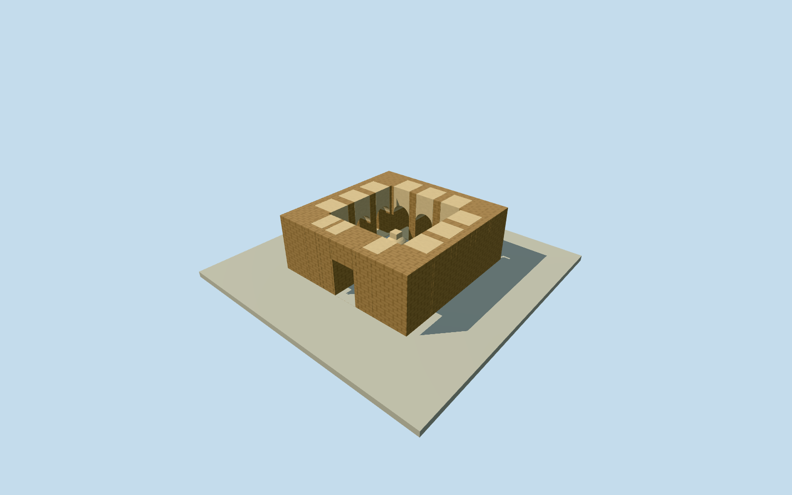

# Fondukistan central sanctuary

Whole central sanctuary structure only: complete square court and surrounding twelve vaulted niches, south entrance and central stupa as a bounded historical architectural reconstruction. Unlocated monastery cells, meeting hall and common rooms remain separate unresolved bodies; this member does not complete the monastery. Court approximately4.5x4.5m and six archival niche widths/southdoor1.3m are written controls. Outer7.7m square, wall thickness, vault sections, stupa shape/height, finishes, precise650CEcondition and geographic body placement are original estimates. Site story coordinate is context, not a surveyed sanctuary point. Nominal200m horizontal/1.5m height/components/90degree facing allowances are not measured bounds. Every photograph, painting, sculpture image, drawing and plan image remains unused. Primary DAFA written description distinguishes a square central sanctuary court, central stupa, twelve vaulted niches and separate monastery dependences. Curator2019footnote5 cites the original Carl journal for east niche widths1.15/1.15/1.20m, south0.75/0.70/0.85m, south entrance1.30m, and infers an approximately4.5m square court. Court is not a measured survey. All paintings, statues, photographs, drawings and plan images unused. Original bounded historical structural interpretation: outer7.7m-square shell around4.5m court,1.2m-deep niches with0.4m backing, three niches per side and one south entrance. Niche placement/order/other six widths, walls/roofs/vault sections, stucco/adobe finish, central stupa size/profile and precise650CEcondition are estimates. Original floor0.15m, foundation-1m, walltop3.1m, niche spring1.55m, south portal height2.1m, stupa base1.8m square and2m overall height. No archaeological section or exact restored decoration is claimed. Own independent256m129x129 original elevation field acquired before choosing floor and main sections. Fixed story/site coordinate retained as an approximate sanctuary origin, not a surveyed body point. Nominal200m horizontal/1.5m height/component/90degree facing allowances are not measured bounds. Modern composite terrain does not certify seventh-century ground contact. Original field/frame/floor/mainsections frozen; no masking, flattening, cutout, fitting or relocation. All four authored levels retain the complete sanctuary shell, open square court, all twelve actual vaulted recesses with closed backs, open south entrance and central stupa. Near levels add simple original reveal/ledge details and smoother curved sections. The source describes wall paintings and sculpture; these unverified decorative programmes are not reconstructed. Historical structural reconstruction only/currentWorldEligiblefalse. Unlocated cells, meeting hall and common rooms are excluded; whole monastery remains unfinished.

Authoring state: **review-in-qa.json**. Current completion evidence is in [qa.json](qa.json) and the [completion ledger](../../../../qualla-structures/batches/qualla-002.PROGRESS.md).

- [Fondukistan Monastery](https://qualla.com/fondukistan-monastery/)

Whole central sanctuary structure only: complete square court and surrounding twelve vaulted niches, south entrance and central stupa as a bounded historical architectural reconstruction. Unlocated monastery cells, meeting hall and common rooms remain separate unresolved bodies; this member does not complete the monastery. Court approximately4.5x4.5m and six archival niche widths/southdoor1.3m are written controls. Outer7.7m square, wall thickness, vault sections, stupa shape/height, finishes, precise650CEcondition and geographic body placement are original estimates. Site story coordinate is context, not a surveyed sanctuary point. Nominal200m horizontal/1.5m height/components/90degree facing allowances are not measured bounds. Every photograph, painting, sculpture image, drawing and plan image remains unused.

Primary DAFA written description distinguishes a square central sanctuary court, central stupa, twelve vaulted niches and separate monastery dependences. Curator2019footnote5 cites the original Carl journal for east niche widths1.15/1.15/1.20m, south0.75/0.70/0.85m, south entrance1.30m, and infers an approximately4.5m square court. Court is not a measured survey. All paintings, statues, photographs, drawings and plan images unused.

Original bounded historical structural interpretation: outer7.7m-square shell around4.5m court,1.2m-deep niches with0.4m backing, three niches per side and one south entrance. Niche placement/order/other six widths, walls/roofs/vault sections, stucco/adobe finish, central stupa size/profile and precise650CEcondition are estimates. Original floor0.15m, foundation-1m, walltop3.1m, niche spring1.55m, south portal height2.1m, stupa base1.8m square and2m overall height. No archaeological section or exact restored decoration is claimed.

Own independent256m129x129 original elevation field acquired before choosing floor and main sections. Fixed story/site coordinate retained as an approximate sanctuary origin, not a surveyed body point. Nominal200m horizontal/1.5m height/component/90degree facing allowances are not measured bounds. Modern composite terrain does not certify seventh-century ground contact. Original field/frame/floor/mainsections frozen; no masking, flattening, cutout, fitting or relocation.

All four authored levels retain the complete sanctuary shell, open square court, all twelve actual vaulted recesses with closed backs, open south entrance and central stupa. Near levels add simple original reveal/ledge details and smoother curved sections. The source describes wall paintings and sculpture; these unverified decorative programmes are not reconstructed. Historical structural reconstruction only/currentWorldEligiblefalse. Unlocated cells, meeting hall and common rooms are excluded; whole monastery remains unfinished.

Build: `node content/worldgen/source/places/tw/tw0/fondukistan_central_sanctuary/models/generate-house.mjs`. Add `--check` to verify exact regeneration. 1990 triangles; 3 materials; no embedded photographs.
