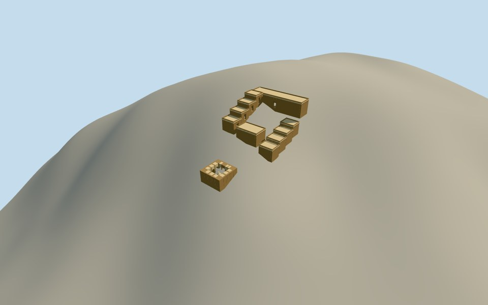

# Fondukistan monastery

A bounded historical structural reconstruction: the separately accepted square sanctuary with twelve vaulted niches and a central stupa, plus a new estimated monastic annex with cells, meeting hall and common room.

Primary DAFA written archaeology establishes these functions. Annex room census, layout, dimensions, roofs, materials, terraced foundations and exact location are original reconstruction estimates. No photograph, artwork or excavation plan was used.

The unchanged original256m sanctuary terrain field spans both models. Source relief is coarse modern ground; it can intersect lower walls and does not locate seventh-century benches. The story point differs roughly1.4km from the current Wikipedia point, so this remains an approximate site-context placement. Individual dated historical placements and accepted member reviews are preserved.

[Qualla story](https://qualla.com/fondukistan-monastery/)
