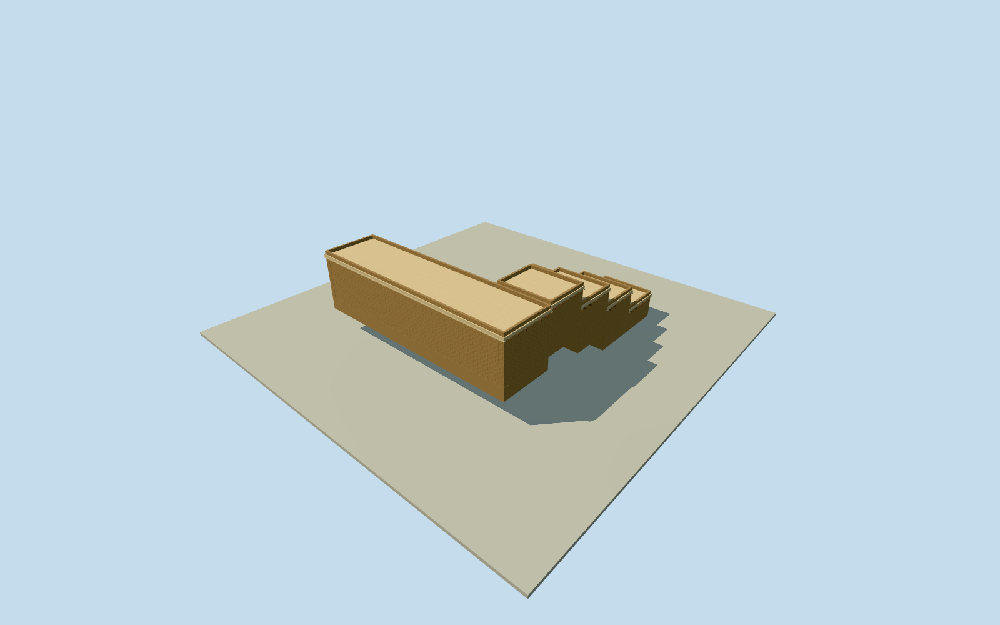

# Fondukistan monastic annex

Estimated historical monastic cells, meeting hall and common rooms adjoining the distinct sanctuary. Written room functions are archaeological facts; dimensions, eight-cell census, sections and south-side layout are original reconstruction estimates. DAFA written excavation description confirms sanctuary plus cells, meeting hall and common rooms. Eight cells, their arrangement around a small court, all widths/heights/roof profiles, doors, materials and precise700CEcondition are original estimates; no excavation plan, photo or artwork supplied geometry. This is a plausible structural interpretation, not an archaeological survey. The annex centre is estimated22m south of the unchanged sanctuary point. Modern coarse terrain precedes sections; modest1.2m plinths support centre-grade floor estimates, rather than tall corner-envelope foundations. Uphill walls can intersect coarse ground and downhill plinths can be exposed. Historical benches and vertical ties are unknown; the source field is unchanged without flattening or masking. Four levels retain all ten estimated rooms, actual door openings, flat roofs and terraced plinths; district and closer levels retain parapets. Near levels add timber beam ends, lintels and slight roof lips. Plain adobe, lime plaster, rammed earth and timber are original material interpretations. No decoration or artifact replicas.

Authoring state: **review-in-qa.json**. Current completion evidence is in [qa.json](qa.json) and the [completion ledger](../../../../qualla-structures/batches/qualla-002.PROGRESS.md).

- [Fondukistan Monastery](https://qualla.com/fondukistan-monastery/)

Estimated historical monastic cells, meeting hall and common rooms adjoining the distinct sanctuary. Written room functions are archaeological facts; dimensions, eight-cell census, sections and south-side layout are original reconstruction estimates.

DAFA written excavation description confirms sanctuary plus cells, meeting hall and common rooms. Eight cells, their arrangement around a small court, all widths/heights/roof profiles, doors, materials and precise700CEcondition are original estimates; no excavation plan, photo or artwork supplied geometry. This is a plausible structural interpretation, not an archaeological survey.

The annex centre is estimated22m south of the unchanged sanctuary point. Modern coarse terrain precedes sections; modest1.2m plinths support centre-grade floor estimates, rather than tall corner-envelope foundations. Uphill walls can intersect coarse ground and downhill plinths can be exposed. Historical benches and vertical ties are unknown; the source field is unchanged without flattening or masking.

Four levels retain all ten estimated rooms, actual door openings, flat roofs and terraced plinths; district and closer levels retain parapets. Near levels add timber beam ends, lintels and slight roof lips. Plain adobe, lime plaster, rammed earth and timber are original material interpretations. No decoration or artifact replicas.

Build: `node content/worldgen/source/places/tw/tw0/fondukistan_monastic_annex/models/generate-house.mjs`. Add `--check` to verify exact regeneration. 3048 triangles; 4 materials; no embedded photographs.
