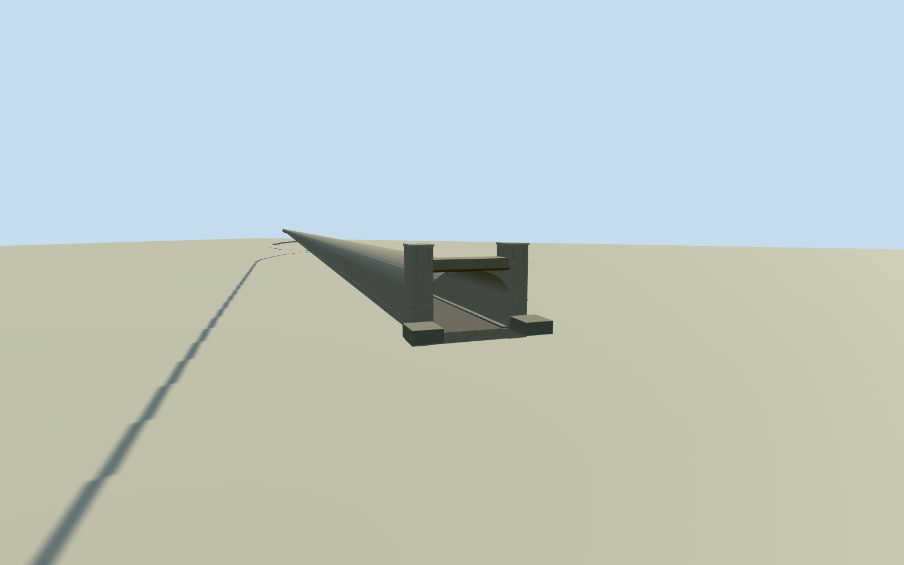

# Salang Tunnel and protective galleries (2011)

Whole Salang Tunnel in a coherent approximate 2011 appearance: complete named main bore and both intrinsic northern and southern avalanche galleries along all original mapped centerline controls; both tunnel ends, continuous road floor, lining/roof, concrete gallery roof/walls/open bays and structural supports, portal piers/beams and short retaining returns. Do not substitute one photographed portal for the full tunnel. Native current centerlines register the older structure approximately; precise historic gallery extents, profiles, grade, bay census and unseen southern portal details are estimated. Exclude the wider pass highway, unrelated culverts, natural mountain body, vehicles, soldiers, snow, signage and later 2013/2023 reconstruction finishes.

Authoring state: **review-in-qa.json**. Current completion evidence is in [qa.json](qa.json) and the [completion ledger](../../../../qualla-structures/batches/qualla-002.PROGRESS.md).

- [Salang Tunnel](https://qualla.com/salang-tunnel/)

Whole Salang Tunnel in a coherent approximate 2011 appearance: complete named main bore and both intrinsic northern and southern avalanche galleries along all original mapped centerline controls; both tunnel ends, continuous road floor, lining/roof, concrete gallery roof/walls/open bays and structural supports, portal piers/beams and short retaining returns. Do not substitute one photographed portal for the full tunnel. Native current centerlines register the older structure approximately; precise historic gallery extents, profiles, grade, bay census and unseen southern portal details are estimated. Exclude the wider pass highway, unrelated culverts, natural mountain body, vehicles, soldiers, snow, signage and later 2013/2023 reconstruction finishes.

Named Army photographs from 2009 and 2011 show the same portal type. Represent 2011; do not claim current 2026 appearance. Current OSM centerlines provide approximate geographic registration of the historical bore/galleries. Post-2013/2023 work is outside this appearance. Neither exact historical route shape nor every hidden section is certified.

Primary engineering dimensions constrain the variable bore; exact section/lining thickness/ventilation census/gallery column pitch/portal returns and historical road grade are explicit estimates, not unavailable Soviet plans.

No mountain mesh/landscape plate, wider highway, unrelated culverts, copied signs/graffiti, vehicles, people or snow. Complete structural scope with both ends and both native protective galleries required.

Original independent field and north-up frame must be frozen before choosing all road floors, grades, roof and main sections. Preserve them after geometry/renders; no terrain masking, cutout, flattening, reacquisition, reframing or late refitting.

Nominal tube dimensions and location/length of the tight section, gallery side-opening profiles/support census, both portal depths and southern facade are estimated. Whole physical scope is retained; exact Soviet drawings are unavailable.

Native current main tube plan is2518 m versus approximately1.6 miles in USACE prose; no stretching of native route controls to a rounded published length. Gallery extents/positions and reconstructed historical appearance remain approximate.

Only the north portal has detailed photographic evidence; complete bore and both gallery exteriors derive from all mapped controls and primary engineering description with explicit hidden-section estimates.

Independent terrain is coarse mountain relief: output pixel spacing31.184 m and64 m review grid, not local road or historic grade survey. Raw heights and frame remain unchanged; lower structural parts can be concealed in source context. No terrain cutout/mask/flattening/reacquisition/reframing.

Primary imagery is four exact Army DVIDS public-domain published1000px renditions, not native originals. No uncertain regional archival imagery or attribution-only sources.

Build: `node content/worldgen/source/places/tw/tw3/salang_tunnel/models/generate-house.mjs`. Add `--check` to verify exact regeneration. 17976 triangles; 3 materials; no embedded photographs.
