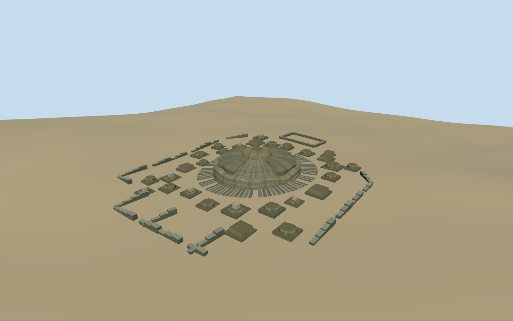

# Butkara Stupa

Excavated Great Stupa of Butkara I with concentric ruined masonry, schist ambulacrum and representative votive foundations.

Authoring state: **review-in-qa.json**. Current completion evidence is in [qa.json](qa.json) and the [completion ledger](../../../../qualla-structures/batches/qualla-003.PROGRESS.md).

- [Butkara Stupa](https://qualla.com/butkara-stupa/)

Official precinct coordinate is the best available anchor for the Great Stupa centre. Move the model only if a better survey identifies that centre.

The model shows the excavated remains. Adjacent votive base placements, localized collapse, individual masonry and peripheral annexes are representative estimates.

No intact historical dome or sculptures are reconstructed. Separate Saidu Sharif I is outside the model scope.

Build: `node content/worldgen/source/places/tw/tw5/butkara_stupa/models/generate-butkara-stupa.mjs`. Add `--check` to verify exact regeneration. 7353 triangles; 5 materials; no embedded photographs.
