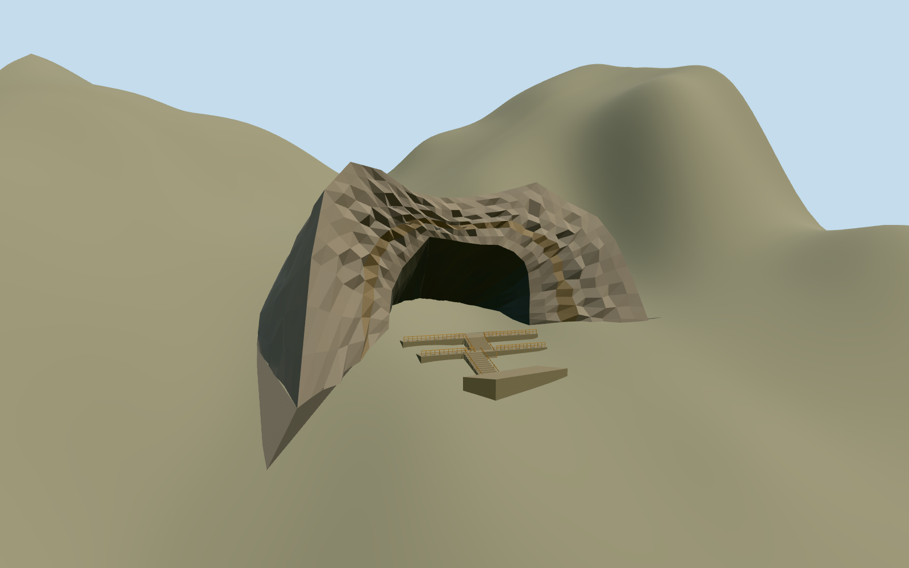

# Amarnath Cave Temple

The south-facing limestone mouth and constructed pilgrim terraces of Amarnath Cave Temple, showing its seasonal sacred ice formation.

Authoring state: **review-in-qa.json**. Current completion evidence is in [qa.json](qa.json) and the [completion ledger](../../../../qualla-structures/batches/qualla-003.PROGRESS.md).

- [Amarnath Temple](https://qualla.com/amarnath-temple/)

The mapped cave mouth and approximate government measurements provide the nominal opening scale. Rock surfaces, exact terrace grades, interior depth and fittings are reconstructed from two photographs and coarse native elevation data.

The scene shows a pilgrimage-season ice formation and a simplified historic terrace. Temporary shelters, people, modern crowd-management fittings, and deeper cave details are outside the modeled scope.

A small reversible viewer opening removes terrain only at the represented cave void. The independent unmasked source terrain remains unchanged and was captured separately.

Build: `node content/worldgen/source/places/tw/twj/amarnath_temple/models/generate-amarnath-temple.mjs`. Add `--check` to verify exact regeneration. 4125 triangles; 5 materials; no embedded photographs.
